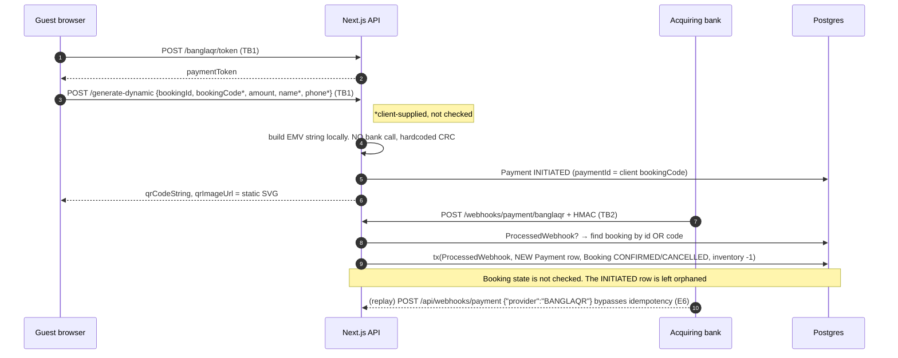

# BanglaQR Security Review — Discovery & Gap Analysis

| | |
|---|---|
| **Date** | 2026-09-29 |
| **Branch** | `hardening/banglaqr` (from `main` @ `ecf22dc`) |
| **Scope** | Every BanglaQR route, server action, library module, admin page, and guest component, plus the shared helpers they call (`r2.ts`, `audit.ts`, `cron-auth.ts`, generic webhook router) |
| **Method** | Line-by-line read of the code (not the docs); key claims re-checked by executing code |
| **Status** | Awaiting owner approval. No code changed in this commit. |

## Summary

The integration is **not production-safe in its current state**. The previous version of this document marked all 12 threats as mitigated. Reading the code shows that 4 of those claims are false and 7 are only partially true.

The four Critical findings are all ways to lose money or leak guest PII without any special access:

1. **Anyone can mint payment tokens** on a deployment without `BANGLAQR_TOKEN_SECRET`: the code falls back to a hardcoded string that is in the source. *(Verified by execution: with no secret set, a token is minted and verifies.)*
2. **A guest can revert a confirmed booking** by re-submitting a receipt: there is no booking-status guard, and the existing `SUCCESS` payment is overwritten.
3. **The auto-release cron expires bookings the guest has already paid for.** In static mode it matches *only* bookings with a submitted receipt, and the admin cannot confirm an `EXPIRED` booking afterward.
4. **Receipts are stored in the public blog bucket.** Their public URL is returned to the browser and saved in the DB, so the 5-minute presigned URLs protect nothing.

Totals: **4 Critical, 11 High, 13 Medium, 7 Low** (35 gaps), plus 4 adjacent findings in shared or other-gateway code.

Existing documents this review corrects are listed in [Corrections to Existing Documentation](#corrections-to-existing-documentation).

Legend for all tables: ✅ Mitigated · ⚠️ Partial · ❌ Unmitigated

---

## 0.1 Endpoint Inventory

`find src/app/api -path "*banglaqr*" -name route.ts` returns five routes. Two more entry points reach BanglaQR logic and are included here: the generic webhook router and the admin server actions.

### E1. `POST /api/payments/banglaqr/token`
File: `src/app/api/payments/banglaqr/token/route.ts`

| Property | Current state |
|---|---|
| Purpose | Issues the signed booking payment token that the other guest endpoints require |
| Auth | None. Knowing `bookingId` (UUID) and `bookingCode` (`RES-` + 6 digits) is enough |
| Rate limit | ❌ None |
| Validation | ❌ Manual truthiness check (`:9-13`), no Zod, unknown fields accepted |
| Output | `{ paymentToken, expiresAt }`. Error at `:27` echoes the booking status (`Booking status 'CONFIRMED' cannot accept payment`). 404 vs 400 distinguishes existing vs missing bookings |
| Errors | Raw `err.message` returned with 500 (`:43-46`) |
| Idempotent | Yes (stateless). A fresh 35-minute token is minted on every call |
| Time window | Booking must be at most `reviewWindowMinutes + 5` old (`:30-34`), but the token then lives 35 min **from issuance**, so the effective window is up to ~70 min |

### E2. `POST /api/payments/banglaqr/submit-receipt`
File: `src/app/api/payments/banglaqr/submit-receipt/route.ts` → `static-qr.ts`

| Property | Current state |
|---|---|
| Purpose | Guest uploads a receipt image (base64 data URL in JSON), transaction ID, and amount for manual verification |
| Auth | Token in `x-payment-token` header or `paymentToken` body field. `bookingId` is taken **from the body** and compared to the token (`:65-68`) |
| Rate limit | In-memory: 20/IP/hour (before auth) and 5/booking/hour (**before** token verification, `:44-58`) |
| Validation | Zod `.strict()` (`schemas.ts:6-19`). `transactionId` is **optional**. Request body size is unbounded (`req.json()` at `:32`) |
| Output | `{ success, message, receiptUrl, paymentId }`. **`receiptUrl` is the public R2 URL** and `paymentId` is the internal Payment UUID |
| Errors | Every error, including Prisma and server faults, returns its raw `err.message` with **400** (`:91-94`). No correlation ID |
| Idempotent | ❌ No. A retry overwrites the existing BanglaQR payment for the booking and re-sets booking status. Concurrent requests can create duplicate Payment rows |
| Booking state checks | ❌ None. Status, age, and "already submitted" are never checked (`static-qr.ts:69-148`) |

### E3. `POST /api/payments/banglaqr/generate-dynamic`
File: `src/app/api/payments/banglaqr/generate-dynamic/route.ts`

| Property | Current state |
|---|---|
| Purpose | Generates a dynamic EMVCo QR for the booking total |
| Auth | Same token as E2. Rejects `PENDING_VERIFICATION`/`SUCCESS` payments (`:80-83`) ✅ |
| Rate limit | In-memory 5/booking/hour, checked **before** token verification (`:33-47`) |
| Validation | Zod `.strict()`. `bookingCode`, `customerName`, and `customerPhone` are **client-supplied and not checked** against the booking; `bookingCode` becomes the QR reference and `Payment.paymentId` (`:87-98`) |
| Output | `{ qrCodeString, qrImageUrl, paymentReference, expiresAt }` |
| Errors | Raw `err.message` with 500 (`:112-115`). Status is echoed in the 400 message at `:69` |
| Idempotent | ❌ Each call creates another `INITIATED` Payment row (limited only by the rate limit) |
| Functional? | ❌ **Stub.** No bank API is called. See gap H9 |

### E4. `POST /api/webhooks/payment/banglaqr`
File: `src/app/api/webhooks/payment/banglaqr/route.ts`

| Property | Current state |
|---|---|
| Purpose | Acquiring-bank callback that confirms or cancels a dynamic-QR booking |
| Auth | HMAC-SHA256 over the raw body with `BANGLAQR_WEBHOOK_SECRET`, compared with `timingSafeEqual` after a length check (`webhook-verifier.ts:22-29`) ✅. Fails closed when the secret is unset ✅. No timestamp, so there is no replay window |
| Rate limit | In-memory 60/IP/min (`:15-29`), using a spoofable IP (see H5) |
| Validation | ❌ `WebhookPayloadSchema` exists (`schemas.ts:30-36`, `.passthrough()`) but is **never used**. Bank adapters `JSON.parse` directly, accept aliased fields, and map any unrecognised status to `FAILED` |
| Output | `{ success, message, bookingCode }` on success; amounts echoed on mismatch (`:83`) |
| Errors | Generic 500 ✅. Signature failure returns 400 and is audited, but without body hash |
| Idempotent | ⚠️ Check-then-insert on `ProcessedWebhook.transactionId` (`:46-57`, `:90`); the unique constraint turns a concurrent duplicate into a 500. No check of **booking** or **payment** state (see H2) |

### E5. `GET|POST /api/cron/banglaqr-release`
File: `src/app/api/cron/banglaqr-release/route.ts`

| Property | Current state |
|---|---|
| Purpose | Expires BanglaQR bookings past the review window |
| Auth | `CRON_SECRET` via `isCronRequestAuthorized`. Fails closed ✅, but uses a non-constant-time `===` and accepts `?secret=` in the query string (`cron-auth.ts:17,21`) |
| Rate limit | None (acceptable given secret auth) |
| Validation | N/A |
| Output | `{ releasedCount, releasedBookings: bookingCode[] }` |
| Errors | Raw `err.message` with 500 (`:74-78`) |
| Idempotent | ⚠️ The `findMany` filter is status-guarded, but `booking.update` is keyed by `id` only (`:43-47`). **What it selects is wrong** (see C3) |

### E6. `POST /api/webhooks/payment` (generic router): unintended BanglaQR entry point
File: `src/app/api/webhooks/payment/route.ts:18-22` → `src/lib/payments/index.ts:20-21`

A body with `"provider": "BANGLAQR"` is dispatched to `banglaqrAdapter.verifyWebhook`. This route has **no rate limit, no `ProcessedWebhook` idempotency, and no audit logging**. A replayed, validly signed BanglaQR webhook sent here creates another SUCCESS payment, decrements room inventory again, and re-sends the confirmation email. See H1.

### E7. Admin server actions and queue page
Files: `src/app/actions/admin-actions.ts:365-476`, `src/app/admin/payments/banglaqr-verification/page.tsx`

| Action | Role | Rate limit | State guards | Atomic? |
|---|---|---|---|---|
| `confirmBanglaQRPaymentAction` | `requireRole("MANAGER")` ✅ | In-memory 100/user/h (shared key) | Booking not CONFIRMED/CANCELLED/EXPIRED ✅; payment `PENDING_VERIFICATION` **or `INITIATED`** ⚠️ | ❌ Payment update is outside the transaction; inventory decrement uses a stale read |
| `rejectBanglaQRPaymentAction` | MANAGER ✅ | same | Booking not CONFIRMED/CANCELLED; payment count guard ✅ | ❌ Payment update is outside the transaction |
| `requestBanglaQRReceiptAction` | MANAGER ✅ | same | Booking not CONFIRMED/CANCELLED | Logs only. **No state change, guest not notified** |
| `releaseExpiredBanglaQRBookingsAction` | `requireRole("OWNER")` ✅ | ❌ | ❌ Hardcoded 30 min; matches any BanglaQR payment; expires **all** of the booking's BanglaQR payments, including `SUCCESS`/`FAILED` | Per-booking tx, no status guard |
| `updateBookingStatus` (generic) | MANAGER for CONFIRMED/CANCELLED | ❌ | ❌ Can confirm a BanglaQR booking with no verified payment | — |
| Queue page | MANAGER ✅, view audited ✅ | — | — | Presigns a URL for every row on every load; presigns are not audited |

None of the actions require MFA (`requireMfa` exists and is used for `toggleRoomStatus`).

---

## 0.2 Data Flow & Trust Boundaries

Trust boundaries are marked **TB1** (browser → our API), **TB2** (bank → our webhook), **TB3** (our server → R2), **TB4** (admin browser → server action), and **TB5** (scheduler → cron route).

### Static QR (default mode)

```mermaid
sequenceDiagram
    autonumber
    participant G as Guest browser
    participant API as Next.js API
    participant DB as Postgres
    participant R2 as R2 (public blog bucket)
    participant A as Admin (MANAGER+)
    participant C as Cron
    participant E as Resend

    G->>API: POST /api/bookings (TB1)
    API->>DB: Booking PENDING (no Payment row)
    G->>API: POST /banglaqr/token {bookingId, bookingCode} (TB1)
    API->>DB: find booking, check status + age
    API-->>G: paymentToken (35 min from issue)
    Note over G: Guest scans static QR, pays in MFS app, off-platform
    G->>API: POST /submit-receipt {bookingId, receiptImage b64, trxId?, amount, token} (TB1)
    API->>API: rate limit (in-memory) → Zod → token check
    API->>API: magic bytes, size, dims (fail-open), EXIF strip (JPEG only)
    API->>R2: PUT receipts/{bookingId}/{sha256}.ext (TB3)
    API->>DB: amount == total? trxId not SUCCESS? hash not in JSON?
    API->>DB: upsert Payment PENDING_VERIFICATION; Booking → PENDING_MANUAL_VERIFICATION (not atomic)
    API-->>G: {receiptUrl: public URL, paymentId}
    Note over E: No "receipt received" email is sent
    A->>API: open queue (TB4) → presigned URL per row
    alt Admin confirms in time
        A->>API: confirmBanglaQRPaymentAction
        API->>DB: Payment SUCCESS, then tx(Booking CONFIRMED, logs), then inventory -1
        API->>E: confirmation email
    else Cron runs first (30 min after booking creation) (TB5)
        C->>DB: Booking EXPIRED, Payment EXPIRED
        Note over A: Confirm now refuses EXPIRED; guest has paid
    end
```

### Dynamic QR (currently a stub)



### Where trust is placed on client input today

| Input | Trusted for | Should be |
|---|---|---|
| `bookingId` in body (E2, E3) | Which booking to act on (cross-checked against token) | Derived from the token only |
| `bookingCode` in body (E3) | QR reference and `Payment.paymentId` | Read from the DB |
| `amountPoisha` in body | Compared to booking total ✅ | Keep (it is the guest's claim) |
| `Content-Type` in data URL | Ignored ✅ (magic bytes used) | Also compare with sniffed type |
| `X-Forwarded-For[0]` | Rate-limit identity | Last hop / `X-Real-IP`, as in `src/lib/blog/client-ip.ts` |
| Bank webhook fields | Aliased fields; unknown status becomes FAILED, which cancels the booking | Strict per-bank Zod schema; unknown status is rejected |

---

## 0.3 Threat Model

| # | Threat | Status | Evidence / what's missing |
|---|---|---|---|
| T1 | Malicious guest uploads fake receipt | ⚠️ Partial | Magic bytes and 5 MB limit ✅. Dimension check **fails open** when the parser returns null (`static-qr.ts:40-48`; WebP VP8L/VP8X and JPEG SOF5–15 always return null). The admin queue shows the booking total but **not the amount the guest claimed**. Authenticity is ultimately a human check against the bank statement, which is acceptable if documented |
| T2 | Receipt for a different booking | ⚠️ Partial | Token binds `bookingId` when a real secret is set ✅. The token is **forgeable** when `BANGLAQR_TOKEN_SECRET` is unset (C1). The token can be obtained with just `bookingId` + `bookingCode`. The amount check only proves both bookings have the same price |
| T3 | Receipt from a previous booking | ⚠️ Partial | SHA-256 dedupe only against `PENDING_VERIFICATION`/`SUCCESS` via `LIKE` on a JSON string (`static-qr.ts:97-106`). A rejected receipt (`FAILED`) becomes reusable. Re-encoding or cropping defeats the byte hash. `transactionId` is optional and checked only against `SUCCESS`, with no 90-day window |
| T4 | Same receipt submitted twice | ⚠️ Partial | App-level check only, no DB constraint, check-then-write race (H7). Resubmitting for the same booking **overwrites** the existing payment |
| T5 | Guest crafts webhook payload | ⚠️ Partial | Forgery needs the secret ✅ (HMAC, fail-closed, constant-time). **Replay** of a genuine signed webhook through the generic router is not idempotent (H1). No timestamp or replay window |
| T6 | Guest guesses transaction IDs | ⚠️ Partial | Format regex only. No DB uniqueness; uniqueness is checked only against `SUCCESS`, so two pending submissions can share a trxID. Field is optional |
| T7 | MANAGER confirms without authorization | ⚠️ Partial | `requireRole("MANAGER")` on all three actions and the page ✅; STAFF is rejected by the role rank (`auth-helpers.ts:48-49`) ✅. Bypass: generic `updateBookingStatus` lets a MANAGER set `CONFIRMED` with no payment verification (H10). No MFA on money-moving actions |
| T8 | Attacker with DB read access, no write | ❌ Unmitigated | DB stores the **public** receipt URL, so every receipt image (bank account fragments, phone numbers) can be downloaded. Full trxIDs are stored in `BookingLog.note` (`static-qr.ts:154`). Secrets are not in the DB ✅ |
| T9 | R2 bucket enumeration | ⚠️ Partial | Keys contain a SHA-256, so they can't be guessed ✅. But receipts share the **public blog bucket** (`blog/storage.ts:28`, `r2.ts:57-58`). Anyone holding a URL (browser, DB, logs) can read the file without expiry. Whether listing is disabled could not be verified without Cloudflare access |
| T10 | Timing attack on HMAC | ✅ Mitigated | `webhook-verifier.ts:25-29` and `token.ts:58` use a length check followed by `timingSafeEqual`. (The cron secret uses `===`; see A3.) |
| T11 | Race on concurrent confirmations | ⚠️ Partial | Manual vs manual is guarded by `updateMany … count` ✅. Manual vs webhook is **not** guarded (the webhook inserts a new row). The payment update is outside the booking transaction. Inventory decrement uses a stale read outside the transaction. Cron vs confirm is a TOCTOU (H8) |
| T12 | Cron failure leaves bookings in limbo | ⚠️ Partial | An OWNER manual-release button exists, but it is destructive (C3). No heartbeat or staleness alert. The larger risk is the reverse: **cron success destroys paid bookings** (C3) |
| T13 | Token forgery | ❌ Unmitigated | Hardcoded fallback secret (C1) |
| T14 | Confirmed booking reverted by guest | ❌ Unmitigated | No status guard on submission (C2) |
| T15 | Rate-limit bypass | ❌ Unmitigated | Spoofable IP, per-process memory under PM2 cluster mode (H5) |
| T16 | Lock-out of a legitimate guest | ❌ Unmitigated | Per-booking limit is consumed before auth; five bogus requests block the real guest for an hour (H5) |
| T17 | Request-body memory exhaustion | ⚠️ Partial | 5 MB check runs only after the whole JSON body is buffered and base64-decoded (M3) |
| T18 | Dynamic QR reference tampering | ❌ Unmitigated | Client-supplied `bookingCode` becomes the QR reference, and the webhook resolves bookings by id **or** code (M12) |

---

## 0.4 Gap List (severity order)

### Critical

**C1. Token secret falls back to a value hardcoded in the source.**
`src/lib/payments/banglaqr/token.ts:5-11`
- **Wrong:** `process.env.BANGLAQR_TOKEN_SECRET || process.env.BETTER_AUTH_SECRET`, then `"default_development_token_secret_32chars_long"`. This is a template repo deployed per client, so the literal is known to everyone with the source. Falling back to the auth secret is also key reuse across purposes. Verified: with neither variable set, a token was minted and verified successfully.
- **Correct:** Read `BANGLAQR_TOKEN_SECRET` only, and require at least 32 bytes. If it is unset, the token, submit-receipt, and generate-dynamic endpoints return 503 "BanglaQR unavailable" and `getBanglaQRReadiness` reports the variable missing, including in static mode.

**C2. Receipt submission does not check booking state and overwrites settled payments.**
`src/lib/payments/banglaqr/static-qr.ts:69-148`, `src/app/api/payments/banglaqr/submit-receipt/route.ts:65-83`
- **Wrong:** No check on booking status, age, or existing receipt. `findFirst({ bookingId, provider })` (no ordering) picks any BanglaQR payment, **including `SUCCESS`**, and rewrites it to `PENDING_VERIFICATION`. The booking is then set to `PENDING_MANUAL_VERIFICATION` unconditionally, which also resurrects `CANCELLED`/`EXPIRED` bookings. Scenario: the admin confirms at minute 12; the still-valid token (alive up to ~70 min) resubmits; the booking is back in the queue and the cron then expires it, while inventory stays decremented.
- **Correct:** Inside a transaction that locks the booking row (`SELECT … FOR UPDATE`), require booking `PENDING` (or `PENDING_MANUAL_VERIFICATION` with an admin-issued re-upload flag), creation within `reviewWindowMinutes + 5`, and no existing `PENDING_VERIFICATION`/`SUCCESS` payment. Never mutate a terminal payment.

**C3. Auto-release expires paid bookings; manual release rewrites payment history.**
`src/app/api/cron/banglaqr-release/route.ts:20-66`, `src/app/actions/admin-actions.ts:438-476`, `src/lib/payments/banglaqr/manual-verifier.ts:35`
- **Wrong:** `banglaqrAdapter.initiatePayment` is never called, so in static mode a BanglaQR Payment row exists **only after a receipt is submitted**. The cron filter (`payments.some { INITIATED | PENDING_VERIFICATION }`) therefore matches *exactly* the bookings whose guest has paid. The window is measured from **booking creation**, so a guest who pays at minute 25 leaves the admin 5 minutes. After expiry, `confirmManualBanglaQRPayment` refuses `EXPIRED`, so the money is received and the booking is lost. The manual OWNER release hardcodes 30 min, matches any BanglaQR payment, and sets **every** BanglaQR payment on the booking (including `SUCCESS`/`FAILED`) to `EXPIRED`.
- **Correct:** Separate the two windows. The **payment window** (guest must submit within `reviewWindowMinutes` of booking creation) applies only to bookings with no receipt. The **verification SLA** applies to `PENDING_MANUAL_VERIFICATION` bookings, which escalate (dashboard alert or email) and are never auto-expired while money may have been received. Release uses `updateMany` with status guards and only touches `INITIATED` payments. *Decision D1 below.*

**C4. Receipts are stored in the public bucket and their public URL is exposed.**
`src/lib/storage/r2.ts:43-58,61-65`, `src/lib/payments/banglaqr/static-qr.ts:61`, `submit-receipt/route.ts:88`, `src/lib/blog/storage.ts:28`
- **Wrong:** `uploadToR2` writes to `R2_BUCKET_NAME`, the same bucket that serves public blog images through `R2_PUBLIC_DOMAIN`, and returns the public URL. That URL is sent to the guest's browser and stored in `Payment.rawWebhookPayload`. R2 public access applies to the whole bucket, so admin presigning adds nothing. `getPresignedR2Url` also returns an **unsigned public URL** (defaulting to a hardcoded `https://pub-r2.com`) when R2 is not configured.
- **Correct:** Use a dedicated private bucket (`R2_RECEIPTS_BUCKET_NAME`, no public domain). Store only the object key and hash, return neither to the guest, presign on demand (5 min) per admin view with an audit row, and fail closed when R2 is unconfigured. *Needs the owner to create the bucket (D6).*

### High

**H1. Generic webhook router gives BanglaQR a second, unhardened entry point.**
`src/app/api/webhooks/payment/route.ts:18-22`, `src/lib/payments/index.ts:20-21`
- **Wrong:** `{"provider":"BANGLAQR"}` reaches the BanglaQR verifier with no rate limit, idempotency, or audit. A replayed signed webhook double-fulfils (duplicate SUCCESS row, second inventory decrement, second email).
- **Correct:** BanglaQR webhooks are accepted only on `/api/webhooks/payment/banglaqr`. The generic router rejects `BANGLAQR` with 400. This is a one-line, BanglaQR-scoped guard that leaves bKash/Nagad/SSLCommerz paths unchanged.

**H2. Webhook ignores booking and payment state.**
`src/app/api/webhooks/payment/banglaqr/route.ts:59-129`, `banks/*-qr.ts:59-70`
- **Wrong:** A SUCCESS webhook with a new trxID on an already `CONFIRMED` booking inserts another SUCCESS payment and decrements inventory again. A `FAILED`/`CANCELLED` webhook, or any unrecognised status (adapters default to `FAILED`), sets a `CONFIRMED` booking to `CANCELLED`. The `INITIATED` row created by generate-dynamic is never updated.
- **Correct:** Unknown status → 400. Transition the existing `INITIATED` payment with `updateMany(where status = INITIATED)` and a `count === 1` check. Only `PENDING` bookings can be confirmed or cancelled. Anything else is logged and answered with 200 (so the bank stops retrying) without state change.

**H3. Webhook payload is not schema-validated.**
`src/lib/payments/banglaqr/schemas.ts:30-36` (unused, `.passthrough()`), `banks/*-qr.ts:54-58`
- **Wrong:** Adapters use aliased fields (`bookingId || account_ref || …`) and `toPoisha(data.amount || "0")`, and bookings are resolved by id **or** bookingCode (`route.ts:59-61`).
- **Correct:** A strict Zod schema per bank adapter (unknown fields rejected), a single canonical reference field, and bookings resolved by the payment reference stored at QR generation.

**H4. Manual confirmation is not atomic.**
`src/lib/payments/banglaqr/manual-verifier.ts:39-96`
- **Wrong:** The payment is set to `SUCCESS` (`:45-55`) outside the transaction that confirms the booking (`:61-89`), so a failure between them leaves a SUCCESS payment on an unconfirmed booking. The booking-status guard is a stale read. The inventory decrement (`:91-96`) is outside the transaction and uses a stale `availableUnits`. `INITIATED` payments (no receipt) are confirmable silently. Claimed amount is not compared with the booking total. Reject (`:144-187`) has the same split.
- **Correct:** One interactive transaction: lock the booking, `updateMany` the payment from `PENDING_VERIFICATION` and require `count === 1`, conditionally update the booking from `PENDING_MANUAL_VERIFICATION`, append audit rows, then commit. Email is sent after commit. The no-receipt path is a separate explicit action with a mandatory reason (spec §11.2).

**H5. Rate limiting is bypassable, per-process, and can lock guests out.**
`src/lib/payments/banglaqr/rate-limiter.ts:7,82-91`, `docs/DEPLOYMENT.md:138,207`, `submit-receipt/route.ts:44-58`, `generate-dynamic/route.ts:33-47`
- **Wrong:** State lives in a module `Map`. Under PM2 `instances: "max"` every worker has its own counters, which reset on reload. `getClientIp` uses the **first** `X-Forwarded-For` entry, which Nginx (`$proxy_add_x_forwarded_for`) passes through from the client, so the limit is bypassed by changing a header, and the map grows unbounded between 5-minute sweeps. Per-booking limits are counted **before** token verification, so an unauthenticated attacker who knows a `bookingId` can exhaust the guest's budget. The token endpoint has no limit.
- **Correct:** Postgres-backed limiter (new additive `RateLimitHit` table plus an advisory lock, the same pattern as `src/app/api/blog/submit/route.ts:91-110`), IP from `src/lib/blog/client-ip.ts`, per-booking limits counted only after auth, and a limit on the token route.

**H6. Internal error details reach clients.**
`submit-receipt/route.ts:91-94`, `generate-dynamic/route.ts:112-115`, `token/route.ts:43-46`, `cron/banglaqr-release/route.ts:74-78`, `BanglaQRPaymentPanel.tsx:190,198`
- **Wrong:** Raw `err.message` is returned, including Prisma messages, `requirePoisha` errors, and status names. Every submit failure is a 400, even server faults. `BanglaQRError` and `ERROR_MAPPINGS` (`errors.ts`) are **defined but never used**. No correlation IDs. Messages are English-only and live outside `src/content/`.
- **Correct:** Throw `BanglaQRError` everywhere and map it at the route boundary to `{ error: <localized>, code, reference: "BR-YYYY-MM-DD-xxxxxx" }` with the right status (4xx client, 5xx/503 server). Detailed logs are keyed by the same reference.

**H7. Transaction-ID and receipt-hash uniqueness are app-level only, and incomplete.**
`schemas.ts:9-14`, `static-qr.ts:85-106`, `prisma/schema.prisma` (Payment)
- **Wrong:** `transactionId` is optional. Uniqueness is checked only against `SUCCESS`, with no 90-day cross-booking rule, no index, and no constraint. The receipt hash is stored inside a JSON string and matched with `contains`, which is unindexed and racy. The duplicate check runs **after** the R2 upload, orphaning objects on rejection.
- **Correct:** Additive columns `Payment.receiptHash` and `Payment.transactionIdNormalized`, with partial unique indexes (a raw SQL migration) enforcing uniqueness among `PENDING_VERIFICATION`/`SUCCESS` BanglaQR rows. Dedupe runs before upload. `transactionId` is required.

**H8. Cron and manual release race with admin confirmation.**
`cron/banglaqr-release/route.ts:42-63`, `admin-actions.ts:455-471`
- **Wrong:** `findMany`, then `booking.update({ where: { id } })`. A confirmation that lands in between is overwritten with `EXPIRED`.
- **Correct:** `updateMany({ where: { id, status: <expected> } })` and only act when `count === 1`.

**H9. Dynamic QR mode is a non-functional stub that can be switched on.**
`src/lib/payments/banglaqr/banks/{sslcommerz,premier,islami}-qr.ts:27`, `dynamic-qr.ts:6-18`
- **Wrong:** No acquiring-bank API is called. The EMV CRC is a hardcoded constant (`6304ABCD`, `63049911`, `6304F3A8`), so every generated string fails checksum validation in banking apps. Tag 62 length is hardcoded as `0516` (16 chars) while booking codes are 10 chars (`RES-123456`), producing a malformed TLV. `qrImageUrl` is the static SVG. Unknown `BANGLAQR_ACQUIRING_BANK` values silently default to SSLCommerz. The readiness check passes as long as the env vars exist.
- **Correct:** Until a real bank spec is integrated, dynamic mode fails closed with a clear "not available" readiness state, and the UI falls back to static. With bank docs: a real API call with a 15 s timeout, one retry on network errors, and a response validated by Zod. Local EMV strings, if kept, use computed CRC16-CCITT and computed TLV lengths. *Decision D2.*

**H10. Generic status change bypasses BanglaQR verification.**
`src/app/actions/admin-actions.ts:176-230`
- **Wrong:** A MANAGER can set any string status, including `CONFIRMED`, on a booking in `PENDING_MANUAL_VERIFICATION` without touching the payment.
- **Correct:** A BanglaQR-scoped guard: if the booking has a BanglaQR payment in `INITIATED`/`PENDING_VERIFICATION`, `updateBookingStatus` refuses `CONFIRMED`/`CANCELLED` and points to the verification queue.

**H11. Concurrent receipt uploads are not serialised.**
`static-qr.ts:117-156`
- **Wrong:** Existence check, then create or update, then booking update, then log, as four separate writes with no lock. Parallel submissions create several `PENDING_VERIFICATION` rows, and a partial failure leaves inconsistent state.
- **Correct:** Covered by the locked transaction in C2.

### Medium

**M1. Image dimension parsing is hand-rolled and fails open.**
`file-security.ts:50-84`, `static-qr.ts:40-48`
- **Wrong:** A `null` result skips both the min and max checks.
- **Correct:** Use `sharp(buffer).metadata()` (already a dependency). Reject when metadata can't be read, below 200×200, or above 4000×4000. Set `limitInputPixels` to guard against decompression bombs.

**M2. Metadata stripping covers JPEG APP1 only.**
`file-security.ts:86-128`
- **Wrong:** PNG `eXIf`/`tEXt`/`iTXt`, WebP `EXIF`/`XMP`, JPEG APP13 (IPTC), ICC profiles, and bytes after EOI (polyglot payloads) all survive.
- **Correct:** Re-encode through `sharp` (`.rotate()` to honour orientation, then re-encode without `withMetadata`). This drops all metadata and trailing data. Hash the re-encoded bytes for storage and the **original** bytes for duplicate detection.

**M3. Upload transport and type checks are weak.**
`submit-receipt/route.ts:32`, `static-qr.ts:15-27`
- **Wrong:** The base64 JSON body is buffered in full before any size check. The data-URL MIME type is captured and discarded, never compared with the sniffed type. No filename or extension check.
- **Correct:** `multipart/form-data` (spec §2.1 `z.instanceof(File)`), reject on `Content-Length` over the limit before reading, cap the stream read, and require that declared type, extension, and magic bytes all agree.

**M4. Receipt submission is missing from the audit log, and trxIDs are logged unmasked.**
`static-qr.ts:150-156`, `webhooks/payment/banglaqr/route.ts:80`
- **Wrong:** Only a `BookingLog` row is written, and it contains the **full** trxID. The webhook amount-mismatch audit also logs the full trxID. Not logged at all: receipt upload failure, webhook received, webhook processed, cron release, manual release, presigned-URL generation, rejection with reason by role. Signature-failure audit has no body hash.
- **Correct:** Implement every event in spec §8.1 through a single `logBanglaQRAudit()` helper that masks trxIDs (first 2 + last 2) and attaches `correlationId` and `component: "banglaqr"`.

**M5. Audit immutability and retention are not enforced.**
`prisma/schema.prisma` (AuditLog: `user … onDelete: SetNull`)
- **Wrong:** No code updates or deletes audit rows (grep confirms ✅), but nothing prevents it, and deleting a user rewrites `userId` on their rows. No retention job or policy.
- **Correct:** *Decision D5.* Either a DB trigger that rejects `UPDATE`/`DELETE` on BanglaQR audit rows, or a dedicated append-only `PaymentAuditLog` with no FK cascade. Plus a documented 2-year minimum retention.

**M6. Admin queue does not show the claimed amount or trxID warnings.**
`banglaqr-verification/page.tsx:54-99`, `VerificationView.tsx:219`
- **Wrong:** Only `booking.totalAmountPoisha` is shown. No unrecognised-format badge. A presigned URL is generated for every row on every page load and not audited.
- **Correct:** Show claimed vs total side by side with a mismatch highlight and a yellow badge for unrecognised trxID formats. Presign on click through a server action that writes an audit row.

**M7. "Request new receipt" is a dead end.**
`manual-verifier.ts:205-256`
- **Wrong:** Writes logs only. The guest is not told, no re-upload flag is set, and the guest's token has likely expired.
- **Correct:** Set payment state `RECEIPT_REQUESTED`, email the guest a re-upload link (a single-use, short-lived token issued server-side), and allow exactly one re-submission.

**M8. Notifications are missing.**
`src/lib/email/index.ts:167` (`sendPaymentReceiptReceivedEmail` is defined but never called)
- **Wrong:** No receipt-received, expiry, stale-queue, or signature-failure notifications.
- **Correct:** Everything in spec §12, reusing the existing Resend helpers.

**M9. Cron staleness is undetectable.**
`cron/banglaqr-release/route.ts`
- **Wrong:** No heartbeat is recorded.
- **Correct:** Record the last successful run (a `SystemHeartbeat` row). The admin dashboard warns if the last run was more than 2 hours ago, and emails `notifyEmail` if configured.

**M10. Token design is loose.**
`token.ts`, `token/route.ts`
- **Wrong:** Expiry is measured from issuance, not booking creation (effective window ~70 min). No `jti`. The token is accepted from both header and body. `bookingId` comes from the body rather than the token. The token route has no Zod and no rate limit.
- **Correct:** Token `exp = min(now + 30 min, booking.createdAt + window + grace)`, a 128-bit random `jti` from `crypto.randomBytes`, header-only transport, `bookingId` read from the verified token, and a strict schema plus rate limit on the token route.

**M11. Cron secret comparison and transport.**
`src/lib/cron-auth.ts:17,21` (shared)
- **Wrong:** `===` comparison, and `?secret=` ends up in Nginx access logs.
- **Correct:** See A3. For BanglaQR, the cron route accepts the header form only, which does not change the shared helper's behaviour for other crons.

**M12. Dynamic QR reference is client-controlled.**
`generate-dynamic/route.ts:31,87-98`
- **Wrong:** Covered in E3 and T18: the body's `bookingCode` becomes the QR reference and `Payment.paymentId`.
- **Correct:** Use `booking.bookingCode` from the DB, a server-generated reference, and drop the client-supplied `customerName`/`customerPhone`.

**M13. No automated coverage of the flows that matter.**
`scripts/test-banglaqr-hardening.ts`
- **Wrong:** An ad hoc `tsx` script outside `pnpm test` that **currently fails 1/17** ("Zod accepts valid receipt submission payload"; the schema moved to `amountPoisha` in `bee3af9`). It writes real rows to the development `AuditLog`. There are no DB-level tests for races, idempotency, or state guards.
- **Correct:** Vitest suites under `src/lib/payments/banglaqr/*.test.ts` run by `pnpm test`, plus DB-backed integration tests (see D8).

### Low

**L1. No MFA on money-moving actions.**
`admin-actions.ts:365-436`
- **Wrong:** Confirm, reject, and release do not call `requireMfa()`.
- **Correct:** Recommend `requireMfa()` on confirm, reject, release, and receipt delete (D7).

**L2. Unstructured logging.**
Throughout (`console.error`/`console.warn`)
- **Wrong:** No `correlationId` or `component` field.
- **Correct:** A small `banglaqrLog` wrapper (no new dependency).

**L3. No webhook replay window.**
`webhook-verifier.ts`
- **Wrong:** The signature covers the body only.
- **Correct:** If the bank sends a timestamp header, include it in the MAC and reject payloads older than 5 min. Otherwise rely on trxID idempotency (once H1 is fixed) and document it.

**L4. Static initiation ID is collision-prone, and the adapter is unused.**
`adapter.ts:59-77`
- **Wrong:** `BQR-STAT-${Date.now()}` can collide.
- **Correct:** Delete the unused static branch, or use `randomBytes`.

**L5. Magic numbers and unsafe casts.**
`static-qr.ts:29-30,42-47`, `admin-actions.ts:441`
- **Wrong:** 200/4000/30 are hardcoded, and `as unknown as Record<string, unknown>` is used to read config.
- **Correct:** Named `BANGLAQR_*` constants and a typed config.

**L6. Offline BanglaQR bookings skip verification.**
`admin-actions.ts:36-100`
- **Wrong:** Staff-created bookings with method `BANGLAQR` are `CONFIRMED` immediately with payment status `PAID`/`UNPAID`. This is by design (the front desk attests), but undocumented.
- **Correct:** Document it in the role matrix. No code change proposed.

**L7. Existing docs overstate the security posture.**
See [Corrections to Existing Documentation](#corrections-to-existing-documentation).
- **Correct:** Rewrite in Sections 14 and 15.

---

## Decisions Needed Before Section 1

These affect design. Each has a recommendation; approval of this document means approving the recommendations unless you note otherwise.

| # | Question | Recommendation |
|---|---|---|
| **D1** | The brief (§6.4) says the cron should release `PENDING_MANUAL_VERIFICATION` bookings. That is the money-losing behaviour in C3: those guests have already paid. | Auto-release only `PENDING` bookings with **no** submitted receipt, measured from booking creation. `PENDING_MANUAL_VERIFICATION` is never auto-expired; it escalates after `verificationSlaMinutes` (default 120) through a dashboard alert and email, and only an OWNER can release it, with a mandatory reason. The guest email says "we'll verify within 30 minutes" as a target, not a deadline. |
| **D2** | Dynamic QR has no real bank integration (H9). §2.2 and §11.3 need the acquiring bank's API and webhook spec, which isn't in the repo. | Section 1–13 hardening applies to the webhook route and plumbing, but dynamic mode stays **disabled by readiness** until a bank spec is supplied. Timeout, retry, and fallback-to-static are implemented against the adapter interface and tested with a fake bank. |
| **D3** | §2.1 caps `amountPaid` at `1_000_000` **paisa** (৳10,000), which is below typical resort bookings. The project convention is poisha fields (`amountPoisha`). | Keep the `amountPoisha` naming, with the cap at ৳1,000,000 as now. The guest types taka; the server converts. |
| **D4** | Token format. §4.3 asks for a JWT; there is no JWT library, and the constraint says no new runtime deps without justification. | A hand-rolled compact HS256 JWT (`header.payload.sig`, about 30 lines using `crypto`), with `bookingId`, `iat`, `exp`, and `jti`. No new dependency. |
| **D5** | Audit immutability. `AuditLog` is shared by all modules and has an FK with `onDelete: SetNull`. | Add an additive `PaymentAuditLog` model (no FK cascade) plus a Postgres trigger that blocks `UPDATE`/`DELETE`. Other modules are untouched. |
| **D6** | Private receipts bucket. This needs a new R2 bucket and credentials (an infrastructure action by the owner). The Cloudflare MCP connectors in this session are not authorised, so I cannot inspect or create buckets. | New env `R2_RECEIPTS_BUCKET_NAME` (no public domain). Receipt upload **fails closed** when it is unset. I'll add a one-off migration script that copies existing `receipts/` objects to the private bucket and deletes them from the public one, for you to run. |
| **D7** | Self-verification (§1.2). Guests are not user accounts, so an admin can never be the submitter online. Offline bookings bypass the queue (L6). | Document "not applicable" and add no check. Add `requireMfa()` to confirm, reject, and release (L1). |
| **D8** | §15.1 needs concurrency and idempotency tests against a real Postgres. | Vitest integration tests that run against `DATABASE_URL_TEST` and skip with a visible notice when it is unset. The verification report will state which tests ran. |
| **D9** | Receipt transport. §2.1 specifies `File`; the current code uses base64 JSON. | Switch to `multipart/form-data` (same as the blog guest submit). The panel is updated in the same commit. |
| **D10** | Manual tests with screenshots (§15.2) need a running app with Postgres, R2, and Resend configured. | I'll run them locally with Playwright where credentials exist. Any step that needs real R2 or Resend is marked **not run** in the report rather than simulated. |

---

## Adjacent Findings (documented, not fixed in this phase)

| # | Location | Finding |
|---|---|---|
| A1 | `src/app/api/webhooks/payment/route.ts:28-80` | Generic webhook router (bKash/Nagad/SSLCommerz) has no idempotency: no `ProcessedWebhook` check. A replayed verified webhook creates a duplicate payment and decrements inventory again. It also has no rate limit and no audit. (Only the BanglaQR dispatch through it is closed in this phase, per H1.) |
| A2 | `src/app/api/bookings/route.ts:52` | `bookingCode` uses `Math.random()` with a 900,000-value space. It isn't a secret, but E1 treats it as a second factor. Collisions throw on the unique constraint as a 500. |
| A3 | `src/lib/cron-auth.ts:17,21` | Cron secret compared with `===` and accepted from the query string (access-log exposure). Shared by all crons. |
| A5 | `src/lib/storage/r2.ts:61-65` | `getPresignedR2Url` falls back to an unsigned public URL (default `https://pub-r2.com`) when R2 isn't configured. BanglaQR no longer calls it and nothing else does; it should be removed or made to fail closed. *(Found during hardening.)* |
| A6 | Admin pages (all), e.g. `/admin/payments/banglaqr-verification` | A signed-in user with too low a role sees the "403 - Access Denied" page, but the HTTP status is **200**, in both dev and production builds. `src/app/admin` streams (it has a `loading.tsx`), so the status is committed before `forbidden()` runs. No data leaks: the page body contains only the 403 UI, and Server Actions do refuse with a real 403. Fix app-wide by guarding in the layout or middleware. *(Found during verification.)* |
| A7 | `src/lib/email/index.ts` (booking confirmation, mock mode) | Without `RESEND_API_KEY`, the shared mock logs the guest's email address with `console.log`. Development only, but PII in logs. |
| A8 | `prisma/schema.prisma` (`Payment.booking onDelete: Cascade`) | Deleting a booking deletes its payment rows, which conflicts with the 7-year payment-record retention. No code path deletes bookings today (grep), but a DB-level `Restrict` would make the rule hold. |
| A4 | Inventory model (all gateways) | Confirmation decrements `Room.availableUnits` regardless of dates, and cancellation or expiry never increments it back. It is inconsistent across gateways and not date-aware. Worth its own review. |

---

## Corrections to Existing Documentation

| Document | Claim | Reality |
|---|---|---|
| Previous `PAYMENTS-BANGLAQR-SECURITY-REVIEW.md` | All 12 threats "⚠️ Mitigated" | 1 mitigated, 10 partial, 1 unmitigated (T1–T12 above) |
| `PAYMENTS-BANGLAQR.md` §3 | "Missing secrets cause immediate rejection (fail-closed)" | False for `BANGLAQR_TOKEN_SECRET` (C1) |
| `PAYMENTS-BANGLAQR.md` §3 | "Private Cloudflare R2 bucket" | Shared public bucket (C4) |
| `PAYMENTS-BANGLAQR.md` §3 | Rate limiting protects against brute force | Spoofable and per-process (H5) |
| `PAYMENTS-BANGLAQR.md` §2 | Example `settlementAccount` "The Wave Resorts Ltd — Islami Bank…" | Client-specific data in docs; fix in Section 14 |
| `PAYMENTS-BANGLAQR-VERIFICATION.md` | "17 / 17 tests passed" | Re-run today: **16 / 17** (Zod payload test fails) |
| `PAYMENTS-BANGLAQR-VERIFICATION.md` | AUT-17 "Duplicate webhook … returns 200" PASS | No such test exists in `scripts/test-banglaqr-hardening.ts` |

### Evidence commands (re-runnable)

```bash
# C1: token minted and verified with no secret configured
env -u BANGLAQR_TOKEN_SECRET -u BETTER_AUTH_SECRET pnpm exec tsx -e '
import {generateBookingPaymentToken, verifyBookingPaymentToken} from "./src/lib/payments/banglaqr/token";
const t = generateBookingPaymentToken("00000000-0000-0000-0000-000000000000");
console.log(!!t.token, !!verifyBookingPaymentToken(t.token));'
# → true true

# C3: static initiation is never called, so Payment rows only exist post-receipt
grep -rn "initiatePayment(" src | grep -v "async initiatePayment"
# → only src/app/api/payments/nagad/create/route.ts:50

# H3/H6: schema and error class defined but unused
grep -rn "WebhookPayloadSchema\|BanglaQRError" src | grep -v "schemas.ts\|errors.ts"
# → (no output)

# M13: existing script
pnpm exec tsx scripts/test-banglaqr-hardening.ts | tail -2
# → RESULTS: 16 / 17 tests passed.
```
