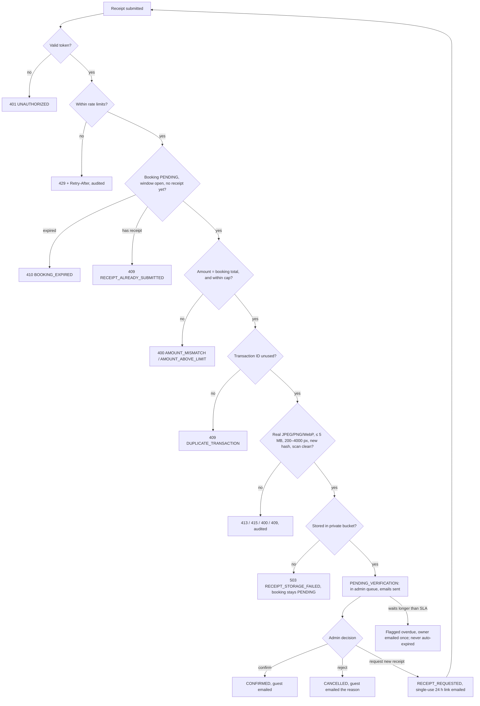

# BanglaQR Payments

The reference for how BanglaQR payments work in this template, how they are secured, and how to operate them. It is written for developers maintaining the integration and for property owners and managers who verify payments.

Related: [security review](PAYMENTS-BANGLAQR-SECURITY-REVIEW.md) · [verification report](PAYMENTS-BANGLAQR-VERIFICATION.md) · [data retention](DATA-RETENTION.md)

---

## 1. Overview

**BanglaQR** is Bangladesh Bank's interoperable QR standard. A guest can scan one QR code with bKash, Nagad, Rocket, Upay or any bank app.

| Mode | How the guest pays | How payment is confirmed | Status |
|---|---|---|---|
| **Static** (default) | Scans the property's fixed QR, types the amount, then uploads the receipt screenshot, transaction ID and amount paid | A MANAGER or OWNER checks the receipt against the settlement account statement | Production-ready |
| **Dynamic** | Scans a QR generated for the exact booking total | The acquiring bank calls our webhook, and the booking is confirmed automatically | **Disabled until an acquiring bank's API is integrated.** The plumbing is hardened and tested against a local sandbox bank. |

If dynamic mode is configured but not available, guests automatically get the static QR instead. BanglaQR never disappears from checkout because dynamic mode failed.

**Guarantees:** every request fails closed, every state change is audited, and no booking ID, amount or file type is taken on trust from the client.

---

## 2. Architecture

```
src/lib/payments/banglaqr/
  constants.ts           statuses, limits, TTLs
  errors.ts              BanglaQRError + codes (messages live in src/content en.ts/bn.ts)
  http.ts                route/action boundary: error → { error, code, reference }, 503 on DB outage
  log.ts                 JSON logger (component "banglaqr", correlation ID)
  context.ts             per-request correlation ID, proxy-appended client IP, user agent
  token.ts               HS256 booking tokens (pay / reupload)
  payment-token.ts       token issuance + INITIATED payment attempt
  schemas.ts             strict Zod schemas for every input
  transaction-id.ts      normalise, classify (bKash/Nagad/Rocket/Upay), mask
  file-security.ts       magic bytes, sharp decode, dimensions, re-encode (metadata strip), malware hook
  receipt-storage.ts     private R2 bucket (dev: .data/ fallback), signed URLs
  receipt-submission.ts  guest receipt flow (checks → upload → locked transaction)
  receipt-access.ts      audited 5-minute signed URLs for admins
  verification.ts        admin confirm / reject / request receipt / confirm-without-receipt
  settlement.ts          row lock + guarded status transitions shared by every settling path
  release.ts             auto-release of unpaid bookings + verification SLA escalation
  retention.ts           90-day receipt purge, owner deletion
  webhook-verifier.ts    HMAC-SHA256, timing-safe
  webhook-processor.ts   verify → parse → idempotent, locked apply
  dynamic-qr.ts / dynamic-payment.ts / banks/*   acquiring-bank adapters, timeout/retry/fallback
  rate-limiter.ts        Postgres-backed sliding windows
  audit.ts               PaymentAuditLog writer
  notifications.ts       guest/admin emails (src/lib/email/banglaqr.ts), after commit
  settings.ts            owner settings (cap, SLA, alert email)
  heartbeat.ts           cron heartbeat + stale alert
  queue.ts               verification queue data
  status-guard.ts        blocks generic status edits on BanglaQR bookings

src/app/api/payments/banglaqr/{token,submit-receipt,generate-dynamic}/route.ts   guest endpoints
src/app/api/webhooks/payment/banglaqr/route.ts                                    bank webhook (the only one)
src/app/api/cron/{banglaqr-release,banglaqr-retention}/route.ts                   scheduled jobs
src/app/api/admin/payments/banglaqr/receipt-file/route.ts                         dev-only receipt server
src/app/actions/banglaqr-actions.ts                                               admin Server Actions
src/app/admin/payments/banglaqr-verification/                                     verification queue
src/app/payment/banglaqr/reupload/                                                guest re-upload page
src/components/travel/BanglaQRPaymentPanel.tsx                                    guest checkout panel
```

**Module boundaries.**

- Routes and actions only authenticate, rate-limit, parse and call the library; all payment logic lives in `src/lib/payments/banglaqr/`.
- Every write that settles a booking goes through `settlement.ts`: lock the booking row, then run guarded `updateMany` transitions.
- The generic `/api/webhooks/payment` router cannot process BanglaQR: the registry adapter in `adapter.ts` always refuses.

### Data model (additive)

**`Payment` gets new nullable columns:** `mode`, `claimedAmountPoisha`, `receiptKey`, `receiptHash`, `receiptSubmittedAt`, `receiptDeletedAt`, `transactionIdFormat`, `verifiedByUserId`, `verifiedAt`, `verificationNote`, `escalatedAt` and `reuploadTokenId`.

**Partial unique indexes** (raw SQL in migration `20260929120000_banglaqr_payment_fields`) enforce three rules at the database level:

- at most one live BanglaQR payment per booking
- one live payment per receipt hash
- one live payment per transaction ID

> If a future `prisma migrate dev` generates `DROP INDEX "banglaqr_…"`, delete that statement. Prisma 6 cannot express partial indexes.

**New tables:** `PaymentAuditLog` (append-only, enforced by a trigger), `BanglaQRSettings`, `BanglaQRRateLimitHit` and `CronHeartbeat`.

### Payment states

| Status | Meaning |
|---|---|
| `INITIATED` | Guest opened BanglaQR (token issued); no receipt yet |
| `PENDING_VERIFICATION` | Receipt uploaded; waiting for an admin |
| `RECEIPT_REQUESTED` | Admin asked for a better receipt; guest has a single-use link |
| `SUCCESS` | Verified (admin, override or bank webhook) |
| `FAILED` | Rejected by an admin, or the bank reported failure |
| `EXPIRED` | Payment window passed with no receipt |

Booking states used: `PENDING` → `PENDING_MANUAL_VERIFICATION` → `CONFIRMED`, or `CANCELLED` / `EXPIRED`.

---

## 3. Configuration

### Environment variables

| Variable | Required | Description | Example |
|---|---|---|---|
| `BANGLAQR_TOKEN_SECRET` | **Yes** | Signs guest booking tokens (HS256). At least 32 characters. Must differ from every other secret. Unset means BanglaQR is unavailable. | `openssl rand -base64 48` |
| `R2_ACCOUNT_ID` | Yes (prod) | Cloudflare account ID (shared with blog storage) | `a1b2c3…` |
| `R2_RECEIPTS_BUCKET_NAME` | Yes (prod) | **Private** bucket for receipts. No public domain, no public access. | `resort-receipts` |
| `R2_RECEIPTS_ACCESS_KEY_ID` | Yes (prod) | R2 API token scoped to the receipts bucket only | `…` |
| `R2_RECEIPTS_SECRET_ACCESS_KEY` | Yes (prod) | Secret for the token above | `…` |
| `CRON_SECRET` | Yes | Bearer secret for `/api/cron/banglaqr-*` (header only; `?secret=` is refused) | `openssl rand -hex 32` |
| `RESEND_API_KEY` | Recommended | Sends guest/admin emails. Unset means emails are logged as mock sends (recipient and subject only). | `re_…` |
| `BANGLAQR_ACQUIRING_BANK` | Dynamic only | `sslcommerz`, `premier`, `islami` (not yet integrated) or `sandbox` (non-production only) | `sandbox` |
| `BANGLAQR_WEBHOOK_SECRET` | Dynamic only | Shared HMAC secret with the bank, at least 32 characters. Unset means every webhook is rejected. | `…` |
| `BANGLAQR_MERCHANT_ID` / `BANGLAQR_API_KEY` / `BANGLAQR_API_SECRET` | Dynamic only | Bank credentials (not needed for `sandbox`) | `…` |
| `DATABASE_URL_TEST` | Tests only | A database whose name ends in `_test`, for `pnpm test:banglaqr:db` | `…/resort_banglaqr_test` |

In development, if the receipts bucket is not configured, receipts are stored under `.data/banglaqr-receipts/`. That folder is git-ignored, sits outside `public/`, and is served only through signed links to signed-in managers. This fallback never runs in production.

### Brand config (`src/components/brand/brand.config.ts` → `payments.banglaqr`)

| Key | Meaning |
|---|---|
| `enabled` | Show BanglaQR at checkout (it also needs the env above) |
| `mode` | `"static"` or `"dynamic"`. Dynamic is used only when fully available, otherwise static. |
| `qrImageUrl`, `settlementAccount`, `instructions` | What the guest sees |
| `reviewWindowMinutes` | Guest **payment window** in minutes from booking creation (default 30). A 5-minute grace period is added. |
| `maxReceiptSizeMb` | Upload limit (default 5) |

### Owner settings (`/admin/settings/payments`, OWNER + 2FA)

| Setting | Default | Meaning |
|---|---|---|
| Maximum booking total | ৳1,000,000 | Bookings above this can't use BanglaQR (checked before the guest pays) |
| Verification alert after | 120 min | Receipts waiting longer are flagged in the queue and emailed as a digest |
| Alert email | none | Receives every admin alert (§11) |

### Scheduled jobs

```cron
*/5 * * * * curl -fsS -X POST -H "Authorization: Bearer $CRON_SECRET" https://<domain>/api/cron/banglaqr-release
30 3 * * *  curl -fsS -X POST -H "Authorization: Bearer $CRON_SECRET" https://<domain>/api/cron/banglaqr-retention
```

### Reverse proxy

Nginx must pass receipt uploads (5 MB of image plus form overhead) and must set `X-Real-IP`, which the rate limits depend on:

```nginx
location = /api/payments/banglaqr/submit-receipt { client_max_body_size 6m; proxy_pass http://127.0.0.1:3000; proxy_set_header X-Real-IP $remote_addr; proxy_set_header Host $host; }
```

---

## 4. Static QR flow

1. **Booking created.** The guest creates a booking, which starts as `PENDING`, and the checkout shows the BanglaQR panel.
2. **Token issued.** The panel calls `POST /token` with the booking ID and booking code. The server checks:
   - the booking is `PENDING`
   - the payment window is still open
   - the total is within the owner's cap
   - no receipt exists yet

   It then opens an `INITIATED` attempt and returns a token. The token expires at the earlier of 30 minutes or the end of the window.
3. **Guest pays.** The guest scans the static QR and pays in their app (off-platform).
4. **Receipt submitted.** The guest uploads the receipt image, transaction ID and amount paid. The request is multipart and carries the token in the `x-banglaqr-token` header.
5. **Checks before any side effect.** The server checks, in order:
   - rate limits
   - the token signature and expiry
   - `Content-Length`
   - the strict field schema
   - booking state
   - that the amount equals the booking total
   - that the transaction ID hasn't been used before
   - the image: magic bytes, full decode, dimensions
   - that the receipt hash is new
   - the malware hook
6. **Upload.** The image is re-encoded, which strips metadata, and uploaded to the private bucket as `receipts/{bookingId}/{sha256}.{ext}`.
7. **One transaction.** The server locks the booking row and re-checks everything. The payment moves `INITIATED` → `PENDING_VERIFICATION` and the booking `PENDING` → `PENDING_MANUAL_VERIFICATION`, and an audit row is written.
8. **Notifications.** After commit, the guest gets a "receipt received" email and the admins get an alert.
9. **Decision.** A MANAGER or OWNER opens the receipt (signed URL, audited) and confirms, rejects or requests a new receipt (§10).

```mermaid
sequenceDiagram
    autonumber
    participant G as Guest browser
    participant API as BanglaQR API
    participant DB as Postgres
    participant R2 as Private R2 bucket
    participant A as Admin (MANAGER+)
    participant M as Email

    G->>API: POST /token {bookingId, bookingCode}
    API->>DB: lock booking; PENDING? window? cap? no receipt?
    API->>DB: Payment INITIATED + audit
    API-->>G: token (≤30 min, ≤ window end)
    Note over G: Guest pays in their MFS/bank app
    G->>API: POST /submit-receipt (multipart, x-banglaqr-token)
    API->>API: rate limit → token → size → schema
    API->>DB: booking state, amount = total, trxID unused, hash unused
    API->>API: magic bytes, sharp decode, dimensions, re-encode, malware hook
    API->>R2: PUT receipts/{bookingId}/{sha256}.ext
    API->>DB: tx: lock booking, re-check, INITIATED→PENDING_VERIFICATION, PENDING→PENDING_MANUAL_VERIFICATION, audit
    API-->>G: { success, reference }
    API-)M: guest "receipt received", admin "new receipt"
    A->>API: View receipt (MANAGER+MFA)
    API->>DB: audit ADMIN_RECEIPT_URL_ISSUED
    API-->>A: 5-minute signed URL
    A->>API: Confirm
    API->>DB: tx: lock, PENDING_VERIFICATION→SUCCESS, →CONFIRMED, hold room unit, audit
    API-)M: guest booking confirmation
```

---

## 5. Dynamic QR flow

> **Disabled until an acquiring bank is integrated.** The bank adapters (`banks/sslcommerz-qr.ts`, `premier-qr.ts`, `islami-qr.ts`) are explicit stubs with `implemented: false`, and readiness reports dynamic mode unavailable. To integrate a bank, implement `BanglaQRBankAdapter` (the API call honouring `signal`, a response validated by Zod, and a strict webhook schema from the bank's documentation) and set `implemented: true`.

1. **Token.** Same as static.
2. **Generate the QR.** `POST /generate-dynamic` (token header, empty body). The server:
   - locks the booking and checks its state
   - creates one server reference per attempt (`BQR-<16 hex>`), reused on retries so a QR the guest already paid still matches
   - calls the bank with a 15-second timeout and one retry on network errors
   - validates the bank's response and returns the QR image
3. **Fallback.** On any failure the attempt switches to static mode, the guest sees the static QR with a notice, and `DYNAMIC_QR_FAILED` is audited.
4. **Guest pays.** The guest scans and pays.
5. **Webhook.** The bank calls `POST /api/webhooks/payment/banglaqr`. The route checks the rate limit, the size cap, the HMAC (timing-safe) and the strict schema.
6. **Apply in one transaction.** The server:
   - claims the transaction ID in `ProcessedWebhook` (the idempotency key)
   - locks the booking
   - checks the amount against the booking total
   - moves the payment `INITIATED` → `SUCCESS` and the booking → `CONFIRMED`, and writes the audit row
7. **Retries and late events.** A retry of the same webhook gets 200 and changes nothing. An authentic event that can't be applied, such as a booking that is already settled or expired, is recorded and answered with 200. A late SUCCESS alerts the owner, because the guest may have paid.

```mermaid
sequenceDiagram
    autonumber
    participant G as Guest browser
    participant API as BanglaQR API
    participant Bank as Acquiring bank
    participant DB as Postgres

    G->>API: POST /generate-dynamic (token)
    API->>DB: lock booking; PENDING, window open, no receipt
    API->>DB: reuse or create reference BQR-…
    API->>Bank: create QR (15 s timeout, 1 retry on network error)
    alt bank OK and response valid
        Bank-->>API: QR payload + image
        API->>DB: attempt mode=dynamic, audit DYNAMIC_QR_GENERATED
        API-->>G: QR image
    else failure
        API->>DB: attempt mode=static, audit DYNAMIC_QR_FAILED
        API-->>G: 503 DYNAMIC_QR_UNAVAILABLE → panel shows static QR
    end
    Bank->>API: POST /webhooks/payment/banglaqr + HMAC
    API->>API: rate limit, size, HMAC (timingSafeEqual), strict schema
    API->>DB: tx: insert ProcessedWebhook(trxId) → duplicate? → 200 no-op
    API->>DB: lock booking; amount = total? else 400 + audit
    API->>DB: INITIATED→SUCCESS, PENDING→CONFIRMED, hold unit, audit
    API-->>Bank: 200
```

### Decision tree: a receipt is submitted, what happens next?



---

## 6. Security controls

**Authentication.**

- Guest endpoints require a short-lived HS256 token signed with `BANGLAQR_TOKEN_SECRET`.
- The token is issued only to a caller who presents both the booking UUID and its booking code, and it is bound to that booking. No guest endpoint accepts a booking ID from the body; unknown form fields are rejected, so a smuggled `bookingId` fails.
- Re-upload tokens are a separate purpose, valid for 24 hours, and single-use: the token ID is stored and cleared on use.
- Admin actions call `requireRole` (MANAGER, or OWNER for overrides, deletion and settings) and `requireMfa` before anything else. A denied attempt by a signed-in user is audited.

This removes the previous hardcoded fallback secret, which let anyone mint tokens.

**HMAC verification.**

- Webhooks must carry a 64-hex HMAC-SHA256 of the exact raw body. Anything else is rejected before comparison.
- Comparison uses `crypto.timingSafeEqual`. `===` or `Buffer.compare` would stop at the first differing byte and leak the signature one byte at a time through response timing.
- The secret is read from `process.env` only. If it is unset or shorter than 32 characters, every webhook is rejected.
- BanglaQR webhooks are accepted only at the dedicated route. The generic payment router refuses them, because it has no idempotency.

**File upload validation.** Receipts are treated as hostile:

- The type comes from magic bytes, and it must agree with the declared MIME type and the extension.
- The whole image is decoded by `sharp`, so a file that only looks like an image fails.
- Sizes and dimensions are bounded. Unreadable images are rejected rather than waved through.
- What we store is a fresh re-encode. That drops EXIF/GPS, ICC profiles, text chunks and anything appended after the image data.
- The object key is content-addressed; the guest's filename is never used.
- A malware-scan hook runs on every upload. It is currently a stub (§9).

**Rate limiting.** Limits are stored in Postgres, with a per-key advisory lock. They therefore hold across PM2 workers and restarts, and parallel requests can't slip under them. The client IP comes from `X-Real-IP` or the last `X-Forwarded-For` hop set by our proxy, never from the client-controlled first hop. Per-booking limits are counted only after authentication, so a stranger can't lock a guest out.

| Endpoint | Limit |
|---|---|
| `/token` | 30 per IP per hour |
| `/submit-receipt` | 20 per IP per hour, and 5 per booking per hour |
| `/generate-dynamic` | 5 per booking per hour |
| webhook | 60 per IP per minute |
| admin actions | 100 per user per hour |

**Idempotency and races.** Every path that changes a booking works the same way:

- it locks the booking row (`SELECT … FOR UPDATE`)
- it moves the payment with `updateMany` where the status is still the expected one, and requires `count === 1`

As a result, two admins confirming at once, an admin racing the webhook, or the cron racing a confirmation always resolve to exactly one outcome. Webhooks claim their transaction ID in `ProcessedWebhook` inside the same transaction. Partial unique indexes enforce "one live payment per booking / receipt / transaction ID" even if application code were bypassed.

**Amount validation.** Amounts are compared in integer poisha, with no floating point:

- **Static:** the guest's claimed amount must equal the booking total, and the admin sees both side by side. Confirm is disabled on a mismatch and re-checked on the server.
- **Dynamic:** the webhook amount must equal the booking total, or the webhook gets a 400 and both values are audited.
- **Cap:** the owner's cap is enforced before the guest pays.

**Transaction IDs.** IDs are normalised: uppercase, with whitespace and hyphens removed. They are then classified by provider pattern. An unrecognised format is accepted but shown with a yellow badge. An ID can back only one live or successful payment ever, and can't be reused on another booking within 90 days, even after a rejection.

**PII.** Receipts live in a private bucket, and only the key is stored. Admins view them through 5-minute signed URLs issued per click and audited. Transaction IDs are masked everywhere except the admin screen.

---

## 7. Compliance

- **Bangladesh Bank BanglaQR standard.** Payments go to the property's settlement account via the national interoperable QR. Dynamic QR payloads follow EMVCo: tag lengths are computed, and the CRC16-CCITT is computed and tested.
- **No surcharge.** The guest pays exactly the booking total. The system cannot add a fee, because the claimed amount must equal the booking total to the poisha. Confirm with the acquiring bank that the static QR itself carries no fee.
- **Audit retention.** Payment audit logs are kept for at least 2 years, following Bangladesh Bank guidance for payment records. This is enforced by a database trigger (§8). Payment records are kept for 7 years for accounting.

---

## 8. Data retention

| Data | Kept | Removal |
|---|---|---|
| Receipt images | 90 days after check-out | `/api/cron/banglaqr-retention` deletes the image; the payment record is kept |
| Payment records | 7 years | not deleted by the application |
| `PaymentAuditLog` | 2 years minimum | trigger blocks UPDATE, TRUNCATE, and DELETE of rows under 2 years old |

For guest deletion requests, an OWNER can delete a receipt image with an audited reason once the payment has been decided. Full policy and process: [DATA-RETENTION.md](DATA-RETENTION.md).

---

## 9. Failure modes

| Failure | What happens | What the user sees |
|---|---|---|
| **Receipt storage (R2) down** | Upload fails before any payment data is written; failure audited; the booking stays `PENDING` | Guest: "We couldn't save your receipt. Please try again in a few minutes." (503, Retry-After). If the guest paid and the problem persists, an OWNER can **Confirm without receipt** after checking the statement. |
| **Database unreachable** | Every BanglaQR endpoint returns 503 with `Retry-After: 30`; nothing is processed | Guest: "Our payment service is temporarily unavailable." Bank: retries the webhook. |
| **Auto-release cron stops** | Unpaid bookings stay `PENDING` (no money is at risk: paid bookings are never auto-released). After 2 hours without a successful run, the queue shows a red banner and one alert email is sent (repeated at most every 6 hours). | Admins: banner. OWNER: **Release expired unpaid bookings** runs the same guarded release manually. |
| **Acquiring bank timeout / error** | 15-second timeout, one retry on network errors (not on rejections), then fallback | Guest sees the static QR with a notice and pays with a receipt |
| **Webhook replayed / retried** | Idempotent: 200, nothing re-applied | none |
| **Late bank SUCCESS** (booking already expired or settled) | Recorded, answered 200, owner alerted | Owner can **Confirm without receipt** |
| **Receipt waits past the SLA** | Flagged overdue in the queue; owner emailed once per receipt; **never auto-expired** (owner decision D1: the guest may have paid) | Admins: amber banner and "Overdue" badges |
| **Email provider down** | Logged; the payment decision is unaffected (emails are sent after commit and can't fail the request) | Guest may not get the email; the booking state is still correct |
| **Malware scanner** | Currently a stub that passes non-empty files. The re-encode is the main defence: stored bytes are produced by `sharp`, not supplied by the guest. | none |

**Known limitation.** The stale-cron alert is triggered by admin visits to the verification queue, because a stopped cron can't report on itself. With no admin traffic, the alert waits until someone opens the admin panel.

---

## 10. Admin operations

**Verification queue** (`/admin/payments/banglaqr-verification`, MANAGER+). The oldest receipts are shown first. For each receipt:

1. Click **View receipt** to open a 5-minute signed link, which is audited.
2. Compare the receipt and the **transaction ID** with the settlement account statement. A yellow badge means the ID format isn't one we recognise, so check it carefully.
3. Check that **Guest says they paid** matches the **Booking total**. Confirm is disabled when they differ.
4. Choose an action:
   - **Confirm payment:** the booking is confirmed and the guest is emailed. Optionally add a note such as the statement line.
   - **Reject:** a reason is required and is emailed to the guest. The booking is cancelled.
   - **Request new receipt:** a reason is required. The guest is emailed a single-use link valid for 24 hours, and the booking stays in the queue as "waiting for the guest".

**OWNER-only tools**

- **Confirm without receipt:** for payments verified another way (statement, cash), or for money that arrived after expiry. A reason is required. It is logged as a distinct audit event and emailed to the alert address.
- **Release expired unpaid bookings:** the manual fallback for the auto-release cron. A reason is required.
- **Delete receipt image** (booking page): for guest deletion requests. Available once the payment is decided.
- **Settings** (`/admin/settings/payments`): amount cap, verification SLA, alert email.

### Role × action matrix

| Action | Guest (token) | STAFF | MANAGER | OWNER |
|---|:---:|:---:|:---:|:---:|
| Get payment token / submit receipt / dynamic QR | ✅ | – | – | – |
| Re-upload receipt (emailed link) | ✅ (single use) | – | – | – |
| View verification queue and receipts | – | ❌ | ✅ | ✅ |
| Confirm / reject / request new receipt | – | ❌ (403, audited) | ✅ | ✅ |
| Confirm without receipt | – | ❌ | ❌ | ✅ |
| Release expired unpaid bookings | – | ❌ | ❌ | ✅ |
| Delete receipt image | – | ❌ | ❌ | ✅ |
| Change BanglaQR settings | – | ❌ | ❌ | ✅ (2FA) |
| Change a BanglaQR booking's status via the generic status control | – | ❌ | ❌ (blocked: use the queue) | ❌ (blocked: use the queue) |

Staff-entered offline bookings with payment method BanglaQR are recorded as staff-attested and don't enter this queue. Guests are not user accounts, so an admin can never verify their own submission. For that reason there is no self-verification check.

---

## 11. Testing

```bash
pnpm test                    # unit tests; DB-backed suites are reported as skipped
DATABASE_URL_TEST=postgresql://…/resort_banglaqr_test pnpm test:banglaqr:db
```

`test:banglaqr:db` refuses any database whose name doesn't end in `_test`. It applies migrations, then runs all BanglaQR suites serially against real Postgres. Receipt storage and the email transport are mocked; everything else is real (tokens, rate limits, transactions, locks, triggers, route handlers).

| Suite | Covers |
|---|---|
| `crypto.test.ts` | HMAC rejects empty, null, malformed, wrong length, and right length with wrong value; unset or short secret; token expiry, purpose, tampering, forgery, rotation, no fallback secret; cron-auth |
| `file-security.test.ts` | magic bytes; `.txt` as `.jpg`; PNG named `.jpg`; size; dimensions; decompression bomb; truncated file; EXIF and ICC stripped; polyglot payload removed |
| `rate-limiter.test.ts` | exact threshold, Retry-After, key isolation, 20 parallel requests against a limit of 5 admit exactly 5, audit row |
| `concurrency.test.ts` | concurrent confirmations, confirm vs reject, concurrent uploads, no resubmission after confirmation, webhook idempotency (sequential and parallel), stale webhook, cron idempotency and D1 |
| `validation.test.ts` | transaction ID normalisation, classification and masking; strict schemas; amount mismatch; cap; duplicate hash; transaction ID reuse; webhook amount mismatch |
| `audit.test.ts` | trigger immutability; required fields; no full transaction ID or token in the trail |
| `roles.test.ts` | STAFF 403 (audited), MANAGER confirms, anonymous redirected, settings OWNER+2FA |
| `retention.test.ts` | 90-day purge, pending receipts kept, owner deletion, audited signed URLs |
| `routes.test.ts` | real route handlers: happy path, 401, 415, 413, 409, smuggled field, storage outage 503, webhook confirm/replay/bad signature, generic router refusal, webhook 429, DB outage 503, no leaks, en/bn messages |
| `resilience.test.ts` | bank timeout and single retry, no retry on rejection, malformed response, fallback to static, override on expired booking, cron heartbeat |
| `notifications.test.ts` | every email trigger, single-use re-upload link, escalation once, signature-alert throttle, late-payment alert, HTML escaping |

**Sandbox (dynamic) in development:** set `BANGLAQR_ACQUIRING_BANK=sandbox`, `BANGLAQR_WEBHOOK_SECRET` and `mode: "dynamic"`, then send a signed webhook:

```bash
BODY='{"reference":"BQR-…","transactionId":"TEST123456","amount":"4500.00","status":"SUCCESS"}'
SIG=$(printf '%s' "$BODY" | openssl dgst -sha256 -hmac "$BANGLAQR_WEBHOOK_SECRET" -hex | sed 's/^.* //')
curl -X POST http://localhost:3000/api/webhooks/payment/banglaqr -H "x-banglaqr-signature: $SIG" -d "$BODY"
```

---

## 12. Monitoring

Logs are JSON lines on stdout/stderr (collected by PM2) with `"component":"banglaqr"`. The guest-visible reference (`BR-YYYY-MM-DD-xxxxxx`) is the `correlationId`, so `grep BR-2026-09-29-7a3f2b` finds the exact request.

| Watch for | Where | Meaning |
|---|---|---|
| `"event":"request_failed"` | logs | 5xx: storage, DB or bug |
| `WEBHOOK_SIGNATURE_INVALID` spikes | `PaymentAuditLog` + alert email | probing, or a secret out of sync with the bank |
| `RATE_LIMIT_HIT` | `PaymentAuditLog` | abuse, or limits too tight |
| `VERIFICATION_ESCALATED` | audit + email | queue not being worked |
| `CRON_STALE_ALERT` | audit + email + banner | release cron not running |
| `ADMIN_CONFIRMED_WITHOUT_RECEIPT` | audit + email | review every override |
| `WEBHOOK_IGNORED` with `lateSuccess: true` | audit + email | money may have arrived for an unconfirmable booking |

### Audit events

| Event | Actor | Key fields |
|---|---|---|
| `PAYMENT_TOKEN_ISSUED` | GUEST | tokenId, expiresAt |
| `RECEIPT_SUBMITTED` | GUEST | amountPaidPoisha, transactionId (masked), format, fileHash, IP, UA |
| `RECEIPT_SUBMISSION_REJECTED` | GUEST | code, reason, masked transactionId, fileHash |
| `RECEIPT_UPLOAD_FAILED` | GUEST | error, fileHash, IP |
| `RECEIPT_MALWARE_DETECTED` | GUEST | fileHash, reason |
| `DYNAMIC_QR_GENERATED` / `DYNAMIC_QR_FAILED` | GUEST | bank, reference / error |
| `ADMIN_ACTION_DENIED` | ADMIN | action, requiredRole |
| `ADMIN_QUEUE_VIEWED` | ADMIN | adminRole |
| `ADMIN_RECEIPT_URL_ISSUED` | ADMIN | ttlSeconds |
| `ADMIN_CONFIRMED` | ADMIN | previousStatus, newStatus, amount, masked transactionId |
| `ADMIN_REJECTED` / `ADMIN_RECEIPT_REQUESTED` | ADMIN | reason |
| `ADMIN_CONFIRMED_WITHOUT_RECEIPT` | ADMIN (OWNER) | reason, previous statuses, hadReceipt |
| `ADMIN_RELEASED` / `AUTO_RELEASED` | ADMIN / SYSTEM | ageMinutes, reason |
| `ADMIN_RECEIPT_DELETED` / `RETENTION_RECEIPT_PURGED` | ADMIN / SYSTEM | reason / checkOutDate |
| `ADMIN_SETTINGS_UPDATED` | ADMIN (OWNER) | before, after |
| `WEBHOOK_RECEIVED` | BANK | reference, masked transactionId, amount, signatureValid |
| `WEBHOOK_SIGNATURE_INVALID` | BANK | reason, bodySha256, IP |
| `WEBHOOK_REJECTED` / `WEBHOOK_AMOUNT_MISMATCH` | BANK | reason / expected and received poisha |
| `WEBHOOK_DUPLICATE` / `WEBHOOK_IGNORED` / `WEBHOOK_PROCESSED` | BANK | reference, statuses |
| `VERIFICATION_ESCALATED` | SYSTEM | slaMinutes, waitingMinutes |
| `CRON_STALE_ALERT` | SYSTEM | hoursSinceSuccess |
| `RATE_LIMIT_HIT` | GUEST / BANK / ADMIN | endpoint, key, limit, IP, UA |
| `LEGACY_RECEIPT_MIGRATED` | SYSTEM | none |

### Error codes

| Code | HTTP | Guest message (EN) | Guest message (BN) |
|---|---|---|---|
| `AMOUNT_MISMATCH` | 400 | The amount you entered doesn't match your booking total of {total}. | আপনার দেওয়া টাকা আপনার বুকিং মোট {total}-এর সাথে মিলছে না। |
| `AMOUNT_ABOVE_LIMIT` | 400 | This amount is above the limit for BanglaQR payments… | এই পরিমাণ বাংলাকিউআর পেমেন্টের সীমার বেশি… |
| `INVALID_TRANSACTION_ID` | 400 | Please enter the transaction ID exactly as shown in your payment app… | পেমেন্ট অ্যাপে যেভাবে দেখানো আছে ঠিক সেভাবে ট্রানজেকশন আইডি লিখুন… |
| `FILE_TOO_LARGE` | 413 | Your receipt is too large. Maximum size is 5 MB. | আপনার রিসিট অনেক বড়। সর্বোচ্চ সাইজ ৫ মেগাবাইট। |
| `INVALID_FILE_TYPE` | 415 | Please upload a JPEG, PNG, or WebP image. | অনুগ্রহ করে JPEG, PNG বা WebP ছবি আপলোড করুন। |
| `IMAGE_DIMENSIONS` / `IMAGE_UNREADABLE` | 400 | Size between 200×200 and 4000×4000 px / couldn't read the image | … |
| `DUPLICATE_RECEIPT` | 409 | This receipt has already been submitted. | এই রিসিট আগেই জমা দেওয়া হয়েছে। |
| `DUPLICATE_TRANSACTION` | 409 | This transaction ID has already been used for another payment. | … |
| `RECEIPT_ALREADY_SUBMITTED` | 409 | We already have a receipt for this booking… | … |
| `BOOKING_EXPIRED` | 410 | The payment window has expired. Please create a new booking. | পেমেন্টের সময় শেষ। নতুন বুকিং তৈরি করুন। |
| `BOOKING_NOT_PAYABLE` / `INVALID_STATE` / `ALREADY_PROCESSED` | 409 | booking/payment can't take that action now | … |
| `UNAUTHORIZED` / `FORBIDDEN` / `NOT_FOUND` | 401/403/404 | session expired / no permission / not found | … |
| `RATE_LIMITED` | 429 | Too many attempts. Please try again later. | … |
| `METHOD_UNAVAILABLE` / `DYNAMIC_QR_UNAVAILABLE` / `RECEIPT_STORAGE_FAILED` / `SERVICE_UNAVAILABLE` | 503 | temporarily unavailable, with a fallback or a retry hint | … |
| `INVALID_INPUT` / `REASON_REQUIRED` / `SERVER_ERROR` | 400/400/500 | generic | … |

Full text for every code, in both languages: `src/content/en.ts` / `bn.ts` → `banglaqrErrors`. Every error response is `{ "error": "<message> Reference: BR-…", "code": "<CODE>", "reference": "BR-…" }`.

---

## 13. Troubleshooting

| Symptom | Likely cause | Fix |
|---|---|---|
| BanglaQR missing at checkout | `BANGLAQR_TOKEN_SECRET` unset or shorter than 32 characters, or the receipts bucket isn't configured (production) | Check `/admin/settings/payments`, which lists the missing variables |
| Guests get 413 on upload before the app sees it | Nginx `client_max_body_size` is at its 1 MB default | Add the location block in §3 |
| Every guest shares one rate limit | `X-Real-IP` isn't set by the proxy | Add `proxy_set_header X-Real-IP $remote_addr;` |
| Webhooks all get 400 "Signature mismatch" | Secret out of sync with the bank, or a proxy re-encoding the body | Compare secrets; make sure nothing rewrites the body |
| Webhooks get 503 | Dynamic mode not integrated, or `BANGLAQR_ACQUIRING_BANK` unset or unknown | Expected until a bank is integrated |
| "Auto-release job has stopped" banner | Cron not scheduled, or `CRON_SECRET` mismatch (header only) | Check crontab (§3); use **Release expired unpaid bookings** meanwhile |
| Guest says they paid but the booking expired | Paid after the window, or never uploaded | Find the payment on the statement, then OWNER **Confirm without receipt** |
| Receipt link "invalid or expired" | Re-upload links last 24 hours and work once; a newer request replaces older links | Request a new receipt again from the queue |
| `migrate dev` wants to drop `banglaqr_*` indexes | Prisma can't model partial indexes | Remove those statements from the generated migration |

---

## 14. Changelog

| Date | Change |
|---|---|
| 2026-09-29 | Security review (`PAYMENTS-BANGLAQR-SECURITY-REVIEW.md`): 35 gaps found, including a hardcoded token secret, receipts in a public bucket, and auto-release expiring paid bookings. |
| 2026-09-29 | §1 Authentication: dedicated token secret with no fallback; booking taken from the token only; state guards; admin guards with MFA; generic webhook router closed to BanglaQR; dynamic mode fails closed. |
| 2026-09-29 | §2 Validation: strict schemas everywhere; owner-configurable amount cap. |
| 2026-09-29 | §3 Uploads: content-based type checks, sharp decode and re-encode (metadata stripped), bounds, duplicate hashes, private storage. |
| 2026-09-29 | §4 Crypto: timing-safe comparisons everywhere, including the shared cron secret. |
| 2026-09-29 | §5 Rate limiting: Postgres-backed, proxy-aware IP, per-booking limits after auth. |
| 2026-09-29 | §6 Races: row locks and guarded transitions; webhook idempotency; auto-release never expires paid bookings (D1). |
| 2026-09-29 | §7 Amounts and transaction IDs: exact poisha match; admin side-by-side view; format badges; 90-day reuse block. |
| 2026-09-29 | §8 Audit: append-only `PaymentAuditLog` enforced by a trigger; masked IDs; denied attempts logged. |
| 2026-09-29 | §9 PII and retention: 90-day receipt purge; owner deletion; audited signed URLs; legacy receipt migration script. |
| 2026-09-29 | §10 Errors: coded, bilingual, with a correlation reference; no internal details in responses. |
| 2026-09-29 | §11 Resilience: cron heartbeat and alert; manual release; confirm without receipt; bank timeout, retry and fallback. |
| 2026-09-29 | §12 Notifications: guest and admin emails; sidebar badge; notifications can't fail a committed decision. |
| 2026-09-29 | §13 Conventions pass. §14 This document. §15 Verification report. |
