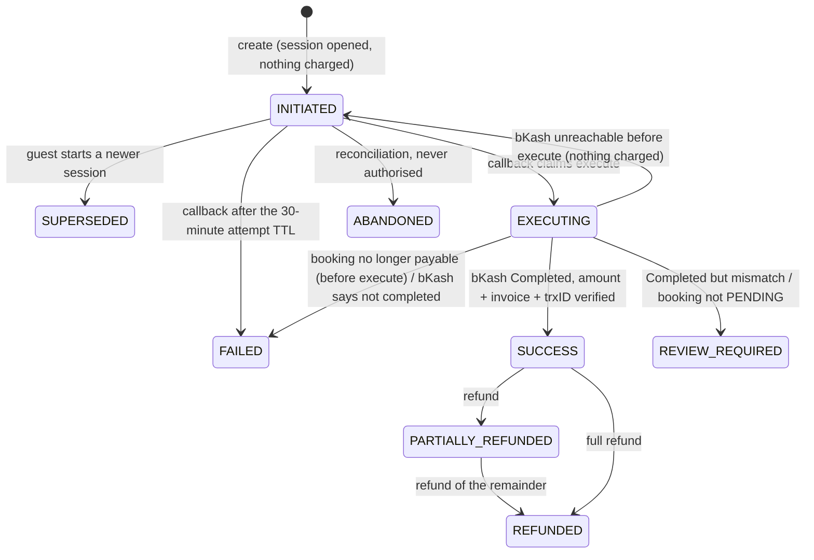
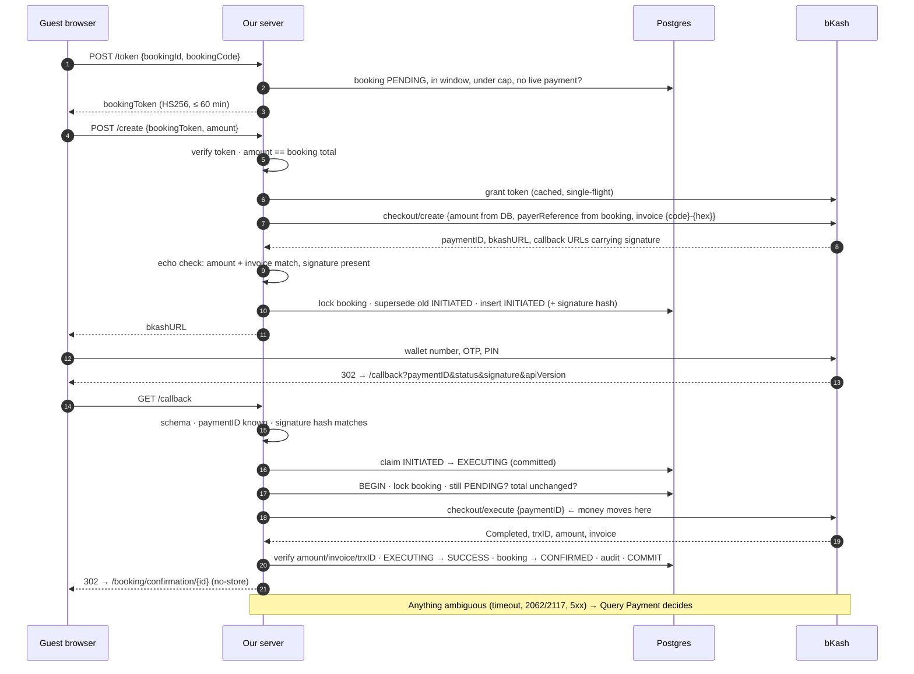
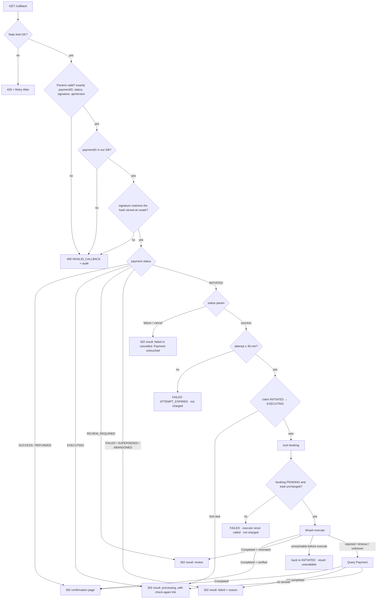
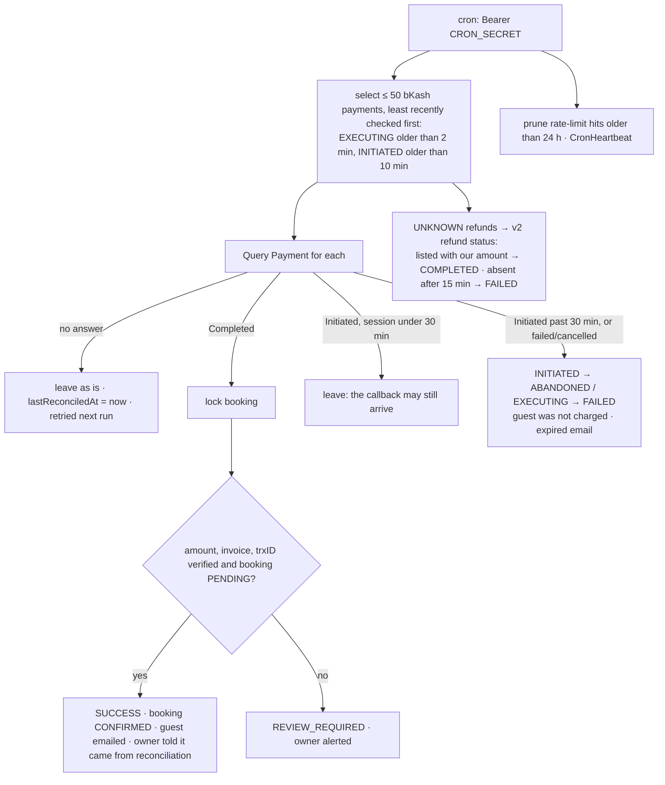

# bKash Payments (Tokenized Checkout)

This is the reference for how bKash payments work in this template, how they are secured, and how to operate them. It is written for developers maintaining the integration and for property owners and managers who handle bKash payments and refunds.

Related: [security review](PAYMENTS-BKASH-SECURITY-REVIEW.md) · [verification report](PAYMENTS-BKASH-VERIFICATION.md) · [data retention](DATA-RETENTION.md) · [deployment](DEPLOYMENT.md)

---

## 1. Overview

The integration uses **bKash Tokenized Checkout, API v1.2.0-beta**, in mode `0011`, where the guest pays without a saved agreement. It is a **redirect flow**:

1. We open a checkout session with bKash.
2. The guest's browser goes to bKash's page and the guest enters their wallet number, OTP and PIN.
3. bKash redirects the browser back to our callback.
4. **Our server calls bKash's execute API. That call, not the redirect, is what moves the money.**

We then confirm the booking only after verifying what bKash reports.

**Guarantees:**

- **The redirect is never trusted.** Its `status` parameter decides only whether we try to execute. It never changes payment state.
- **Every request fails closed.** A missing secret, an unreachable bKash, or an unverifiable response always results in "not paid, not confirmed". It never results in "confirmed".
- **A guest can't be charged twice for one booking.** The database enforces one live session per booking, and an unknown execute outcome blocks new sessions until reconciliation settles it.
- **Every state change is audited.** Rows go to an append-only log with a correlation ID the guest can read out to support.

What bKash really does differs from what integrators often assume. Each point below was checked against the bKash sandbox on 2026-09-29; the full record is in the [verification report](PAYMENTS-BKASH-VERIFICATION.md).

| Topic | Reality | Consequence here |
|---|---|---|
| Execute and Query Payment | `POST` with `{"paymentID": …}` in the body. The path-parameter and `GET` forms return HTTP 403 | The pre-hardening code used those forms and could not complete a payment |
| Callback parameters | `paymentID`, `status`, `signature` and `apiVersion` (sent as `1.2.0-beta/`) | The callback schema accepts exactly these. `signature` is verified against the value bKash returned from create |
| Webhooks | Delivered by **AWS SNS**, signed with an X.509 certificate, with no shared secret. The payload has `trxID`, `merchantInvoiceNumber`, `amount` and `transactionStatus`, but **no paymentID** | Verified as SNS messages (§5); matched to payments by our invoice number |
| Invoice number | bKash expects a unique `merchantInvoiceNumber` per payment | One invoice per attempt: `{bookingCode}-{4 hex}` |
| Refunds | The v2 refund API allows up to 10 partial refunds. The v1 refund-status call shows only one refund | Refunds and refund status use v2 |
| Token limits | More than 2 Refresh-token calls per hour blocks the merchant for 1 hour | We always re-grant and never call Refresh |
| Payment ID lifetime | A payment ID stays executable for 24 hours | We refuse to execute after 30 minutes |

---

## 2. Architecture

```
src/lib/payments/bkash/
  constants.ts          statuses, TTLs, limits (BKASH_*)
  errors.ts             BkashError + codes (messages in src/content en.ts/bn.ts → bkashErrors)
  http.ts               route/action boundary: error → { error, code, reference }, 503 + Retry-After on DB outage
  log.ts                bkashLog (JSON lines, component "bkash") + BK-YYYY-MM-DD-xxxxxx correlation IDs
  mask.ts               phone → 01XXXXXX378, trxID → AB****XY, paymentID → TR00…1234
  context.ts            per-request context: correlation ID, proxy-reported IP, user agent
  config.ts             every env var, read once, no fallbacks; readiness (what's missing)
  token.ts              booking tokens (HS256, BKASH_TOKEN_SECRET, 60 min)
  booking-token.ts      issue a booking token on booking ID + code
  token-manager.ts      bKash grant token: memory-only cache, single-flight refresh
  transport.ts          the only HTTP to bKash: JSON POST with a 30 s timeout
  client.ts             authenticated call → ok | rejected | unavailable | unknown
  api.ts                create, execute, query, refund (v2), refund status (v2)
  schemas.ts            Zod for every input and every bKash response
  payability.ts         "can this booking take a bKash payment now?"
  settlement.ts         row locks, guarded transitions, invoice numbers, callback signature
  create-payment.ts     open a session (supersedes older unexecuted ones)
  callback.ts           the redirect handler's decisions
  execute-payment.ts    claim → execute under the booking lock → verify → fulfil; resolve via Query Payment
  webhook-verifier.ts   AWS SNS signature, certificate-URL pinning, topic check
  webhook-processor.ts  verified notification → Query Payment → settle, idempotent per trxID
  reconcile.ts          the 5-minute reconciliation job
  refund.ts             refund ledger, v2 refund, refund-status reconciliation
  status-guard.ts       guards the generic admin booking actions against editing bKash state
  settings.ts           owner-editable limits (BkashSettings)
  rate-limiter.ts       bKash limits on top of shared/rate-limit.ts
  audit.ts              PaymentAuditLog writes (provider BKASH)
  notifications.ts      guest and owner emails, never throwing
src/lib/payments/shared/  hs256.ts, rate-limit.ts, db-errors.ts (gateway-neutral)

Routes
  POST /api/payments/bkash/token              booking ID + code → booking token
  POST /api/payments/bkash/create             booking token + amount → bkashURL
  GET  /api/payments/bkash/callback           bKash redirect → execute → 302
  POST /api/webhooks/payment/bkash            AWS SNS notifications
  GET|POST /api/cron/bkash-reconcile          reconciliation (Bearer CRON_SECRET)
  POST /api/admin/payments/bkash/test-connection   OWNER + 2FA
Server Actions (src/app/actions/bkash-actions.ts)
  refundBkashPaymentAction (OWNER + 2FA) · checkBkashPaymentStatusAction (MANAGER+) · updateBkashSettingsAction (OWNER + 2FA)
Pages
  /payment/bkash/result          failure, processing and review states for the guest
  /admin/bookings/[id]           bKash controls: refund dialog, status check
  /admin/settings/payments       bKash limits form
```

Module boundaries:

- Routes and actions only parse input, rate-limit, call one domain function, and map errors.
- Domain modules never build HTTP responses.
- `transport.ts` is the only code that talks to bKash.
- `token-manager.ts` is the only code that holds the grant token.

### Data model (additive)

| Model | Change | Purpose |
|---|---|---|
| `Payment` | `merchantInvoiceNumber` (unique), `callbackSignatureHash`, `executingAt`, `executedAt`, `failureReason`, `lastReconciledAt`, `refundedAmountPoisha` | Per-attempt invoice, callback binding, reconciliation state, refunds |
| `Payment` indexes | `bkash_one_live_payment_per_booking`, `bkash_payment_id_unique`, `bkash_transaction_id_unique` (partial, raw SQL) | One live session per booking; one row per paymentID; one payment per trxID |
| `BkashRefund` | New. Delete is blocked by a trigger; request fields are immutable; settled outcomes are final | Refund ledger and idempotency |
| `BkashSettings` | New singleton | Owner-editable cap, windows and alert email |
| `PaymentRateLimitHit` | New, gateway-neutral | Rate-limit counters shared across PM2 workers |
| `PaymentAuditLog`, `ProcessedWebhook` | Reused (provider `BKASH`) | Append-only audit; webhook idempotency |

### Payment states



`EXECUTING` means we asked bKash to execute and don't yet know the answer. It blocks new sessions for that booking, which is what stops a double charge. `REVIEW_REQUIRED` means bKash holds the guest's money but we could not apply it; an OWNER must refund the guest or confirm the booking manually.

---

## 3. Configuration

### Environment variables

| Variable | Required | Example | Description |
|---|---|---|---|
| `BKASH_APP_KEY` | Yes | `4f6o0c…` | Merchant app key from bKash onboarding |
| `BKASH_APP_SECRET` | Yes | (secret) | Merchant app secret. Server-only |
| `BKASH_USERNAME` | Yes | `merchantUser` | Tokenized API username |
| `BKASH_PASSWORD` | Yes | (secret) | Tokenized API password. Server-only |
| `BKASH_TOKEN_SECRET` | Yes | `openssl rand -base64 48` | Signs guest booking tokens. At least 32 characters. **New.** |
| `BKASH_CALLBACK_URL` | Yes in production | `https://resort.example/api/payments/bkash/callback` | Where bKash redirects the guest. In development it defaults to the request origin; in production it is never derived from the `Host` header |
| `BKASH_BASE_URL` | No | `https://tokenized.pay.bka.sh/v1.2.0-beta` | Defaults from `BKASH_IS_SANDBOX`. v2 refund calls use the same host |
| `BKASH_IS_SANDBOX` | No | `false` | `true` selects the sandbox URL. Refused in production (see next row) |
| `BKASH_ALLOW_SANDBOX_IN_PRODUCTION` | No | `true` | Staging only: permits a sandbox URL while `NODE_ENV=production` |
| `BKASH_WEBHOOK_TOPIC_ARN` | For webhooks | `arn:aws:sns:ap-southeast-1:…:bkash-…` | The SNS topic bKash gives you. If unset, every webhook is rejected; payments still settle through the callback and reconciliation |
| `CRON_SECRET` | Yes | (secret) | Bearer secret for `/api/cron/bkash-reconcile` (shared with other crons) |
| `RESEND_API_KEY` | For email | (secret) | Without it, emails are logged as mock sends (subject only) |

`BKASH_WEBHOOK_SECRET` is **no longer used**. bKash webhooks have no shared secret (§1).

bKash is offered to guests only when **both** of these hold:

- `payments.bkash.enabled` is true in `brand.config.ts`
- `getBkashReadiness()` reports nothing missing (credentials, token secret, callback URL in production, no sandbox URL in production)

### Owner settings (`/admin/settings/payments`, OWNER + 2FA)

| Setting | Default | Notes |
|---|---|---|
| Maximum booking total | ৳500,000 | Bookings above it can't choose bKash. Hard ceiling ৳500,000 |
| Payment window | 60 minutes | Measured from booking creation; the booking token never outlives it |
| Refund window | 7 days | bKash refuses late refunds but doesn't publish the number. **Confirm it against your merchant agreement** |
| Alert email | none | Receives refund, review, reconciliation and webhook-signature alerts |

### Scheduled job

```cron
*/5 * * * * curl -fsS -X POST -H "Authorization: Bearer $(grep ^CRON_SECRET= /var/www/resort-app/.env | cut -d= -f2-)" https://yourresort.com/api/cron/bkash-reconcile >> /var/log/resort-cron.log 2>&1
```

The secret must be in the header. `?secret=` is refused, because query strings end up in access logs.

---

## 4. Flow

### 4.1 Full sequence



### 4.2 Decision tree: the callback arrives, what happens next?



### 4.3 Reconciliation job (every 5 minutes)



The brief suggested abandoning sessions after 2 hours. A session can't be executed after 30 minutes, so the job closes it once it passes that point.

---

## 5. Security controls

**Authentication.**

- **Guests** need a 60-minute HS256 booking token signed with `BKASH_TOKEN_SECRET`. It is issued only to a caller who presents both the booking UUID and its booking code. The create endpoint takes no booking ID and no phone number: both come from the token and the booking record.
- **Admin actions** call `requireRole` (OWNER for refunds, settings and the connection test; MANAGER for status checks) and `requireMfa` outside `try`, so a denial is a real 403. Denials by signed-in users are audited.
- **The callback** has no session; it proves itself with the signature bKash issued (see "Never trust the redirect").

**Never trust the redirect.**

- The callback's `status` parameter never changes state.
- Execute runs only when:
  - the `signature` hashes to the value we stored from bKash's own create response, compared with `timingSafeEqual`
  - the payment is ours and still `INITIATED`
  - the session is under 30 minutes old
  - the booking is still `PENDING` with the same total
- Fulfilment requires bKash's execute (or Query Payment) response to report `Completed` with our amount, our invoice number, and a trxID not used by any other payment.
- Replays and forgeries get a 400 with an audit row; they never change anything.
- Every redirect is a 302 with `Cache-Control: no-store, no-cache, must-revalidate`.

**Token cache.**

- The grant token lives only in `token-manager.ts` memory. It is never in the DB, on disk, in a log line or in a response; tests capture every log line to check this.
- A promise-as-lock makes concurrent requests share one grant call.
- The token is refreshed when under 60 seconds remain.
- A 401 drops that token and retries once.
- Failures are never cached and surface as `BKASH_UNAVAILABLE` (503).
- The Refresh API is never called, because of bKash's 2-per-hour block rule.

**Webhook verification (AWS SNS).**

- `SigningCertURL` must be `https://sns.<region>.amazonaws.com/…pem`. Anything else is refused before download, so nobody can sign with their own certificate.
- The RSA signature (SHA1 or SHA256) is verified over SNS's canonical string.
- `TopicArn` must equal `BKASH_WEBHOOK_TOPIC_ARN` (compared with `timingSafeEqual`).
- With no topic configured, every message is rejected.
- A verified message is still only a trigger: the payment is looked up by our invoice number and confirmed with Query Payment before any state changes.
- `ProcessedWebhook` (keyed `BKASH:{trxID}`) makes redelivery a no-op.
- `SubscribeURL` is followed only on AWS SNS hosts, which prevents SSRF.

**Amount and invoice validation.**

- At **create**, the client amount must equal the booking total, and bKash must echo the amount and invoice back.
- At **execute**, the amount and invoice must equal what we stored.
- A **webhook** amount must equal the stored amount.
- A **refund** must be ≤ the original payment minus earlier refunds.
- Amounts are integer poisha throughout; taka strings are parsed without floating point.
- A mismatch after capture parks the payment in `REVIEW_REQUIRED` with a HIGH-severity audit row and an owner alert, and does not confirm the booking.

**Idempotency and races.**

- Partial unique indexes allow one live bKash payment per booking, one row per paymentID, one payment per trxID, and one in-flight refund per payment.
- The execute claim is a guarded `updateMany`, so a double callback, or a callback racing a webhook or the cron, executes and fulfils once.
- Every settlement holds the booking row lock.
- The generic admin actions refuse to hand-edit bKash payment status, record a bKash refund as a note, or change a booking mid-execute.

**Rate limiting.** Limits live in Postgres with a per-key advisory lock, so they hold across PM2 workers and restarts. They are keyed on `X-Real-IP` from our proxy. The per-booking create limit counts only after the token is verified.

| Endpoint | Limit |
|---|---|
| `POST /api/payments/bkash/create` | 5 per booking per hour; 20 per IP per hour |
| `POST /api/payments/bkash/token` | 30 per IP per hour |
| `GET /api/payments/bkash/callback` | 60 per IP per hour |
| `POST /api/webhooks/payment/bkash` | 60 per IP per minute |
| Refund action | 10 per admin per day |
| Test connection | 10 per admin per hour |
| Other bKash admin actions | 100 per user per hour |

**Secrets.**

- Every `BKASH_*` secret is read through `process.env` in `config.ts` or `token.ts`, with no fallbacks. A missing value disables bKash rather than weakening it.
- Random values (invoice suffixes, token IDs, correlation IDs) use `crypto.randomBytes`.

---

## 6. Compliance

- **Bangladesh Bank PSP.** bKash is a Bangladesh Bank–licensed PSP; the guest pays bKash, and bKash settles to the merchant.
- **2FA is bKash's.** The guest's OTP and PIN are entered on bKash's page. This site never sees, handles or stores a PIN, OTP or wallet credential.
- **What we store** about the payer: the phone number we already hold on the booking, sent to bKash as `payerReference` to prefill the wallet field. bKash's `customerMsisdn` / `debitMSISDN` values are never stored or logged.
- **Admin 2FA.** OWNER accounts must have 2FA enabled to reach refunds and settings.

---

## 7. Data retention

| Data | Kept | Notes |
|---|---|---|
| `Payment` rows (bKash) | 7 years | Accounting. Never deleted by the application |
| `BkashRefund` rows | 7 years | A database trigger blocks deletion outright |
| `PaymentAuditLog` (provider BKASH) | At least 2 years | Append-only; the trigger blocks UPDATE, TRUNCATE, and DELETE of rows under 2 years old |
| `ProcessedWebhook` | 7 years | Part of the payment record |
| `PaymentRateLimitHit` | 24 hours | Pruned by the reconciliation job |
| Structured logs | Per server log rotation | Contain masked values only |

See [DATA-RETENTION.md](DATA-RETENTION.md).

---

## 8. Failure modes

| Situation | System behaviour | What the guest sees |
|---|---|---|
| bKash token endpoint down | Grant retried once; create returns 503 and no session is opened | "bKash is temporarily unavailable. Please try again in a few minutes." Booking stays PENDING |
| bKash API down at execute | Nothing was executed, so the attempt goes back to INITIATED | Result page "bKash is temporarily unavailable. You have not been charged yet." with a check-again link |
| Execute times out or the response is lost | Stays EXECUTING, and new sessions for the booking are blocked. Query Payment is tried at once, then every 5 minutes by the cron | "Confirming your payment… please don't pay again." Confirmation email once settled |
| Guest closes the browser after paying | Can't normally happen: nothing is charged until our execute. If execute ran and the response was lost, see the previous row | As above |
| Guest never authorises | Session closed as ABANDONED after 30 minutes | Expired email: "You were not charged" |
| Webhook delayed or missing | Nothing depends on it; the callback and the cron settle payments. A late webhook is a no-op | Nothing |
| Webhook before the callback | Webhook resolves via Query Payment; the later callback just shows confirmation | Confirmation |
| Callback twice or refreshed | One execute, one fulfilment; the second request shows confirmation or processing | Confirmation |
| Booking cancelled or total edited while the guest is in bKash | Refused under the lock **before** execute; the guest is not charged | Result page: booking cancelled / amount changed |
| bKash reports a different amount or invoice | REVIEW_REQUIRED; owner alerted; booking not confirmed | "Payment received, confirmation pending… our team will contact you" |
| Database unreachable | Create and webhook return 503 with Retry-After 30. Callback redirects to the result page with a check-again link | "Our payment service is temporarily unavailable" |
| Refund response lost | Refund UNKNOWN; not retried; settled from bKash's refund list by the cron | Owner sees "being checked, don't refund again" |

---

## 9. Admin operations

**Refunds** (booking page → bKash payment → "Refund via bKash", OWNER + 2FA):

1. Choose **Full** or **Partial**; the refundable remainder is shown.
2. Give a reason of 10 to 500 characters. It is audited and emailed to the alert address.
3. Retype the exact amount (paste is blocked).
4. For a second refund on a partly refunded payment, tick "additional refund".

Results:

- **Completed:** you see the bKash refund trxID. The payment becomes PARTIALLY_REFUNDED or REFUNDED.
- **Declined:** nothing changes.
- **No response in time:** the refund shows as being checked. **Don't refund again**; the cron settles it from bKash's records.

Two-person approval and password re-entry are not in v1. OWNER 2FA, the typed amount and the audit trail are the controls; see the security review for the tradeoff.

**Cancelling a bKash-paid booking.** Cancel it without recording a refund, then issue the refund with "Refund via bKash". The cancel dialog refuses to record a bKash refund as a note, because that would claim money was returned when it wasn't.

**Check status with bKash** (MANAGER or OWNER). Available for a payment stuck in EXECUTING (or an open session). It runs the same Query Payment reconciliation as the cron, straight away.

**REVIEW_REQUIRED.** bKash holds the guest's money but it couldn't be applied; the reason is shown. Check the transaction in the bKash merchant portal. Then either confirm the booking with the normal booking status control (the payment row stays REVIEW_REQUIRED as a record), or refund the guest **from the bKash merchant portal**. The in-app refund dialog accepts only SUCCESS and PARTIALLY_REFUNDED payments, and v1 has no in-app action that resolves a review; that is listed as a limitation in the verification report.

**Test connection** (`/admin/settings/payments`, OWNER + 2FA). This forces a fresh grant and returns only `success`, `environment` and `tokenExpiresIn`. It is limited to 10 per hour.

**Reconciliation log.** Every reconciliation check is an audit row (`RECONCILIATION_CHECKED`, `PAYMENT_ABANDONED`, `FULFILLMENT_COMPLETED` with `source: "query"`). The cron response and log line give counts (`checked`, `settled`, `confirmed`, `stillPending`, `refunds`).

### Role × action matrix

| Action | STAFF | MANAGER | OWNER |
|---|---|---|---|
| View bKash payments on a booking | ✅ | ✅ | ✅ |
| Check status with bKash | ❌ | ✅ | ✅ |
| Refund via bKash | ❌ (403, audited) | ❌ (403, audited) | ✅ with 2FA |
| Edit bKash limits and alert email | ❌ | ❌ | ✅ with 2FA |
| Test bKash connection | ❌ | ❌ | ✅ with 2FA |
| Hand-edit a bKash payment status | ❌ | ❌ (refused, audited) | ❌ (refused, audited) |
| Record a bKash refund as a cancellation note | ❌ | ❌ (refused, audited) | ❌ (refused, audited) |
| Cancel or confirm a booking while its bKash payment is EXECUTING | ❌ | ❌ (refused) | ❌ (refused) |

---

## 10. Testing

**Automated.**

- `pnpm test` runs the unit tests; the DB-backed tests are marked skipped.
- `DATABASE_URL_TEST=postgresql://…/resort_banglaqr_test pnpm test:bkash:db` runs every bKash test against a `*_test` database.
- Tests talk to an in-memory bKash (`src/lib/payments/bkash/__tests__/fake-bkash.ts`) whose request and response shapes copy what the real sandbox returned.
- Webhooks are signed with a real RSA key exactly as AWS SNS does.

**Sandbox test matrix** (credentials in the local `.env` only, never committed):

| Scenario | How | Expected |
|---|---|---|
| Successful payment | Test wallet `01929918378`, OTP `123456`, PIN `12121` | Booking CONFIRMED, confirmation email |
| Wrong PIN or failed authorisation | Wallet `01770618575` with the same PIN (refused in our sandbox run) | Callback `status=failure`; payment untouched; result page "not completed" |
| Cancel on bKash's page | Press Cancel | `status=cancel`; result page "cancelled"; booking PENDING |
| Insufficient balance | Published test wallet `01823074817` (not run in our sandbox session) | Failure callback; not charged |
| Double callback | Reload the callback URL | One execute; confirmation shown |
| Partial then full refund | Refund dialog twice (tick additional) | PARTIALLY_REFUNDED, then REFUNDED; both refunds listed by bKash |
| Execute response lost | Hard to force in the sandbox; covered by automated tests | EXECUTING → cron → SUCCESS |

---

## 11. Monitoring

| Watch | Where | Why |
|---|---|---|
| `REVIEW_REQUIRED` payments | Audit `FULFILLMENT_REJECTED` (severity HIGH); owner email | Money received but not applied: act the same day |
| Payments EXECUTING for more than 10 minutes | `Payment` where status = EXECUTING | Reconciliation isn't settling; check bKash availability and the cron |
| Cron health | `CronHeartbeat` name `bkash-reconcile`; cron log | If it stops, lost executes and unknown refunds stay unsettled |
| `bkash.token.refresh_failed` log lines / `TOKEN_REFRESH_FAILED` | Logs, audit | Credentials revoked or bKash down |
| `WEBHOOK_REJECTED` with signature reasons | Audit; owner email (at most 1/hour) | Probing, or a wrong topic ARN |
| `CALLBACK_REJECTED` volume by IP | Audit | Forged or replayed callbacks |
| `RATE_LIMIT_HIT` | Audit | Abuse, or limits too tight |
| UNKNOWN refunds | `BkashRefund` where status = UNKNOWN | Should settle within 15 minutes |

### Audit events

All are written to `PaymentAuditLog` with `provider = 'BKASH'` and a correlation ID. Trx IDs are masked `AB****XY`; phone numbers never appear.

| Event | Key fields |
|---|---|
| `TOKEN_GRANTED` / `TOKEN_REFRESH_FAILED` | expiresIn, source / reason, attempts |
| `BOOKING_TOKEN_ISSUED` | tokenId, expiresAt |
| `PAYMENT_CREATED` / `PAYMENT_CREATE_FAILED` / `PAYMENT_SUPERSEDED` | amountPoisha, merchantInvoiceNumber, bkashPaymentId (masked) / outcome, bkashCode |
| `CALLBACK_RECEIVED` / `CALLBACK_REJECTED` | status param, paymentStatus, IP, user agent / reason |
| `EXECUTE_CALLED` / `EXECUTE_SUCCEEDED` / `EXECUTE_FAILED` / `EXECUTE_OUTCOME_UNKNOWN` / `EXECUTE_REFUSED` | trigger, amount / trxId, transactionStatus / outcome, bkashCode / reason |
| `FULFILLMENT_COMPLETED` / `FULFILLMENT_REJECTED` | previousStatus, newStatus, source / severity HIGH, expected vs actual amount and invoice |
| `PAYMENT_ABANDONED`, `RECONCILIATION_CHECKED` | trigger, bkashStatus |
| `WEBHOOK_RECEIVED` / `WEBHOOK_REJECTED` / `WEBHOOK_DUPLICATE` / `WEBHOOK_IGNORED` / `WEBHOOK_PROCESSED` / `WEBHOOK_SUBSCRIPTION_CONFIRMED` | signatureValid, messageType / reason, bodyHash / trxId |
| `REFUND_INITIATED` / `REFUND_SUCCEEDED` / `REFUND_FAILED` / `REFUND_OUTCOME_UNKNOWN` | admin ID and role, amount, reason, trxId / refundTrxId / bkashCode |
| `ADMIN_ACTION_DENIED`, `ADMIN_STATUS_CHANGE_BLOCKED`, `ADMIN_SETTINGS_UPDATED`, `ADMIN_CONNECTION_TESTED` | action, requiredRole / before and after |
| `RATE_LIMIT_HIT` | endpoint, key, limit, retryAfterSeconds, IP, user agent |

### Error codes

The guest sees the English and Bangla message plus `Reference: BK-…`. Full list in `src/content/en.ts` / `bn.ts` → `bkashErrors`.

| Code | HTTP | Guest message (EN) |
|---|---|---|
| `AMOUNT_MISMATCH` | 400 | The amount doesn't match your booking. Please try again. |
| `TOKEN_EXPIRED` | 401 | Your payment session expired. Please start a new booking. |
| `PAYMENT_ALREADY_PROCESSED` | 409 | This payment was already processed. |
| `BKASH_UNAVAILABLE` | 503 | bKash is temporarily unavailable. Please try again in a few minutes. |
| `BOOKING_CANCELLED` | 409 | This booking has been cancelled. |
| `INVALID_PAYMENT_METHOD` | 503 | This payment method is not available. |
| `BOOKING_EXPIRED` | 410 | The payment window for this booking has closed. Please create a new booking. |
| `PAYMENT_IN_PROGRESS` | 409 | A bKash payment for this booking is already being processed. Please wait a moment. |
| `PAYMENT_SUPERSEDED` | 409 | This payment link was replaced by a newer one. |
| `PAYMENT_EXPIRED` / `PAYMENT_FAILED` | 410 / 402 | …You were not charged… |
| `INVALID_CALLBACK` | 400 | This payment link isn't valid. If you were charged, please contact us with the reference below. |
| `AMOUNT_ABOVE_LIMIT` | 400 | This booking is above the limit for bKash payments. |
| `RATE_LIMITED` | 429 | Too many attempts. Please try again later. |
| `SERVICE_UNAVAILABLE` | 503 | Our payment service is temporarily unavailable. |
| `REFUND_*`, `REASON_REQUIRED` | 400/409/502 | Admin-facing refund messages |

---

## 12. Troubleshooting

| Symptom | Likely cause | Fix |
|---|---|---|
| bKash missing at checkout | Disabled in brand config, or readiness reports something missing | Run Test Connection; the server log line for that request (`request_rejected`, same reference) lists the missing variables |
| Every create returns 503 | Wrong credentials, or bKash down | Test Connection; check `bkash.token.refresh_failed` for the bKash code |
| Callback always returns 400 `INVALID_CALLBACK` | `BKASH_CALLBACK_URL` points to a different deployment than the one that created the session | Callback must reach the server that holds the payment row |
| Payments stuck in EXECUTING | Reconciliation cron not running, or bKash Query Payment failing | Check cron log and `CronHeartbeat`; press "Check status with bKash" |
| Webhooks all rejected with `TOPIC_NOT_CONFIGURED` / `TOPIC_MISMATCH` | `BKASH_WEBHOOK_TOPIC_ARN` unset or wrong | Set it to the ARN bKash provided; payments still settle without webhooks |
| Refund "being checked" for more than 15 minutes | Cron not running | Run the cron; the refund settles from bKash's list |
| Refund declined `REFUND_WINDOW_CLOSED` | Beyond the refund window | Refund outside bKash (bank transfer) and note it; adjust the window only if your agreement allows |
| Sandbox works, production 403s | Production credentials or base URL wrong | `BKASH_BASE_URL` must be the production host; `BKASH_IS_SANDBOX` false |

---

## 13. Changelog

| Date | Change |
|---|---|
| 2026-09-29 | Security review (Section 0): 32 gaps, including a confirmation that the old execute and query calls returned 403 against bKash |
| 2026-09-30 | §1 Booking tokens, signature-bound callback, claim/lock/verify execute, SNS webhooks, OWNER-only refunds and connection test; legacy HMAC webhook route removed; generic router refuses bKash |
| 2026-09-30 | §2 Strict Zod schemas for every input; Zod-validated bKash responses |
| 2026-09-30 | §3 Single-flight grant, 60 s refresh buffer, 401 retry, no cached failures, token never logged |
| 2026-09-30 | §4 Unique paymentID; forged, replayed, expired and superseded callbacks refused; 302 + no-store |
| 2026-09-30 | §5 Amount, invoice and trxID verified at every step; REVIEW_REQUIRED after capture; masked payer reference |
| 2026-09-30 | §6 One live session per booking and one payment per trxID (DB); single execute per payment; refund idempotency; admin action guards |
| 2026-09-30 | §7 Refund dialog, v2 partial refunds, refund ledger with UNKNOWN reconciliation, refund window |
| 2026-09-30 | §8 SNS signature, booking-token and callback-signature test suite |
| 2026-09-30 | §9 Postgres-backed rate limits on every endpoint |
| 2026-09-30 | §10 Full audit event set in the append-only PaymentAuditLog |
| 2026-09-30 | §11 Bilingual error messages, correlation IDs, fail-closed paths |
| 2026-09-30 | §12 Reconciliation cron, 30 s timeouts with a single safe retry, DB-outage 503s |
| 2026-09-30 | §13 Guest and owner email notifications |
| 2026-09-30 | §14 Naming, typing and logging conventions; owner settings form |
