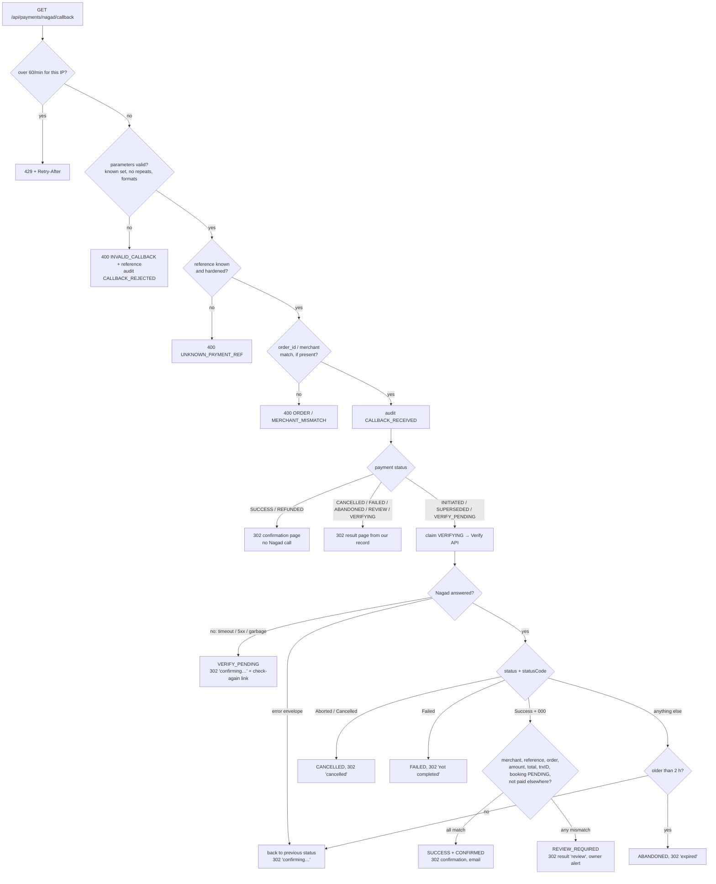
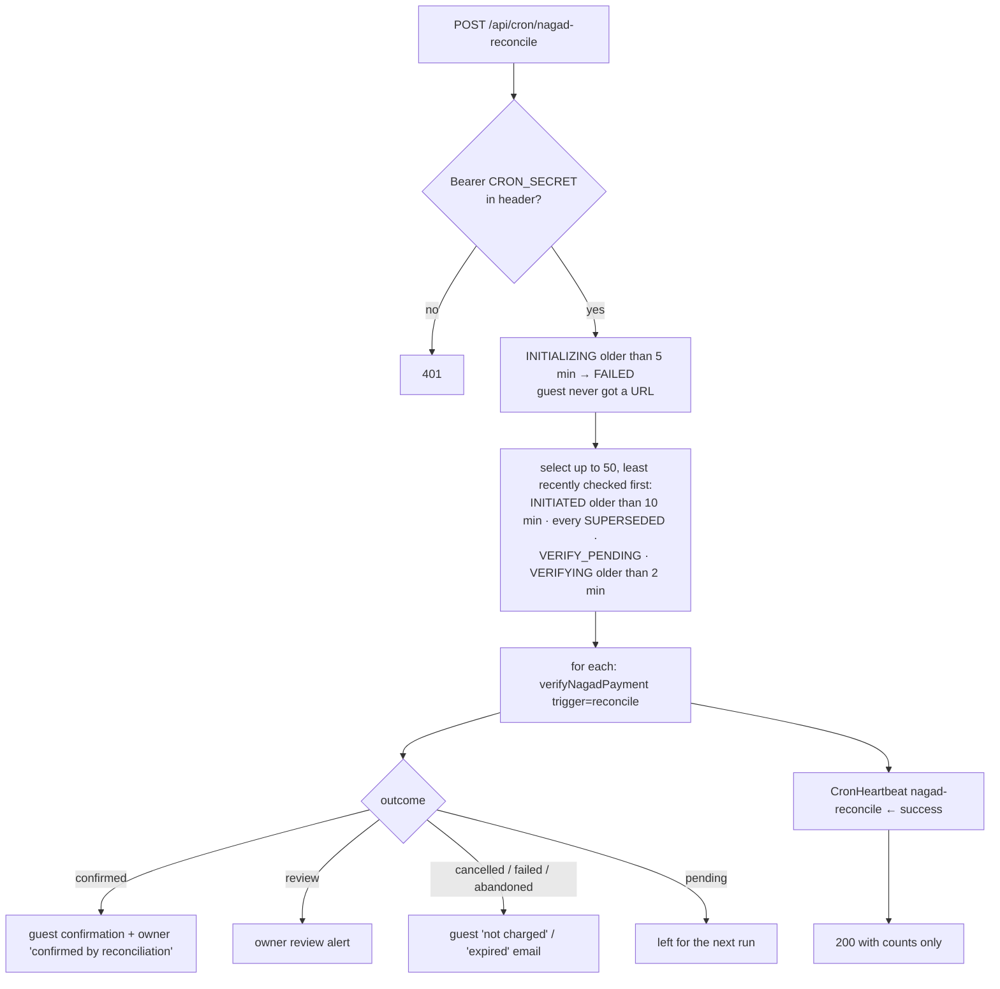

# Nagad Payments (Merchant API)

This is the reference for how Nagad payments work in this template, how they are secured, and how to operate them. It is written for developers maintaining the integration and for property owners and managers who handle Nagad payments and refunds.

Related: [security review](PAYMENTS-NAGAD-SECURITY-REVIEW.md) · [verification report](PAYMENTS-NAGAD-VERIFICATION.md) · [data retention](DATA-RETENTION.md) · [deployment](DEPLOYMENT.md)

---

## 1. Overview

The integration uses the **Nagad Merchant API** (`X-KM-Api-Version: v-0.2.0`) with **RSA** on both sides. It is a **redirect flow with two setup phases**:

1. **Initialize.** Our server sends Nagad an encrypted, signed request. Nagad answers with an encrypted, signed payment reference and a one-time challenge.
2. **Complete.** Our server sends the order amount with that challenge, again encrypted and signed. Nagad answers with the URL of its checkout page.
3. The guest's browser goes to Nagad's page, where the guest enters their wallet number, OTP and PIN. **This is where the money moves.** Nothing we call moves money.
4. Nagad redirects the browser back to our callback.
5. **Our server asks Nagad's Verify Payment API what happened.** Only that answer can confirm the booking.

Both setup phases run on our server in one request, so Nagad's challenge never reaches the browser.

**Guarantees:**

- **The redirect is never trusted.** Its `status` and `status_code` only choose which page the guest sees while we verify. They never change payment state.
- **Every Nagad response we act on is authenticated.** Signed responses (initialize, refund) must decrypt, carry a valid Nagad signature over the decrypted bytes, and match a schema. Nagad sends unsigned responses (complete, verify) over TLS, only to a pinned host; they must match a schema and every identifying field is cross-checked.
- **Every request fails closed.** A missing or malformed key, an unreachable Nagad, or an unverifiable answer always results in "not paid, not confirmed". It never results in "confirmed".
- **A booking is never fulfilled twice.** The database allows one open attempt and one confirmed Nagad payment per booking. Any second payment is recorded for an owner to refund, never applied.
- **Every state change is audited.** Rows go to an append-only log with a correlation ID (`NG-…`) the guest can read out to support.

Nagad publishes no open developer portal; its guide goes to onboarded merchants. The shapes below come from that guide as quoted publicly and from three public SDKs (see the [security review](PAYMENTS-NAGAD-SECURITY-REVIEW.md#external-references)). **None has been confirmed against Nagad's sandbox yet** (decision D10).

| Topic | Reality | Consequence here |
|---|---|---|
| Padding and signatures | RSA PKCS#1 v1.5 encryption (not OAEP), RSA-SHA256 signatures, base64 | `crypto.ts` implements exactly this |
| Initialize response signature | Covers the **decrypted** `sensitiveData` | The pre-hardening code checked it over the ciphertext and would reject every genuine response |
| Complete and verify responses | Plain JSON, **unsigned** | Authenticated by TLS to a pinned host, strict schemas and field cross-checks (D1) |
| Callback parameters | `merchant`, `order_id`, `payment_ref_id`, `status`, `status_code`, `message`, `payment_dt`, `issuer_payment_ref`; success is `status=Success&status_code=00_0000_000` | The pre-hardening callback treated every code other than `000` as failure, so it recorded real payments as FAILED |
| Errors | HTTP 200 with `{ reason, message }` or `devMessage` | The client checks for the error envelope before anything else |
| Order ID | Must be unique per order | One order ID per attempt: `{bookingCode without hyphen}{4 hex}` (D4) |
| Refunds | `POST /purchase/cancel?paymentRefId&orderId`, encrypted and signed both ways; **no refund-status API** | A refund with no clear answer is UNKNOWN and resolved by an owner (D7) |
| Server-to-server notifications | None | The generic webhook router refuses Nagad; the cron reconciles instead |
| Base URLs | Production `https://api.mynagad.com/api/dfs`; sandbox `http://sandbox.mynagad.com:10080/remote-payment-gateway-1.0/api/dfs` | Only allow-listed hosts are accepted |

---

## 2. Architecture

```
src/lib/payments/nagad/
  constants.ts          statuses, TTLs, limits (NAGAD_*)
  errors.ts             NagadError {code, userFacingMessage {en, bn}, httpStatus}; messages in src/content → nagadErrors
  http.ts               route/action boundary: error → { error, code, reference }; RSA failures → one SIGNATURE_INVALID
  log.ts                nagadLog (JSON lines, component "nagad", PEM-redacting) + NG-YYYY-MM-DD-xxxxxx correlation IDs
  mask.ts               phone → 01XXXXXX324, trxID → 7A****3D, reference → MTEy…Y2E=
  context.ts            per-request context: correlation ID, proxy-reported IP, user agent
  keys.ts               the only reader of the RSA env vars: \n-normalise, parse, ≥ 2048 bits, swap check, cache
  crypto.ts             PKCS#1 v1.5 + RSA-SHA256: seal requests, open signed responses, challenge hashing
  config.ts             every env var, no fallbacks; request-scoped readiness; base-URL allow-list
  token.ts              booking tokens (HS256, NAGAD_TOKEN_SECRET, 60 min)
  booking-token.ts      issue a booking token on booking ID + code
  transport.ts          the only HTTP to Nagad: JSON, 30 s timeout, no redirects
  client.ts             call → ok | rejected | unavailable | unknown; X-KM-* headers
  api.ts                initialize, complete, verify, purchase/cancel; opens signed answers
  schemas.ts            Zod for every input and every Nagad response
  payability.ts         "can this booking take a Nagad payment now?"
  settlement.ts         row locks, guarded transitions, per-attempt order IDs
  initialize-payment.ts claim → phase 1 → phase 2 → INITIATED
  callback.ts           the redirect handler's decisions
  verify-payment.ts     claim → Verify API → settle under the booking lock
  reconcile.ts          the 5-minute reconciliation job
  heartbeat.ts          stale-cron alert (2 hours without a successful run)
  refund.ts             refund ledger, purchase/cancel, owner resolution of UNKNOWN refunds
  connection-check.ts   what "test connection" can honestly prove (D9)
  status-guard.ts       guards the generic admin booking actions against editing Nagad state
  settings.ts           owner-editable limits (NagadSettings)
  rate-limiter.ts       Nagad limits on top of shared/rate-limit.ts
  audit.ts              PaymentAuditLog writes (provider NAGAD)
  notifications.ts      guest and owner emails, never throwing
  adapter.ts            generic-router registry entry: refuses everything
  __tests__/            fake Nagad (real RSA), harness, TEST-ONLY key fixtures

Routes
  POST /api/payments/nagad/token                  booking ID + code → booking token
  POST /api/payments/nagad/initialize             booking token + amount → Nagad checkout URL
  GET  /api/payments/nagad/callback               Nagad redirect → verify → 302
  POST|GET /api/cron/nagad-reconcile              reconciliation (Bearer CRON_SECRET)
  POST /api/admin/payments/nagad/test-connection  OWNER + 2FA
Server Actions (src/app/actions/nagad-actions.ts)
  refundNagadPaymentAction (OWNER + 2FA) · resolveNagadRefundAction (OWNER + 2FA)
  checkNagadPaymentStatusAction (MANAGER+) · updateNagadSettingsAction (OWNER + 2FA)
Pages
  /payment/nagad/result          processing, failure, cancelled, expired and review states for the guest
  /admin/bookings/[id]           Nagad controls: refund dialog, refund resolution, status check
  /admin/settings/payments       Nagad limits form, test connection
```

Removed: `/api/payments/nagad/create`, `/api/webhooks/payment/nagad`, `complete-initialization.ts`, and the `nagad.ts` / `nagad/index.ts` barrels.

Module boundaries:

- Routes and actions only parse input, rate-limit, call one domain function, and map errors.
- Domain modules never build HTTP responses.
- `transport.ts` is the only code that talks to Nagad.
- `keys.ts` is the only code that reads the RSA env vars; everything else receives parsed `KeyObject`s.

### Data model (additive)

| Model | Change | Purpose |
|---|---|---|
| `Payment` | `challengeHash`, `verifyingAt` (new); reuses `merchantInvoiceNumber` (order ID), `executedAt`, `failureReason`, `lastReconciledAt`, `refundedAmountPoisha` | Phase state, verify claims, reconciliation, refunds |
| `Payment` indexes (raw SQL) | `nagad_one_open_attempt_per_booking`, `nagad_one_confirmed_payment_per_booking`, `nagad_payment_ref_unique`, `nagad_transaction_id_unique` | One open attempt and one confirmed payment per booking; one row per reference; one payment per Nagad transaction |
| `NagadRefund` | New. A trigger blocks deletes; request fields are immutable; settled outcomes are final | Refund ledger, idempotency, owner resolution |
| `NagadSettings` | New singleton | Owner-editable cap, windows, hold and alert email |
| `PaymentAuditLog`, `PaymentRateLimitHit`, `CronHeartbeat` | Reused (provider `NAGAD`, key prefix `nagad:`, job `nagad-reconcile`) | Append-only audit; rate limits; cron health |

The migration marks pre-hardening `INITIATED` Nagad rows `SUPERSEDED` (`LEGACY_SESSION_RETIRED`). See §9 for what the owner should check after deploying.

### Payment states

```mermaid
stateDiagram-v2
    [*] --> INITIALIZING: initialize claims the row (before any Nagad call)
    INITIALIZING --> INITIATED: phase 1 + 2 succeeded; guest sent to Nagad
    INITIALIZING --> FAILED: a phase failed, or the process died (cron after 5 min)
    INITIATED --> VERIFYING: callback / cron / admin / new-attempt check claims verify
    SUPERSEDED --> VERIFYING: cron keeps asking (the guest can still pay it)
    VERIFY_PENDING --> VERIFYING: cron asks again
    INITIATED --> SUPERSEDED: a newer attempt after the open-window hold
    VERIFYING --> SUCCESS: Nagad Success/000 and every field matches
    VERIFYING --> REVIEW_REQUIRED: paid, but mismatch / booking not payable / already paid
    VERIFYING --> CANCELLED: Nagad says Aborted / Cancelled
    VERIFYING --> FAILED: Nagad says Failed
    VERIFYING --> ABANDONED: still unpaid after 2 hours
    VERIFYING --> VERIFY_PENDING: Nagad unreachable or answer unreadable
    VERIFYING --> INITIATED: Nagad says still open (or SUPERSEDED / VERIFY_PENDING, whichever it was)
    SUCCESS --> PARTIALLY_REFUNDED: refund
    PARTIALLY_REFUNDED --> REFUNDED: refund of the remainder
    SUCCESS --> REFUNDED: full refund
```



`VERIFY_PENDING` means Nagad may already have the guest's money and we don't know. It blocks new attempts for the booking, which is what prevents a second charge. `REVIEW_REQUIRED` means Nagad took the guest's money but we could not apply it; an OWNER must refund the guest or confirm the booking manually.

---

## 3. Configuration

### Environment variables

| Variable | Required | Example | Description |
|---|---|---|---|
| `NAGAD_MERCHANT_ID` | Yes | `683002007104225` | Digits only, from the Nagad merchant portal |
| `NAGAD_MERCHANT_PRIVATE_KEY` | Yes | PEM, or the bare base64 body Nagad issues | Ours. RSA ≥ 2048 bits; PKCS#8 or PKCS#1. Literal `\n` sequences are normalised. **Server-only; never committed** |
| `NAGAD_PG_PUBLIC_KEY` | Yes | PEM, bare body, or a certificate | Nagad's key **for the same environment as the base URL**. Must not be our own public key |
| `NAGAD_CALLBACK_URL` | Yes in production | `https://resort.example/api/payments/nagad/callback` | Must be https in production and end in `/api/payments/nagad/callback`. Must be whitelisted with Nagad. Never derived from the `Host` header in production |
| `NAGAD_TOKEN_SECRET` | Yes | `openssl rand -hex 32` | Signs guest booking tokens. At least 32 characters; distinct from every other secret. **New** |
| `NAGAD_IS_SANDBOX` | No | `true` | Selects the sandbox URL. **Unset means production** (the old default was the reverse) |
| `NAGAD_BASE_URL` | No | `http://sandbox.mynagad.com:10080/remote-payment-gateway-1.0/api/dfs` | Must be one of the allow-listed Nagad endpoints, or Nagad is disabled |
| `NAGAD_ALLOW_SANDBOX_IN_PRODUCTION` | No | `true` | Staging only: permits a sandbox URL while `NODE_ENV=production` |
| `NAGAD_SERVER_IPV4` | Recommended | `203.0.113.10` | The server's public IPv4, whitelisted with Nagad. Sent as `X-KM-IP-V4` when the guest's IP isn't IPv4 (IPv6 guests, cron) |
| `NAGAD_TIMEOUT_MS` | No | `30000` | Per-call timeout; values outside 5–60 s fall back to 30 s |
| `CRON_SECRET` | Yes | (secret) | Bearer secret for `/api/cron/nagad-reconcile` (shared with other crons) |
| `RESEND_API_KEY` | For email | (secret) | Without it, emails are logged as mock sends (subject only) |
| `TZ` | Recommended | `Asia/Dhaka` | Nagad timestamps don't depend on it (they're computed for Asia/Dhaka explicitly), but server logs and cron times read more naturally |

Nagad is offered to guests only when **both** of these hold:

- `payments.nagad.enabled` is true in `brand.config.ts`
- `getNagadReadiness()` reports nothing missing: merchant ID, both keys valid, token secret, callback URL, allow-listed base URL, and no sandbox URL in production

Readiness is recomputed per request. Keys are re-parsed only when their env values change, so fixing the environment and restarting takes effect immediately. The readiness message names the variable and the problem (e.g. `NAGAD_PG_PUBLIC_KEY (PG_KEY_IS_MERCHANT_KEY)`), never any part of the value. It appears only in server logs.

### Owner settings (`/admin/settings/payments`, OWNER + 2FA)

| Setting | Default | Notes |
|---|---|---|
| Maximum booking total | ৳500,000 | Bookings above it can't choose Nagad. Hard ceiling ৳500,000 |
| Payment window | 60 minutes | From booking creation; the booking token never outlives it |
| Open-window hold | 15 minutes | An unfinished Nagad window blocks a new one for this long, because Nagad may still accept payment on it (D5) |
| Refund window | 7 days | **Confirm it against your Nagad merchant agreement** |
| Alert email | none | Receives refund, review, reconciliation, signature-failure and stale-cron alerts |

### Scheduled job

```cron
*/5 * * * * curl -fsS -X POST -H "Authorization: Bearer $(grep ^CRON_SECRET= /var/www/resort-app/.env | cut -d= -f2-)" https://yourresort.com/api/cron/nagad-reconcile >> /var/log/resort-cron.log 2>&1
```

The secret must be in the header; `?secret=` is refused, because query strings end up in access logs.

---

## 4. Flow

### 4.1 Full sequence

```mermaid
sequenceDiagram
    autonumber
    participant G as Guest browser
    participant S as Our server
    participant DB as Postgres
    participant N as Nagad API

    G->>S: POST /api/payments/nagad/token { bookingId, bookingCode }
    S->>DB: booking payable? (PENDING, in window, under cap, not paid elsewhere)
    S-->>G: bookingToken (HS256, ≤ 60 min)
    G->>S: POST /api/payments/nagad/initialize { bookingToken, amount }
    S->>S: amount == booking total? open attempts? → ask Nagad first (D5)
    S->>DB: lock booking; INSERT Payment INITIALIZING (orderId per attempt; unique open attempt)
    S->>N: initialize/{merchantId}/{orderId}<br/>enc(PG pub){merchantId, datetime (Dhaka), orderId, challenge} + sign(ours)
    N-->>S: { sensitiveData, signature }
    S->>S: decrypt (ours) → verify Nagad's signature over the plaintext → schema → merchantId
    S->>DB: store paymentReferenceId + sha256(challenge)
    S->>S: challenge == stored hash? (timingSafeEqual)
    S->>N: complete/{ref}: enc{merchantId, orderId, amount, 050, challenge} + sign, merchantCallbackURL
    N-->>S: { status: Success, callBackUrl } → must be an https Nagad page
    S->>DB: INITIALIZING → INITIATED
    S-->>G: { redirectUrl }
    G->>N: pays on Nagad's page (PIN/OTP): MONEY MOVES HERE
    N-->>G: 302 → /api/payments/nagad/callback?payment_ref_id&status&status_code&order_id&merchant&…
    G->>S: GET callback
    S->>DB: known reference? order_id / merchant match? already settled → answer from record
    S->>DB: claim INITIATED → VERIFYING (guarded updateMany)
    S->>N: GET verify/payment/{ref} (30 s, one retry on network error)
    N-->>S: { merchantId, orderId, paymentRefId, amount, status, statusCode, issuerPaymentRefNo, … }
    S->>DB: lock booking; all fields match → SUCCESS + booking CONFIRMED (else REVIEW_REQUIRED)
    S-->>G: 302 → /booking/confirmation/{id} (or /payment/nagad/result)
    Note over S,N: Every 5 min the cron repeats the verify step for open, superseded and pending payments
```

### 4.2 Decision tree: the callback arrives, what happens next?



### 4.3 Reconciliation job (every 5 minutes)



A row that throws is logged and retried next run; it never stops the batch. The same guarded claim as the callback means the cron and a late callback can't both fulfil.

---

## 5. Security controls

**RSA key handling.**

- `NAGAD_MERCHANT_PRIVATE_KEY` and `NAGAD_PG_PUBLIC_KEY` are read from `process.env` in `keys.ts` only. A test walks the whole source tree to enforce this.
- Keys are refused, and Nagad disabled, when:
  - missing;
  - not a well-formed PEM or base64 body (header and footer must match; a private key in the public slot, or the reverse, is refused);
  - not RSA;
  - under 2048 bits;
  - an expired certificate;
  - Nagad's slot holds our own public key (the most common paste mistake).
- Literal `\n` in env values is normalised. PKCS#8, PKCS#1 and bare bodies all load.
- Parsed keys are cached as `KeyObject`s per env value, never as strings. Errors name the variable and problem only; the parser's own message is discarded because it can quote input bytes.
- `nagadLog` redacts anything PEM-shaped from every line as a last line of defence.

**Cryptographic correctness.**

- PKCS#1 v1.5 encryption and RSA-SHA256 (PKCS#1 v1.5) signatures, as Nagad requires. OAEP would be rejected by Nagad.
- A request payload is serialised once; the same bytes are encrypted and signed. Payloads over one RSA block (245 bytes) are refused, never truncated.
- A signed response is opened in order: decrypt, verify Nagad's signature over the exact decrypted bytes, parse JSON, then check the schema. Nothing is interpreted before the signature passes.
- Ciphertext and signatures must be canonical base64 of exactly one RSA block.
- **Decryption oracle:** we only decrypt responses we fetched from Nagad over TLS, and Node uses implicit rejection. All failures (bad base64, undecryptable, bad signature, not JSON, wrong shape, wrong merchant) surface as one `SIGNATURE_INVALID`. The internal reason and a body hash go to the `NAGAD_SIGNATURE_INVALID` log line, never the signature. Each failure counts against the guest IP that triggered the call; after 5 in an hour that IP can't start new sessions.
- Challenges are 160 random bits (`randomBytes`). Nagad's challenge is stored only as a domain-separated sha256 and compared with `timingSafeEqual`. Booking tokens are compared with `timingSafeEqual` in `shared/hs256.ts`. No `Math.random` anywhere (a test enforces it).

**Authentication.**

- **Guests** need a 60-minute HS256 booking token signed with `NAGAD_TOKEN_SECRET`, issued only on the booking UUID plus its booking code. Initialize accepts only `{ bookingToken, amount }`: no booking ID, order ID or phone number.
- **Admin actions** call `requireRole` and `requireMfa` outside `try`, so a denial is a real 403 and is audited. OWNER is required for refunds, refund resolution, settings and test connection; MANAGER for status checks.
- **The callback** has no session and no Nagad signature. It proves nothing by itself, which is why it can only trigger a verify.

**Never trust the redirect.**

- `status` and `status_code` never change state. The callback accepts only a strict parameter set, rejects repeated keys, and requires `order_id` and `merchant`, when present, to be this attempt's.
- Fulfilment requires Nagad's Verify API to report `status: Success` **and** `statusCode: 000`, with:
  - our merchant ID, the row's payment reference and its order ID;
  - an amount equal to both the attempt's snapshot and the current booking total;
  - an issuer transaction ID not used by any other payment;
  - a booking still `PENDING` with no other confirmed payment.
- Replays of settled payments are answered from our record without calling Nagad.
- Every redirect is a 302 with `Cache-Control: no-store, no-cache, must-revalidate`. Redirects use the configured origin, never the `Host` header.

**Unsigned responses (D1).** Complete and verify responses are unsigned plain JSON. They are trusted only because:

- they come from an allow-listed host (production: `https://api.mynagad.com` only);
- redirects are never followed;
- they match strict schemas;
- every identifying field is cross-checked (above).

The complete response's `callBackUrl` must be an https page on `mynagad.com`, so a tampered response can't send the guest to a phishing site. The residual trust in TLS and Nagad's DNS is accepted and documented.

**Idempotency and races.**

- Partial unique indexes allow:
  - one open attempt and one confirmed payment per booking;
  - one row per reference;
  - one payment per Nagad transaction;
  - one in-flight refund per payment.
- Verify claims are guarded `updateMany`s, so a double callback, or a callback racing the cron or an admin check, verifies and fulfils once.
- Every settlement holds the booking row lock.
- The generic admin actions refuse to:
  - hand-edit Nagad payment status;
  - record a Nagad refund as a note;
  - change a total while a Nagad window is open;
  - change booking status while Nagad is being asked.

**Rate limiting.** Limits are stored in Postgres with a per-key advisory lock, so they hold across PM2 workers and restarts. They are keyed on `X-Real-IP` from our proxy. The per-booking limit counts only after the token is verified.

| Endpoint | Limit |
|---|---|
| `POST /api/payments/nagad/initialize` | 5 per booking per hour; 20 per IP per hour |
| `POST /api/payments/nagad/token` | 30 per IP per hour |
| `GET /api/payments/nagad/callback` | 60 per IP per minute |
| Refund action | 10 per admin per day |
| Test connection | 10 per admin per hour |
| Other Nagad admin actions | 100 per user per hour |
| Bad Nagad signatures triggered from one guest IP | 5 per hour, then that IP can't start sessions |

**Environment separation.** Production is the default. A sandbox URL in production disables Nagad unless `NAGAD_ALLOW_SANDBOX_IN_PRODUCTION=true`. A sandbox key used against production (or the reverse) fails signature checks and is treated as `SIGNATURE_INVALID`, never accepted.

---

## 6. Compliance

- **Regulated provider.** Nagad is a Bangladesh Bank–licensed mobile financial service. The guest pays Nagad, and Nagad settles to the merchant.
- **No PIN or OTP handling.** The guest's wallet number, OTP and PIN are entered on Nagad's page. This site never sees, handles or stores them.
- **What we store** about the payer: nothing from Nagad. The guest's phone (already on the booking) is not sent to Nagad. Nagad's `clientMobileNo` (partly masked by Nagad) and `merchantMobileNo` are never stored or logged. The stored payment summary is a masked whitelist: masked trxID, amount, order ID, status.
- **Admin 2FA.** OWNER accounts must have 2FA enabled to reach refunds, refund resolution and settings.
- **Audit.** Every payment event is kept in an append-only log for at least 2 years (below).

---

## 7. Data retention

| Data | Kept | Notes |
|---|---|---|
| `Payment` rows (Nagad) | 7 years | Accounting. Never deleted by the application |
| `NagadRefund` rows | 7 years | A database trigger blocks deletion outright |
| `PaymentAuditLog` (provider NAGAD) | At least 2 years | Append-only; the trigger blocks UPDATE, TRUNCATE and DELETE of rows under 2 years old |
| `PaymentRateLimitHit` (`nagad:` keys) | 24 hours | Pruned by `/api/cron/nagad-reconcile` (and by the bKash job, which prunes all gateways' counters) |
| `CronHeartbeat` (`nagad-reconcile`) | Current state only | One row, updated in place |
| Structured logs | Per server log rotation | Masked values only; PEM-shaped text is redacted |

Details in [DATA-RETENTION.md](DATA-RETENTION.md).

---

## 8. Failure modes

| Situation | System behaviour | What the guest sees |
|---|---|---|
| Nagad down at initialize or complete | Not retried (a repeat can trip Nagad's duplicate-order check). The attempt is FAILED; no window opened | "Nagad is temporarily unavailable. Please try again in a few minutes." Booking stays PENDING and bookable |
| Guest pays, then closes the browser | Callback never arrives. The cron verifies INITIATED attempts older than 10 minutes and confirms | Confirmation email when the cron runs |
| Verify times out or Nagad errors | One retry on a network error or 5xx (not on 4xx). Then VERIFY_PENDING, which blocks new attempts; the cron retries every 5 minutes | "We're confirming your payment… please don't pay again", with a check-again link |
| Verify answers with something unrecognised | Treated as "still open", never as failure (wrongly failing a paid payment is how the old code lost money) | "Confirming your payment…" |
| Guest never pays | Reopened on each check; ABANDONED after 2 hours; booking stays PENDING (D12) | Expiry email: "You were not charged" |
| Guest pays an older, replaced window | The cron watches superseded windows and applies the payment if the booking is still payable; otherwise REVIEW_REQUIRED for a refund | Confirmation, or "payment received, confirmation pending" |
| Booking cancelled or total edited while the guest pays | Nagad has already taken the money, so it's recorded as REVIEW_REQUIRED; the booking is not revived or confirmed. The admin actions refuse a total edit while a window is open | "Payment received… our team will contact you" |
| Invalid signature on initialize | Refused; the attempt FAILED; owner alerted (at most 1/hour); counts against the guest IP | "We couldn't verify the payment securely. Please contact us." |
| Refund answer lost or unverifiable | UNKNOWN; not retried; blocks further refunds; owner resolves it after checking the Nagad portal | Owner: "Nagad didn't confirm this refund…" |
| Process dies between phases | The INITIALIZING row is closed by the cron after 5 minutes (the guest never got a URL) | Guest retries |
| Database unreachable | 503 with Retry-After 30; the callback redirects to the result page with a check-again link | "Our payment service is temporarily unavailable" |
| Reconciliation cron stops | Admin visits to the payment settings page or a Nagad booking raise a CRON_STALE_ALERT and an owner email, once per 6 hours | Nothing until the cron resumes |

### Key rotation (§11.4)

Nagad works with one key pair per merchant, so **zero-downtime rotation isn't possible**. Schedule it for a low-traffic window:

1. Generate the new merchant key pair (RSA ≥ 2048) and register its public half with Nagad. Obtain Nagad's current PG public key for the same environment.
2. Wait until no Nagad payment is `INITIATED`, `VERIFYING` or `VERIFY_PENDING`, or accept that the cron will verify them after the switch. Verify is unsigned, so it keeps working across the rotation.
3. Update `NAGAD_MERCHANT_PRIVATE_KEY` (and `NAGAD_PG_PUBLIC_KEY` if Nagad changed theirs), then restart the app.
4. Run **Test connection** (it checks both keys and reachability), then make one small real payment.

Raw RSA keys carry no expiry dates. If Nagad supplies its key as a certificate, `keys.ts` logs `pg_certificate_expiring` 30 days before it expires and refuses it once expired.

### Timezone

Timestamps sent to Nagad (`datetime`, the refund's `originalRequestDate`) are Asia/Dhaka wall-clock time in `yyyyMMddHHmmss` (`time.ts`). They are computed with `Intl` and `hourCycle: "h23"`, so they are correct at Dhaka midnight, across the new year, and whatever the server's `TZ`. Tests cover all three.

---

## 9. Admin operations

**Refunds** (booking page → Nagad payment → "Refund via Nagad", OWNER + 2FA):

1. Choose **Full** or **Partial**; the refundable remainder is shown.
2. Give a reason of 10 to 500 characters. The full reason is audited and emailed to the alert address. Nagad receives a short ASCII summary, because the encrypted request must fit one RSA block.
3. Retype the exact amount (paste is blocked).
4. For a second refund on a partly refunded payment, tick "additional refund".

Results:

- **Completed:** the payment becomes PARTIALLY_REFUNDED or REFUNDED.
- **Declined by Nagad:** nothing changes.
- **Unconfirmed** (timeout, or an answer we can't verify): the refund is UNKNOWN. **Don't refund again.** Check the Nagad merchant portal, then use the form under the payment: "Nagad refunded it" (enter Nagad's refund reference) or "Nagad did not refund it" (with a note). Both are audited. Further refunds are blocked until it is resolved.

**Cancelling a Nagad-paid booking.** Cancel it without recording a refund, then issue the refund with "Refund via Nagad". The cancel dialog refuses to record a Nagad refund as a note.

**Check status with Nagad** (MANAGER or OWNER). Available for an open, superseded, pending or verifying payment. It runs the same verification as the cron, straight away.

**REVIEW_REQUIRED.** Nagad took the guest's money but it couldn't be applied; the reason is shown (e.g. `AMOUNT_MISMATCH`, `ALREADY_PAID`, `BOOKING_NOT_PENDING`). Check the transaction in the Nagad merchant portal. Then either confirm the booking with the normal booking status control (the payment row stays REVIEW_REQUIRED as the record), or refund the guest **from the Nagad merchant portal**. The in-app refund dialog accepts only SUCCESS and PARTIALLY_REFUNDED payments.

**After deploying this version, check the legacy rows.** The old callback recorded successful payments as FAILED, and its INITIATED rows are now SUPERSEDED (`LEGACY_SESSION_RETIRED`). Compare every Nagad row created before the deploy with the Nagad merchant portal, and refund or confirm by hand where the guest was charged.

**Test connection** (`/admin/settings/payments`, OWNER + 2FA, 10 per hour). It checks:

- our key pair signs, verifies and decrypts;
- Nagad's key is usable;
- Nagad is reachable, by asking it to verify a random, non-existent reference (no session is opened).

It returns only `success`, `environment` and `keySizeBits`. It can't prove Nagad accepts our signature; only a real initialize can.

**Reconciliation log.** Every check is an audit row: `VERIFY_CALLED` (source `reconcile`), `RECONCILIATION_CHECKED`, `PAYMENT_ABANDONED`, and `FULFILLMENT_COMPLETED` with `source: "reconcile"`. The cron response and log line give counts: `checked`, `settled`, `confirmed`, `abandoned`, `stillPending`, `closedInitializing`.

### Role × action matrix

| Action | STAFF | MANAGER | OWNER |
|---|---|---|---|
| View Nagad payments on a booking | ✅ | ✅ | ✅ |
| Check status with Nagad | ❌ | ✅ | ✅ |
| Refund via Nagad | ❌ (403, audited) | ❌ (403, audited) | ✅ with 2FA |
| Resolve an unconfirmed refund | ❌ | ❌ (403, audited) | ✅ with 2FA |
| Edit Nagad limits and alert email | ❌ | ❌ | ✅ with 2FA |
| Test Nagad connection | ❌ | ❌ (403, audited) | ✅ with 2FA |
| Hand-edit a Nagad payment status | ❌ | ❌ (refused, audited) | ❌ (refused, audited) |
| Record a Nagad refund as a cancellation note | ❌ | ❌ (refused, audited) | ❌ (refused, audited) |
| Change a booking total while a Nagad window is open | ❌ | ❌ (refused, audited) | ❌ (refused, audited) |
| Change booking status while Nagad is being asked | ❌ | ❌ (refused) | ❌ (refused) |

---

## 10. Testing

**Automated.**

- `pnpm test` runs the unit tests; the DB-backed tests are marked skipped.
- `DATABASE_URL_TEST=postgresql://…/resort_banglaqr_test pnpm test:nagad:db` runs every Nagad test (255, in 15 files) against a `*_test` database.
- Tests talk to an in-memory Nagad (`__tests__/fake-nagad.ts`) that does **real RSA** with committed TEST-ONLY keys (`__tests__/keys/`). It decrypts and signature-checks our requests, signs its answers over the plaintext, and returns errors with HTTP 200 as Nagad does.
- Fault injection covers timeouts, network errors, 5xx and 4xx, error envelopes, lost answers, garbled bodies, and bad signatures (wrong key, or signed over the ciphertext).

**Sandbox test matrix** (needs merchant sandbox credentials plus a whitelisted server IP and callback URL, kept in the local `.env` only; **not yet run**, see D10):

| Scenario | How | Expected |
|---|---|---|
| Successful payment | Pay with a Nagad sandbox wallet | Booking CONFIRMED; confirmation email; `issuerPaymentRefNo` recorded |
| Signature scheme | The first initialize | Succeeds. If it fails with `SIGNATURE_INVALID`, Nagad signs differently from its guide; capture the log line |
| Cancel on Nagad's page | Press Cancel | `status=Aborted`; verify says Aborted/Cancelled; CANCELLED; result page "cancelled" |
| Close the tab after paying | Pay, then close the browser | The cron confirms within 10–15 minutes; owner "confirmed by reconciliation" email |
| Double callback | Reload the callback URL | One verify; confirmation shown |
| Reopen after an abandoned window | Start, close the window, start again | 409 for 15 minutes (or immediately allowed if Nagad reports Aborted) |
| Partial then full refund | Refund dialog twice (tick additional) | PARTIALLY_REFUNDED, then REFUNDED; both visible in the Nagad portal |
| Wrong keys | Put our own public key in `NAGAD_PG_PUBLIC_KEY` | Nagad not offered; Test connection reports not configured |

---

## 11. Monitoring

| Watch | Where | Why |
|---|---|---|
| `REVIEW_REQUIRED` payments | Audit `FULFILLMENT_REJECTED` (severity HIGH); owner email | Money received but not applied: act the same day |
| `VERIFY_PENDING` older than 30 minutes | `Payment` where status = VERIFY_PENDING | Nagad unreachable from the server, or the cron not running |
| Cron health | `CronHeartbeat` name `nagad-reconcile`; `CRON_STALE_ALERT` | If it stops, closed-browser payments stay unconfirmed |
| `NAGAD_SIGNATURE_INVALID` log lines / `SIGNATURE_INVALID` audit | Logs, audit; owner email (at most 1/hour) | Wrong PG key for the environment, key rotation, or tampering |
| `NAGAD_AMOUNT_MISMATCH` / `AMOUNT_MISMATCH` | Logs, audit | Total edited mid-payment, or tampering |
| `CALLBACK_REJECTED` volume by IP | Audit | Forged or replayed callbacks |
| `RATE_LIMIT_HIT` | Audit | Abuse, or limits too tight |
| UNKNOWN refunds | `NagadRefund` where status = UNKNOWN; owner email | Need an owner to resolve |
| `nagad.api.call` with outcome ≠ ok | Logs (operation, outcome, nagadCode, durationMs) | Nagad availability and error codes |
| `pg_certificate_expiring` | Logs | Only when Nagad's key is a certificate |

### Audit events

All are written to `PaymentAuditLog` with `provider = 'NAGAD'` and a correlation ID.

- Transaction IDs are masked `7A****3D` and payment references `MTEy…Y2E=`.
- Challenges appear only as `challengeHash`.
- Signatures, `sensitiveData`, PEM material and phone numbers never appear.

| Event | Key fields |
|---|---|
| `BOOKING_TOKEN_ISSUED` | tokenId, expiresAt |
| `INITIALIZE_CALLED` / `INITIALIZE_FAILED` | merchantOrderId, amountPoisha, datetime / outcome, nagadCode, reason |
| `COMPLETE_CALLED` / `COMPLETE_FAILED` | paymentRef, challengeHash / outcome, nagadCode |
| `PAYMENT_INITIATED` / `PAYMENT_SUPERSEDED` | merchantOrderId, amountPoisha, paymentRef |
| `CALLBACK_RECEIVED` / `CALLBACK_REJECTED` | paymentRef, status, statusCode, sourceIp, userAgent, paymentStatus / reason |
| `VERIFY_CALLED` / `VERIFY_SUCCEEDED` / `VERIFY_FAILED` / `VERIFY_PENDING` | source (callback, reconcile, initialize, admin), previousStatus / trxId, amountPoisha / nagadStatus, statusCode / outcome, reason |
| `SIGNATURE_INVALID` | endpoint, reason |
| `AMOUNT_MISMATCH` | paymentRef, expectedPoisha, actualPoisha, bookingTotalPoisha |
| `FULFILLMENT_COMPLETED` / `FULFILLMENT_REJECTED` | previousStatus, newStatus, source / severity HIGH, reason, expected vs actual amount and order |
| `PAYMENT_ABANDONED`, `RECONCILIATION_CHECKED`, `CRON_STALE_ALERT` | source, nagadStatus, ageMinutes / job, hoursSinceSuccess |
| `REFUND_INITIATED` / `REFUND_SUCCEEDED` / `REFUND_FAILED` / `REFUND_OUTCOME_UNKNOWN` / `REFUND_RESOLVED` | adminUserId, amount, reason, paymentRef, trxId / refundTrxId / nagadCode / outcome / outcome, note |
| `GENERIC_WEBHOOK_REFUSED` | route |
| `ADMIN_ACTION_DENIED`, `ADMIN_STATUS_CHANGE_BLOCKED`, `ADMIN_SETTINGS_UPDATED`, `ADMIN_CONNECTION_TESTED` | action, requiredRole / before and after / success, problem, environment, keySizeBits |
| `RATE_LIMIT_HIT` | endpoint, key, limit, retryAfterSeconds, IP, user agent |

### Error codes

The guest sees the English and Bangla message plus `Reference: NG-…`. The full list is in `src/content/en.ts` / `bn.ts` → `nagadErrors`.

| Code | HTTP | Guest message (EN) | Guest message (BN) |
|---|---|---|---|
| `AMOUNT_MISMATCH` | 400 | The amount doesn't match your booking. Please try again. | টাকার পরিমাণ আপনার বুকিংয়ের সাথে মিলছে না। আবার চেষ্টা করুন। |
| `SESSION_EXPIRED` | 401 | Your payment session expired. Please start a new booking. | আপনার পেমেন্ট সেশন শেষ। নতুন করে চেষ্টা করুন। |
| `PAYMENT_ALREADY_PROCESSED` | 409 | This payment was already processed. | এই পেমেন্ট আগেই প্রক্রিয়া করা হয়েছে। |
| `NAGAD_UNAVAILABLE` | 503 | Nagad is temporarily unavailable. Please try again in a few minutes. | নগদ সাময়িকভাবে অনুপলব্ধ। কয়েক মিনিট পর আবার চেষ্টা করুন। |
| `BOOKING_CANCELLED` | 409 | This booking has been cancelled. | এই বুকিং বাতিল হয়েছে। |
| `SIGNATURE_INVALID` | 502 | We couldn't verify the payment securely. Please contact us. | আমরা পেমেন্টটি নিরাপদে যাচাই করতে পারিনি। অনুগ্রহ করে যোগাযোগ করুন। |
| `INVALID_PAYMENT_METHOD` | 503 | This payment method is not available. | এই পেমেন্ট পদ্ধতি উপলব্ধ নয়। |
| `BOOKING_EXPIRED` | 410 | The payment window for this booking has closed. Please create a new booking. | এই বুকিংয়ের পেমেন্টের সময় শেষ। নতুন বুকিং করুন। |
| `PAYMENT_IN_PROGRESS` | 409 | A Nagad payment for this booking is already open… | এই বুকিংয়ের একটি নগদ পেমেন্ট খোলা আছে… |
| `PAYMENT_FAILED` / `PAYMENT_CANCELLED` / `PAYMENT_EXPIRED` | 402 / 402 / 410 | …You were not charged… | …কোনো টাকা কাটা হয়নি… |
| `INVALID_CALLBACK` | 400 | This payment link isn't valid. If you were charged, please contact us with the reference below. | এই পেমেন্ট লিংকটি বৈধ নয়… |
| `AMOUNT_ABOVE_LIMIT` | 400 | This booking is above the limit for Nagad payments. | এই বুকিং নগদ পেমেন্টের সীমার বেশি… |
| `RATE_LIMITED` | 429 | Too many attempts. Please try again later. | অনেকবার চেষ্টা করা হয়েছে। পরে আবার চেষ্টা করুন। |
| `SERVICE_UNAVAILABLE` | 503 | Our payment service is temporarily unavailable. | আমাদের পেমেন্ট সেবা সাময়িকভাবে বন্ধ… |
| `REFUND_*`, `REASON_REQUIRED` | 400/409/502 | Admin-facing refund messages | — |

---

## 12. Troubleshooting

| Symptom | Likely cause | Fix |
|---|---|---|
| Nagad missing at checkout | Disabled in brand config, or readiness reports a problem | Run Test Connection. The server log line for that request (`request_rejected`, same reference) names the variable and problem |
| Readiness says `MALFORMED_PEM` | Literal `\n` mangled by the host, a truncated paste, or an encrypted (`BEGIN ENCRYPTED PRIVATE KEY`) key | Paste the single-line value with `\n` escapes, or the bare base64 body; decrypt the key first |
| `TOO_SMALL` / `NOT_RSA` | Wrong key file | Nagad requires RSA ≥ 2048 |
| `PG_KEY_IS_MERCHANT_KEY` | Our own public key pasted as Nagad's | Use the PG public key Nagad issued for this environment |
| Every initialize fails with `SIGNATURE_INVALID` | Sandbox PG key with the production URL (or the reverse); Nagad rotated its key; or Nagad signs differently from its guide | Check the environment pairing; get Nagad's current key; capture the `NAGAD_SIGNATURE_INVALID` log line (reason, body hash) for Nagad support |
| "RSA padding" or "data too large" errors | A payload over one RSA block, or a key under 2048 bits | Refused by design; check the key size |
| Every initialize is rejected (`nagad.api.call` outcome rejected) | Server IP or callback URL not whitelisted, or a wrong merchant ID | Ask Nagad to whitelist `NAGAD_SERVER_IPV4` and `NAGAD_CALLBACK_URL` |
| Nagad rejects `datetime` | Clock skew | Keep the server clock NTP-synced. The format is Dhaka time and is independent of `TZ` |
| Callback returns 400 `INVALID_CALLBACK` | The callback reached a different deployment than the one that created the attempt, or the URL was edited | The callback must reach the server that holds the payment row |
| Payments stuck in VERIFY_PENDING | Nagad unreachable from the server, or the cron not running | Check the cron log and `CronHeartbeat`; press "Check status with Nagad" |
| Guest gets 409 "payment already open" | An unfinished Nagad window younger than the hold (15 min) | Wait, or finish/cancel in the Nagad window (an Aborted window frees the booking at once) |
| Refund UNKNOWN | Timeout, or an answer we couldn't verify | Check the Nagad portal, then resolve it on the booking page |

---

## 13. Changelog

| Date | Change |
|---|---|
| 2026-09-30 | Section 0: security review. 34 gaps (5 critical), including real success callbacks recorded as FAILED, an unauthenticated generic webhook, and the initialize signature checked over the wrong bytes |
| 2026-09-30 | §1 Key loading and validation (≥ 2048 bits, PEM formats, swap check, certificate expiry), signature verified over decrypted plaintext, one generic crypto error, fail-closed config, production by default, base-URL allow-list, honest test connection (D9), generic webhook refused |
| 2026-09-30 | §2 Strict schemas for every input; the callback schema follows real Nagad callbacks (D3); every Nagad response validated |
| 2026-09-30 | §3 Booking tokens; server-side two-phase initialize with challenge hashing (D2); per-attempt order IDs (D4); open attempts verified before replacement (D5); verify-only fulfilment with full field checks (D6); refund ledger with owner resolution (D7); `/create` and the Nagad webhook route removed |
| 2026-09-30 | §4 Callback: strict parameters, idempotent replays, per-IP limit, configured-origin redirects |
| 2026-09-30 | §5 Idempotency; the live-payment index split into one-open-attempt and one-confirmed-payment indexes, so a second captured payment can be recorded for review |
| 2026-09-30 | §6 Amount, order, merchant, reference and trxID checks; NAGAD_AMOUNT_MISMATCH logging; the phone is never sent to Nagad |
| 2026-09-30 | §7 Reconciliation cron, heartbeat and stale-cron alert |
| 2026-09-30 | §8 Full audit event set in the append-only PaymentAuditLog |
| 2026-09-30 | §9 Postgres-backed rate limits, including the per-IP signature-failure pause |
| 2026-09-30 | §10 Bilingual error messages, correlation IDs, fail-closed paths |
| 2026-09-30 | §11 Verify retry and parking, key-rotation procedure, certificate expiry warning, Dhaka timestamps |
| 2026-09-30 | §12 Guest and owner email notifications |
| 2026-09-30 | §13–14 Test suite gap fill, naming and typing conventions; owner settings form (D8) |
