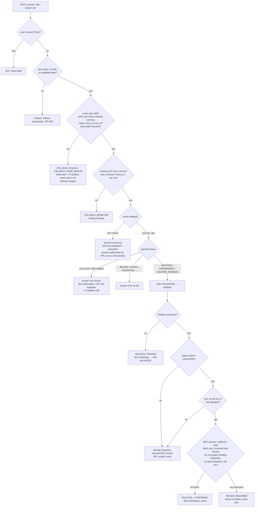
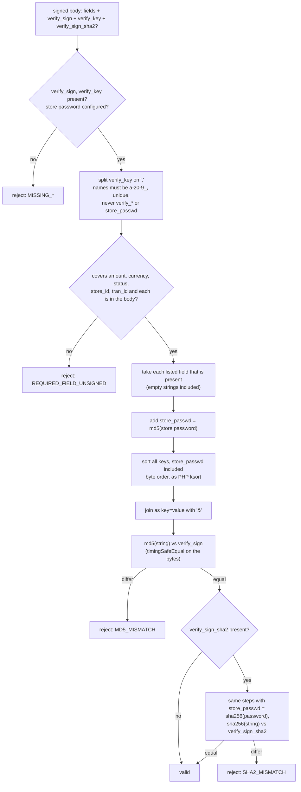
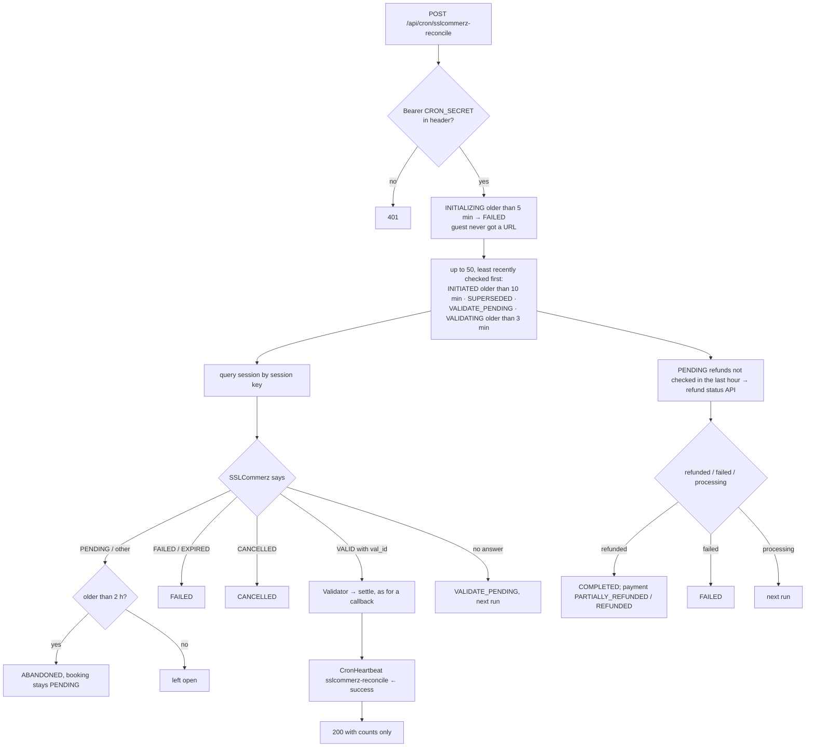

# SSLCommerz Payments (Hosted Checkout)

This is the reference for how SSLCommerz payments work in this template, how they are secured, and how to operate them. It is written for developers maintaining the integration and for property owners and managers who handle SSLCommerz payments and refunds.

Related: [security review](PAYMENTS-SSLCOMMERZ-SECURITY-REVIEW.md) · [verification report](PAYMENTS-SSLCOMMERZ-VERIFICATION.md) · [data retention](DATA-RETENTION.md) · [deployment](DEPLOYMENT.md)

---

## 1. Overview

SSLCommerz is an **aggregator with a hosted checkout**. One session lets the guest pay by card (Visa, Mastercard, Amex and local cards), by internet banking, or with a mobile wallet (bKash, Nagad, Upay and others), all on SSLCommerz's own pages. We never see card numbers, wallet PINs or OTPs.

1. **Session.** Our server opens a checkout session for the booking. SSLCommerz returns a session key and the URL of its checkout page.
2. The guest's browser goes to that page and picks a method. **This is where the money moves.** Nothing we call moves money.
3. SSLCommerz **form-POSTs a signed result through the guest's browser** to our success, fail or cancel URL. Separately, it POSTs the same signed result **server-to-server to our IPN URL**.
4. **Our server asks SSLCommerz's Validator API** about the payment's `val_id`. Only that answer can confirm the booking.
5. If neither the redirect nor the IPN arrives, the **reconciliation cron** asks SSLCommerz about the session every 5 minutes.

**Guarantees:**

- **The success redirect is never trusted.** Fulfilment needs the Validator's `VALID`/`VALIDATED`, for this attempt's `tran_id` and `val_id`, in BDT, for the exact amount.
- **No callback is trusted without its hash.** `verify_sign` must match (MD5, as SSLCommerz specifies), and `verify_sign_sha2` too when present, before anything is looked up.
- **The IPN and the success redirect are one event.** Whichever arrives first validates; the other finds the payment settled. A booking is fulfilled once, in any order, however many times either arrives.
- **Every request fails closed.** Missing credentials, an unreachable SSLCommerz or an unreadable answer always mean "not confirmed". They never mean "confirmed".
- **Every state change is audited**, append-only, with a correlation ID (`SC-…`) the guest can read out to support.

Every shape below was **confirmed against the public sandbox** on 2026-09-30 (raw evidence in the [security review](PAYMENTS-SSLCOMMERZ-SECURITY-REVIEW.md#08-live-sandbox-probe)), except IPN delivery, which the sandbox can't make to a local server.

| Topic | Reality | Consequence here |
|---|---|---|
| Callbacks | All four (success, fail, cancel, IPN) are `POST application/x-www-form-urlencoded`, signed with `verify_sign` + `verify_key` | One gate for all four: form body only, hash first |
| Hash | `md5` of `key=value&…` over the `verify_key` fields (empty values included) **plus** `store_passwd=md5(password)`, all keys sorted | The pre-hardening code appended the password after sorting and rejected every genuine IPN |
| `verify_sign_sha2` | Undocumented; the same string with SHA-256 and `sha256(password)` | Checked when present (D1); MD5 stays required |
| Validator | Accepts POST; `VALID` on the first call, `VALIDATED` after; `INVALID_TRANSACTION` for an unknown `val_id`; wrong credentials → `APIConnect: FAILED`, all HTTP 200 | POST keeps the password out of URLs; credentials are judged by `APIConnect` |
| Risk | A successful payment can come back `status=VALID, risk_level=1, risk_title="Not Safe"` | Held for owner review by default (D5) |
| `tran_id` | The sandbox accepts a reused `tran_id`, even after it was paid | A new `tran_id` per attempt (D3) |
| Transaction query / refund API | GET only (a POST gets HTTP 500 and a SOAP fault) | The password must be in the query string for these two (D2); it never leaves the server |
| Refunds | `"success"` means **initiated**; a second refund is refused while one is in progress | A refund ledger; the cron follows each refund to completion (D7) |
| Amount limits | Documented ৳10 to ৳500,000; the sandbox enforces neither | Enforced here |

---

## 2. Architecture

```
src/lib/payments/sslcommerz/
  constants.ts          statuses, TTLs, limits (SSLCOMMERZ_*)
  errors.ts             SSLCommerzError {code, userFacingMessage {en, bn}, httpStatus}; messages in src/content → sslcommerzErrors
  http.ts               route/action boundary: error → { error, code, reference }
  log.ts                sslcommerzLog (JSON lines, component "sslcommerz"; scrubs store_passwd pairs and the configured password) + SC- IDs
  mask.ts               val_id / tran_id / bank_tran_id → 2609…n3mR; store ID → test****01; session key → 16-hex hash
  context.ts            per-request context: correlation ID, proxy-reported IP, user agent
  config.ts             every env var, no fallbacks; request-scoped readiness; host allow-list; production by default
  token.ts              booking tokens (HS256, SSLCOMMERZ_TOKEN_SECRET, 60 min)
  booking-token.ts      issue a booking token on booking ID + code
  transport.ts          the only HTTP to SSLCommerz: form params, 30 s timeout, no redirects, URL never in an error
  client.ts             call → ok | rejected | unavailable | unknown; the only place the password enters a request
  api.ts                session, Validator, session query, refund, refund status, credential probe
  schemas.ts            Zod for every input, callback and SSLCommerz response
  hash.ts               verify_sign / verify_sign_sha2 (official SDK algorithm), timingSafeEqual
  callback-body.ts      reads callback / IPN bodies: form only, ≤ 16 KB, no repeated fields
  callbacks.ts          the gate for success, fail, cancel and IPN
  redirect-route.ts     browser returns → 303 to confirmation or the result page
  payability.ts         "can this booking take an SSLCommerz payment now?"
  settlement.ts         row locks, guarded transitions, per-attempt tran_id
  initiate-session.ts   claim → ask about open sessions (D6) → session → INITIATED
  validate-payment.ts   claim → (session query) → Validator → settle under the booking lock
  reconcile.ts          the 5-minute reconciliation job (payments and pending refunds)
  heartbeat.ts          stale-cron alert (2 hours without a successful run)
  refund.ts             refund ledger, refund API, refund-status polling, owner resolution of UNKNOWN refunds
  connection-check.ts   what "test connection" can honestly prove
  status-guard.ts       guards the generic admin booking actions against editing SSLCommerz state
  settings.ts           owner-editable limits (SSLCommerzSettings)
  rate-limiter.ts       SSLCommerz limits on top of shared/rate-limit.ts
  audit.ts              PaymentAuditLog writes (provider SSLCOMMERZ), with a last-line secret scrubber
  notifications.ts      guest and owner emails, never throwing
  adapter.ts            generic-router registry entry: refuses everything
  __tests__/            fake SSLCommerz, harness, env fixture, genuine sandbox vectors

Routes
  POST     /api/payments/sslcommerz/token                  booking ID + code → booking token
  POST     /api/payments/sslcommerz/initiate               booking token + amount → { gatewayUrl, reference }
  POST|GET /api/payments/sslcommerz/{success,fail,cancel}  browser returns (GET never processes) → 303
  POST     /api/payments/sslcommerz/ipn                    server-to-server IPN → text/plain
  POST|GET /api/cron/sslcommerz-reconcile                  reconciliation (Bearer CRON_SECRET)
  POST     /api/admin/payments/sslcommerz/test-connection  OWNER + 2FA
Server Actions (src/app/actions/sslcommerz-actions.ts)
  refundSSLCommerzPaymentAction (OWNER + 2FA) · resolveSSLCommerzRefundAction (OWNER + 2FA)
  checkSSLCommerzPaymentStatusAction (MANAGER+) · updateSSLCommerzSettingsAction (OWNER + 2FA)
Pages
  /payment/sslcommerz/result     processing, failure, cancelled, expired, review and invalid states for the guest
  /admin/bookings/[id]           SSLCommerz controls: refund dialog, pending / unknown refunds, status check
  /admin/settings/payments       SSLCommerz limits form, test connection
```

Removed: `/api/payments/sslcommerz/create`, `/api/webhooks/payment/sslcommerz`, `ipn-verifier.ts`, and the `sslcommerz.ts` / `sslcommerz/index.ts` barrels. The shared `/api/admin/payments/refund` route refuses SSLCommerz.

Module boundaries:

- Routes and actions only parse input, rate-limit, call one domain function, and map errors.
- Domain modules never build HTTP responses.
- `transport.ts` is the only code that talks to SSLCommerz; `client.ts` is the only code that adds the store credentials; `config.ts` is the only code that reads them.

### Data model (additive)

| Model | Change | Purpose |
|---|---|---|
| `Payment` | `valId` (new); reuses `merchantInvoiceNumber` (tran_id), `paymentId` (session key), `transactionId` (bank_tran_id), `verifyingAt` (validation claim), `executedAt`, `failureReason`, `lastReconciledAt`, `refundedAmountPoisha` | Attempt identity, validation claims, reconciliation, refunds |
| `Payment` indexes (raw SQL) | `sslcommerz_one_open_attempt_per_booking`, `sslcommerz_one_confirmed_payment_per_booking`, `sslcommerz_session_key_unique`, `sslcommerz_val_id_unique`, `sslcommerz_bank_tran_id_unique` | One open attempt and one confirmed payment per booking; a session key, `val_id` or bank transaction settles one payment |
| `SSLCommerzRefund` | New. A trigger blocks deletes; request fields immutable; `refundRefId` set once; COMPLETED / FAILED final | Refund ledger, idempotency, follow-up, owner resolution |
| `SSLCommerzSettings` | New singleton | Owner-editable cap, windows, hold, risk policy and alert email |
| `PaymentAuditLog`, `PaymentRateLimitHit`, `CronHeartbeat` | Reused (provider `SSLCOMMERZ`, key prefix `sslcommerz:`, job `sslcommerz-reconcile`) | Append-only audit; rate limits; cron health |

The migration marks pre-hardening `INITIATED` SSLCommerz rows `SUPERSEDED` (`LEGACY_SESSION_RETIRED`). See §9 for what the owner should check after deploying.

### Payment states

```mermaid
stateDiagram-v2
    [*] --> INITIALIZING: initiate claims the row (before calling SSLCommerz)
    INITIALIZING --> INITIATED: session opened; guest sent to SSLCommerz
    INITIALIZING --> FAILED: SSLCommerz refused / unreachable, or the process died (cron after 5 min)
    INITIATED --> VALIDATING: success / IPN / cron / admin / new-attempt check claims it
    SUPERSEDED --> VALIDATING: cron keeps asking (the guest can still pay it)
    VALIDATE_PENDING --> VALIDATING: cron asks again
    INITIATED --> SUPERSEDED: a newer attempt after the open-session hold
    VALIDATING --> SUCCESS: Validator VALID and every field matches
    VALIDATING --> REVIEW_REQUIRED: paid, but mismatch / risk flag / booking not payable / already paid
    VALIDATING --> CANCELLED: SSLCommerz reports the session cancelled
    VALIDATING --> FAILED: SSLCommerz reports the session failed
    VALIDATING --> ABANDONED: still unpaid after 2 hours
    VALIDATING --> VALIDATE_PENDING: SSLCommerz unreachable or answer unreadable
    VALIDATING --> INITIATED: still open, or the Validator didn't confirm a claimed val_id
    SUCCESS --> PARTIALLY_REFUNDED: refund completed
    PARTIALLY_REFUNDED --> REFUNDED: refund of the remainder completed
    SUCCESS --> REFUNDED: full refund completed
```



`VALIDATE_PENDING` means SSLCommerz may already have the guest's money and we don't know. It blocks new attempts for the booking, which prevents a second charge. `REVIEW_REQUIRED` means SSLCommerz took the money but we did not apply it; an OWNER must refund the guest or confirm the booking manually.

---

## 3. Configuration

### Environment variables

| Variable | Required | Example | Description |
|---|---|---|---|
| `SSL_STORE_ID` | Yes | `yourstore01` | From the SSLCommerz merchant panel. `testbox` (the public demo store) is refused in production |
| `SSL_STORE_PASSWORD` | Yes | (secret) | Store password (API key). Server-only: never logged, returned, stored or put in an error. At least 6 characters, no surrounding spaces |
| `SSLCOMMERZ_TOKEN_SECRET` | Yes | `openssl rand -hex 32` | Signs the 60-minute guest booking token. At least 32 characters; not shared with other gateways |
| `SSL_BASE_URL` | No | `https://securepay.sslcommerz.com` | Only `https://securepay.sslcommerz.com` (default) or `https://sandbox.sslcommerz.com` |
| `SSL_IS_SANDBOX` | No | `true` | If set, must agree with `SSL_BASE_URL`. With `SSL_BASE_URL` unset, `true` selects the sandbox |
| `SSL_CALLBACK_SUCCESS` / `_FAIL` / `_CANCEL` / `_IPN` | Yes, or `NEXT_PUBLIC_APP_URL` | `https://yourresort.com/api/payments/sslcommerz/success` | Exact paths; https in production. Derived from `NEXT_PUBLIC_APP_URL` when unset |
| `SSL_TIMEOUT_MS` | No | `30000` | 5,000 to 60,000 |
| `SSL_ALLOW_SANDBOX` | No | `true` | Staging only: allows the sandbox host while `NODE_ENV=production` |
| `CRON_SECRET` | Yes (shared) | | Bearer secret for the reconciliation cron |

Anything missing or invalid disables SSLCommerz: it isn't offered to guests, and every entry point refuses with `INVALID_PAYMENT_METHOD`. The server log names the variable and the problem, never a value.

### Owner settings (`/admin/settings/payments`, OWNER + 2FA)

| Setting | Default | Meaning |
|---|---|---|
| Maximum booking total | ৳500,000 | Bookings above this can't use SSLCommerz (SSLCommerz's own limit is ৳500,000; the minimum is ৳10) |
| Payment window | 60 min | After booking creation |
| Open-session hold | 15 min | An unfinished session blocks a new one for this long, because the guest can still pay it (D6) |
| Refund window | 7 days | **Confirm this against your SSLCommerz merchant agreement** |
| Risky payments | Hold for review | `risk_level=1` payments go to REVIEW_REQUIRED; "Confirm anyway" accepts them (D5) |
| Alert email | none | Refunds, reviews, reconciliation, invalid-notification and stale-cron alerts |

### Scheduled job

```cron
*/5 * * * * curl -fsS -X POST -H "Authorization: Bearer $(grep ^CRON_SECRET= /var/www/resort-app/.env | cut -d= -f2-)" https://yourresort.com/api/cron/sslcommerz-reconcile >> /var/log/resort-cron.log 2>&1
```

The secret must be in the header; `?secret=` is refused, because query strings end up in access logs.

### IPN URL in the SSLCommerz panel

The IPN URL is sent with every session (`ipn_url`). If your store also has an IPN URL in the SSLCommerz merchant panel, set it to the same `SSL_CALLBACK_IPN`. The IPN must reach this server over public HTTPS; SSLCommerz cannot deliver to `localhost`.

---

## 4. Flow

### 4.1 Full flow

```mermaid
sequenceDiagram
    autonumber
    participant G as Guest browser
    participant S as Our server
    participant DB as Postgres
    participant P as SSLCommerz

    G->>S: POST /api/payments/sslcommerz/token { bookingId, bookingCode }
    S->>DB: booking payable? (PENDING, in window, ৳10..cap, not paid elsewhere)
    S-->>G: bookingToken (HS256, ≤ 60 min)
    G->>S: POST /api/payments/sslcommerz/initiate { bookingToken, amount }
    S->>S: amount == booking total? open sessions → ask SSLCommerz first (D6)
    S->>DB: lock booking; INSERT Payment INITIALIZING (tran_id per attempt; one open attempt)
    S->>P: POST gwprocess/v4/api.php (store credentials, tran_id, total, BDT, callback URLs, guest details, value_a = our row ID)
    P-->>S: { status: SUCCESS, sessionkey, GatewayPageURL }
    S->>DB: store session key; INITIALIZING → INITIATED
    S-->>G: { gatewayUrl, reference } (allow-listed SSLCommerz host only)
    G->>P: picks card / internet banking / wallet; pays: MONEY MOVES HERE
    par browser return
        P-->>G: auto-submitting form
        G->>S: POST /success (signed body)
    and server-to-server
        P->>S: POST /ipn (same signed body)
    end
    S->>S: verify_sign (+ sha2) → schema → store_id ours → attempt by tran_id + value_a
    S->>DB: settled? → answer from record. Else claim INITIATED → VALIDATING (one winner)
    S->>P: POST validationserverAPI.php { val_id } (30 s, one retry)
    P-->>S: { status VALID/VALIDATED, tran_id, val_id, amount, currency, bank_tran_id, risk_level, … }
    S->>DB: lock booking; all match → SUCCESS + CONFIRMED (else REVIEW_REQUIRED)
    S-->>G: 303 → /booking/confirmation/{id}
    S-->>P: IPN: 200 "OK" (or "OK duplicate")
    Note over S,P: Every 5 min the cron asks SSLCommerz about open, superseded and pending sessions by session key
```

### 4.2 Decision tree: a callback arrives, what happens next?



### 4.3 IPN hash computation



### 4.4 Reconciliation job (every 5 minutes)



---

## 5. Security controls

**Hash verification: the only cryptographic control (brief §5).** SSLCommerz authenticates what it posts to us with one mechanism: `verify_sign`, an MD5 over the signed fields and a digest of the store password.

- **Why MD5.** SSLCommerz specifies it; SHA-256 of the same string never matches (tested). It's used as a keyed integrity check. MD5's collision weakness would let someone craft two inputs with the same hash, but it doesn't let anyone produce a matching `verify_sign` for fields of their choosing without the store password.
- **What it protects against:** anyone who doesn't know the store password changing a signed field (amount, tran_id, status, currency, val_id, risk level…) or inventing a signed body.
- **What it doesn't protect against:**
  - **Someone who has the store password** can sign anything. Rotate it in the SSLCommerz panel, then update `SSL_STORE_PASSWORD`.
  - **Replay.** Three of the four signed bodies pass through the guest's browser, so a guest can resend their own. Freshness comes from the state machine and the unique `val_id`, never from the hash.
- **Details:**
  - the official SDK algorithm, proven on four genuine sandbox bodies;
  - `timingSafeEqual` on the decoded bytes;
  - `verify_sign_sha2` also required when present (D1);
  - `verify_key` must cover the fields we act on (review M1);
  - never computed against an empty password (review H2);
  - checked before any database lookup, so unsigned bodies can't probe booking codes (review M5).

**The Validator is the authority.** Nothing a callback says confirms a booking. The success redirect and the IPN hand the `val_id` to the Validator, called server-to-server with our credentials. Fulfilment requires all of:

- status `VALID` (first call) or `VALIDATED` (later calls);
- `tran_id` equal to **this attempt's** per-attempt `tran_id`, and `val_id` equal to the one asked about;
- currency `BDT` (`currency` and `currency_type`);
- amount equal to both the attempt's snapshot and the current booking total, in integer poisha;
- a `bank_tran_id`, and a `val_id` and `bank_tran_id` not used by any other payment (unique indexes);
- a booking still `PENDING` with no other confirmed payment;
- `risk_level` not `1`, unless the owner chose "confirm anyway".

A paid `val_id` that belongs to another attempt reopens this one and is audited `VALIDATOR_FAILED` (severity HIGH). It never parks the attempt in review, so replaying someone else's `val_id` can neither confirm nor lock a booking (review C1).

**Callback trust (D4).**

- **Fail and cancel** change nothing. SSLCommerz may still complete the payment; the IPN, the cron, or the guest's next attempt (which asks SSLCommerz, D6) settles the session.
- **Success and IPN** can only trigger a validation.
- **Every browser return** is a `303 See Other` with `Cache-Control: no-store` and `Referrer-Policy: no-referrer`. The old default (307) made the browser re-POST the signed body to the confirmation page (review M8).
- **A GET** to these URLs never processes anything.
- **Redirects** use the configured origin, never the `Host` header, and never carry a booking ID except on the confirmation page.

**Credentials (brief §1).**

- **Reading and use.** `SSL_STORE_ID` / `SSL_STORE_PASSWORD` are read in `config.ts` only. `client.ts` is the only place they enter a request.
- **Where the password travels.** Session creation and the Validator use POST bodies. The transaction-query and refund APIs are GET-only, so there the password is in the query string of a server-to-server HTTPS request (D2).
- **Keeping it out of errors.** The transport never puts a URL or response body into an error, and redirects are refused. Logs are scrubbed of `store_passwd=…` and of the password itself. Audit metadata drops forbidden keys and scrubs values.
- **Residual risk:** the password appears in any outbound proxy's URL log for those two GET APIs.
- **Test connection** returns only `{ success, environment, storeIdMasked }`.

**Authentication.**

- **Guests** need a 60-minute HS256 booking token signed with `SSLCOMMERZ_TOKEN_SECRET`, issued only on the booking UUID plus its booking code. Initiate accepts only `{ bookingToken, amount }`: no booking ID, `tran_id`, customer fields or store credentials.
- **Admin actions** call `requireRole` and `requireMfa` outside `try`, so a denial is a real 403 and is audited. OWNER is required for refunds, refund resolution, settings and test connection; MANAGER for status checks.

**Amount validation.** Initiate refuses any client amount other than the booking total and any total outside ৳10..cap. The Validator's amount must equal both the attempt and the current total; a mismatch logs `SSLCOMMERZ_AMOUNT_MISMATCH` with both values and audits `AMOUNT_MISMATCH`. The money is still recorded (`REVIEW_REQUIRED`), never dropped (review H7).

**Idempotency and races.**

- Partial unique indexes allow:
  - one open attempt and one confirmed payment per booking;
  - one row per session key, `val_id` and bank transaction;
  - one in-flight refund per payment.
- Validation claims are guarded `updateMany`s, so a success redirect racing its IPN, or either racing the cron or an admin check, validates and fulfils once. Every settlement holds the booking row lock.
- The generic admin actions refuse to:
  - hand-edit SSLCommerz payment status;
  - record an SSLCommerz refund as a note;
  - change a total while a session is open;
  - change booking status mid-validation (review H12).

**Rate limiting.** Limits are stored in Postgres with a per-key advisory lock, so they hold across PM2 workers and restarts. They are keyed on `X-Real-IP` from our proxy; the per-booking limit counts only after the token is verified.

| Endpoint | Limit |
|---|---|
| `POST /api/payments/sslcommerz/initiate` | 5 per booking per hour; 20 per IP per hour |
| `POST /api/payments/sslcommerz/token` | 30 per IP per hour |
| `POST /api/payments/sslcommerz/success` / `fail` / `cancel` | 30 per IP per minute each |
| `POST /api/payments/sslcommerz/ipn` | 60 per IP per minute |
| Refund action | 10 per admin per day |
| Test connection | 10 per admin per hour |
| Other SSLCommerz admin actions | 100 per user per hour |

Over the limit: 429 with `Retry-After` (text/plain `RETRY` for the IPN). Every hit is audited.

**Environment separation.** Production is the default. The sandbox host in production disables SSLCommerz unless `SSL_ALLOW_SANDBOX=true`, and the public demo store `testbox` is always refused in production, so test cards can never confirm a real booking (review H9).

**Generic webhook router.** `/api/webhooks/payment` refuses SSLCommerz (audited `GENERIC_WEBHOOK_REFUSED`); `/api/webhooks/payment/sslcommerz` is gone (review H1).

---

## 6. Compliance

- **PCI-DSS scope.** SSLCommerz Hosted Checkout (`GatewayPageURL`) is used, not the card-storage or non-hosted APIs. Card numbers, expiry dates, CVVs, OTPs and wallet PINs are entered on SSLCommerz's pages and never touch this server. We don't parse the truncated card number SSLCommerz returns, or its tokenisation fields (`token_key`, `card_ref_id`); only `card_type` and `card_brand` are kept. `grep card_no|cvv|card_expiry src/` finds nothing outside the committed sandbox test vectors.
- **Regulated provider.** SSLCommerz is a Bangladesh Bank–licensed payment system operator; it settles to the merchant.
- **Refund window.** 7 days assumed, owner-editable. **Confirm it against your SSLCommerz merchant agreement.**
- **Admin 2FA.** OWNER accounts must have 2FA enabled to reach refunds, refund resolution, settings and test connection.
- **Audit.** Every payment event is kept in an append-only log for at least 2 years.

---

## 7. Data retention

| Data | Kept | Notes |
|---|---|---|
| `Payment` rows (SSLCommerz) | 7 years | Accounting. Never deleted by the application |
| `SSLCommerzRefund` rows | 7 years | A database trigger blocks deletion outright |
| `PaymentAuditLog` (provider SSLCOMMERZ) | At least 2 years | Append-only; the trigger blocks UPDATE, TRUNCATE and DELETE of rows under 2 years old |
| `PaymentRateLimitHit` (`sslcommerz:` keys) | 24 hours | Pruned by `/api/cron/sslcommerz-reconcile` (and by the other gateways' jobs) |
| `CronHeartbeat` (`sslcommerz-reconcile`) | Current state only | One row, updated in place |
| Payer data | Not stored beyond the booking | Guest name, email and phone (already on the booking) are sent to SSLCommerz as the checkout requires. The stored payment summary is a whitelist: source, card/wallet type and brand, risk level, amount, currency, masked bank transaction |
| Structured logs | Per server log rotation | Masked values only; credentials scrubbed |

Details in [DATA-RETENTION.md](DATA-RETENTION.md).

---

## 8. Failure modes

| Situation | System behaviour | What the guest sees |
|---|---|---|
| SSLCommerz down at initiate | Not retried (a repeat would open a second session). The attempt is FAILED; the booking stays PENDING | "The payment gateway is temporarily unavailable. Please try again in a few minutes." |
| Guest pays, then closes the browser | The IPN confirms; if the IPN is lost too, the cron (sessions older than 10 min) confirms | Confirmation email |
| Validator timeout / 5xx / unreadable answer | 30 s; one retry on network errors and 5xx. Then VALIDATE_PENDING, which blocks new attempts; IPN answers 503 so SSLCommerz retries; the cron retries every 5 min | "Confirming your payment… please don't pay again" |
| Validator says the `val_id` is invalid | The attempt is reopened, nothing changes, audited | "We couldn't verify your payment securely. If you were charged, please contact us." |
| IPN hash fails after the success redirect confirmed the booking (§13.4) | Logged `IPN_HASH_INVALID`; nothing is reverted; owner alerted (at most 1/hour) | Nothing |
| Success redirect after the IPN fulfilled (§13.5) | Answered from our record; no Validator call | Confirmation page |
| Fail redirect, then the payment completes | Fail changed nothing; the IPN or the cron confirms | "Not completed" page, then a confirmation email |
| Guest never pays | ABANDONED after 2 hours; the booking stays PENDING (D13) | Expiry email: "You were not charged" |
| Guest pays an older, replaced session | The cron watches superseded sessions; applied if the booking is still payable, otherwise REVIEW_REQUIRED | Confirmation, or "payment received, confirmation pending" |
| Booking cancelled or total edited while the guest pays | SSLCommerz already has the money: REVIEW_REQUIRED; nothing revived or confirmed. Admin actions refuse a total edit while a session is open | "Payment received… our team will contact you" |
| `risk_level=1` | REVIEW_REQUIRED (`RISK_FLAGGED`) under the default policy | "Payment received, confirmation pending" |
| Refund initiated | PENDING; the cron follows it until SSLCommerz reports refunded or failed | Owner: "SSLCommerz accepted the refund…" |
| Refund answer lost | UNKNOWN; never re-sent; blocks further refunds; owner resolves it against the panel | Owner: "SSLCommerz didn't confirm this refund…" |
| Process dies mid-initiate | The INITIALIZING row is closed by the cron after 5 minutes | Guest retries |
| Database unreachable | 503 with Retry-After; browser returns go to the result page | "Our payment service is temporarily unavailable" |
| Reconciliation cron stops | Admin visits to the payment settings page or an SSLCommerz booking raise `CRON_STALE_ALERT` and an owner email, once per 6 hours | Nothing until the cron resumes |

**Store password rotation.** Change it in the SSLCommerz merchant panel, update `SSL_STORE_PASSWORD`, restart, run **Test connection**. Callbacks signed with the old password in the seconds around the switch fail the hash; the IPN retry or the cron settles those payments.

---

## 9. Admin operations

**Refunds** (booking page → SSLCommerz payment → "Refund via SSLCommerz", OWNER + 2FA):

1. Choose **Full** or **Partial**; the refundable remainder is shown.
2. Give a reason of 10 to 500 characters (audited, emailed to the alert address; SSLCommerz gets a printable summary).
3. Retype the exact amount (paste is blocked).
4. For another refund after one has completed, tick "additional refund".

Results:

- **Accepted (PENDING):** SSLCommerz has started it; the bank completes it, usually within days. The page shows it as pending; the cron checks hourly and the payment becomes PARTIALLY_REFUNDED or REFUNDED when SSLCommerz reports it refunded.
- **Declined:** nothing changes.
- **Unconfirmed (UNKNOWN):** **don't refund again.** Check the SSLCommerz merchant panel, then use the form under the payment:
  - "SSLCommerz has this refund": enter its `refund_ref_id`; the cron then follows it;
  - "SSLCommerz has no such refund": with a note.

  Both are audited.

SSLCommerz allows one refund in progress per transaction; so does this system.

**Cancelling an SSLCommerz-paid booking.** Cancel it without recording a refund, then issue the refund with "Refund via SSLCommerz". The cancel dialog refuses to record an SSLCommerz refund as a note.

**Check status with SSLCommerz** (MANAGER or OWNER). Available for an open, superseded, pending or validating payment. It runs the same check as the cron, straight away.

**REVIEW_REQUIRED.** SSLCommerz took the money but it was not applied. The reason is shown:

| Reason | Meaning |
|---|---|
| `RISK_FLAGGED` | SSLCommerz marked the payment `risk_level=1` ("Not Safe") |
| `AMOUNT_MISMATCH` | The amount paid differs from the attempt |
| `BOOKING_TOTAL_CHANGED` | The booking total was edited after the session opened |
| `CURRENCY_MISMATCH` | The payment wasn't in BDT |
| `ALREADY_PAID` | The booking was paid meanwhile by another method or session |
| `BOOKING_NOT_PENDING` | The booking was cancelled or confirmed meanwhile |
| `MISSING_BANK_TRAN_ID`, `VAL_ID_REUSED`, `BANK_TRAN_ID_REUSED` | SSLCommerz's answer was incomplete or already used |

Check the transaction in the SSLCommerz merchant panel. Then either confirm the booking with the normal booking status control, or refund the guest **from the SSLCommerz merchant panel**. The in-app refund dialog accepts only SUCCESS and PARTIALLY_REFUNDED payments.

**After deploying this version, check the legacy rows.** The old IPN rejected every genuine notification, and the old code had no reconciliation, so guests may have paid for bookings that stayed PENDING. The migration marks the old INITIATED rows SUPERSEDED (`LEGACY_SESSION_RETIRED`). Compare every SSLCommerz row created before the deploy with the SSLCommerz merchant panel, and refund or confirm by hand where the guest was charged. Also check old `PaymentLog` rows (provider `SSLCOMMERZ`, events `REFUND_ERROR`, `IPN_VALIDATION_ERROR`, `SESSION_INIT_ERROR`): the old code could write the store password into `responsePayload` there (review C2). If any contain it, rotate the password.

**Test connection** (`/admin/settings/payments`, OWNER + 2FA, 10 per hour). One Validator call for a `val_id` that can't exist:

| SSLCommerz answers | Test connection reports |
|---|---|
| `APIConnect: DONE` | Reachable, and the credentials are accepted |
| `APIConnect: FAILED` | `CREDENTIALS_REJECTED` |
| No answer | `SSLCOMMERZ_UNREACHABLE` |

It returns only `success`, `environment`, `storeIdMasked`, and on failure `problem` and a reference.

**Reconciliation log.** Every check is an audit row:

- `VALIDATOR_CALLED` (source `reconcile`);
- `RECONCILIATION_CHECKED`, `PAYMENT_CLOSED`, `PAYMENT_ABANDONED`;
- `FULFILLMENT_COMPLETED` (source `reconcile`);
- `REFUND_SUCCEEDED` / `REFUND_FAILED` (actor SYSTEM).

The cron's response and log line give counts: `checked`, `settled`, `confirmed`, `abandoned`, `stillPending`, `closedInitializing`, `refundsChecked`, `refundsCompleted`.

### Role × action matrix

| Action | STAFF | MANAGER | OWNER |
|---|---|---|---|
| View SSLCommerz payments on a booking | ✅ | ✅ | ✅ |
| Check status with SSLCommerz | ❌ (403, audited) | ✅ | ✅ |
| Refund via SSLCommerz | ❌ (403, audited) | ❌ (403, audited) | ✅ with 2FA |
| Resolve an unconfirmed refund | ❌ | ❌ (403, audited) | ✅ with 2FA |
| Edit SSLCommerz limits, risk policy and alert email | ❌ | ❌ (403, audited) | ✅ with 2FA |
| Test SSLCommerz connection | ❌ (403, audited) | ❌ (403, audited) | ✅ with 2FA |
| Hand-edit an SSLCommerz payment status | ❌ | ❌ (refused, audited) | ❌ (refused, audited) |
| Record an SSLCommerz refund as a cancellation note | ❌ | ❌ (refused, audited) | ❌ (refused, audited) |
| Change a booking total while a session is open | ❌ | ❌ (refused, audited) | ❌ (refused, audited) |
| Change booking status while SSLCommerz is being asked | ❌ | ❌ (refused) | ❌ (refused) |

---

## 10. Testing

**Automated.**

- `pnpm test` runs the unit tests (hash vectors, schemas, config, errors); the DB-backed tests are marked skipped.
- `DATABASE_URL_TEST=postgresql://…/resort_banglaqr_test pnpm test:sslcommerz:db` runs every SSLCommerz test (334, in 15 files) against a `*_test` database.
- The hash is tested against **four genuine signed bodies** captured from the public sandbox (`__tests__/vectors/`).
- Everything else talks to an in-memory SSLCommerz (`__tests__/fake-sslcommerz.ts`) that follows the sandbox's observed behaviour (form POSTs, VALID then VALIDATED, `APIConnect: FAILED` for bad credentials, GET-only query/refund API, one refund in progress per transaction). It signs callbacks with its own implementation of the algorithm.
- Fault injection: timeouts, network errors, 5xx, unreadable and overridden answers.

**Sandbox test matrix.** Use a sandbox store (the public demo store `testbox` / `qwerty` works for everything except IPN delivery) and a public HTTPS URL for the IPN.

| Scenario | How | Expected |
|---|---|---|
| Card payment | Card tab; a test card below; OTP `111111`; **Success** | Booking CONFIRMED (or REVIEW_REQUIRED `RISK_FLAGGED` if SSLCommerz marks it risky, see below) |
| Risky payment | **Success with risk** | REVIEW_REQUIRED `RISK_FLAGGED`; owner alert |
| Internet banking | Net Banking tab (e.g. City Touch); OTP; Success | Booking CONFIRMED |
| Mobile wallet | Mobile Banking tab (bKash / Nagad); OTP; Success | Booking CONFIRMED |
| Failed payment | **Failed** | Fail page; booking PENDING; payment stays open until IPN / cron / next attempt closes it |
| Cancel | "Cancel this transaction" → "Yes, Cancel" | Cancel page; nothing changes |
| Close the tab after paying | Pay, then close the browser before the redirect | IPN or cron confirms; owner "confirmed by reconciliation" email if the cron did |
| Fabricated `val_id` | POST a success body with an altered `val_id` | Hash fails; nothing changes |
| Replay | POST the same success body twice / IPN twice | One fulfilment; IPN "OK duplicate" |
| Partial refund | Refund dialog | PENDING with `refund_ref_id`; completes when the bank does |

**Sandbox test cards and methods** (used on 2026-09-30; the sandbox's OTP page accepts `111111` and offers **Success**, **Success with risk** and **Failed** buttons):

| Method | Details | Result observed |
|---|---|---|
| VISA card | `4111 1111 1111 1111`, expiry 12/28, CVV `111` | VALID (risk 1 on the first probe, risk 0 on a later one) |
| Internet banking | Net Banking → City Touch | VALID (with "Success with risk": risk 1) |
| Mobile wallet | Mobile Banking → bKash, and → Nagad | VALID, risk 0 |

For other test cards (Mastercard, Amex, local cards) use the list in SSLCommerz's developer documentation (`developer.sslcommerz.com/doc/v4/`); they were not run here. The sandbox decides the risk flag itself: the same VISA test card came back `risk_level=1` on one payment and `0` on another.

---

## 11. Monitoring

| Watch | Where | Why |
|---|---|---|
| `REVIEW_REQUIRED` payments | Audit `FULFILLMENT_REJECTED`; owner email | Money received but not applied: act the same day |
| `VALIDATE_PENDING` older than 30 minutes | `Payment` where status = VALIDATE_PENDING | SSLCommerz unreachable from the server, or the cron not running |
| Cron health | `CronHeartbeat` name `sslcommerz-reconcile`; `CRON_STALE_ALERT` | If it stops, lost-callback payments and pending refunds aren't settled |
| `IPN_HASH_INVALID` / `CALLBACK_HASH_INVALID` | Logs, audit; owner email (at most 1/hour) | A wrong `SSL_STORE_PASSWORD`, a password rotation, or forged notifications |
| `VALIDATOR_FAILED` with severity HIGH | Audit | A `val_id` that isn't the attempt's: replay attempts, or an SSLCommerz inconsistency |
| `SSLCOMMERZ_AMOUNT_MISMATCH` / `AMOUNT_MISMATCH` | Logs, audit | Total edited mid-payment, or tampering |
| `CALLBACK_REJECTED` volume by IP | Audit | Probing |
| `RATE_LIMIT_HIT` | Audit | Abuse, or limits too tight |
| PENDING refunds older than 10 days, UNKNOWN refunds | `SSLCommerzRefund` | Bank delay, or an owner needs to resolve |
| `sslcommerz.api.call` with outcome ≠ ok | Logs (operation, outcome, sslcommerzCode, durationMs) | SSLCommerz availability; `API_CONNECT_FAILED` means credentials were refused |

### Audit events

All are written to `PaymentAuditLog` with `provider = 'SSLCOMMERZ'` and a correlation ID.

- `val_id`, `tran_id`, `bank_tran_id` and `refund_ref_id` are masked `2609…n3mR`; the session key appears only as a 16-hex hash.
- The store password, card data, `verify_sign` and raw SSLCommerz bodies never appear.

| Event | Key fields |
|---|---|
| `BOOKING_TOKEN_ISSUED` | tokenId, expiresAt |
| `SESSION_INITIATED` / `SESSION_FAILED` | bookingId, tranId, amountPoisha, sessionKeyHash / reason, outcome, sslcommerzCode |
| `PAYMENT_SUPERSEDED` | tranId |
| `SUCCESS_REDIRECT_RECEIVED` / `FAIL_REDIRECT_RECEIVED` / `CANCEL_REDIRECT_RECEIVED` / `IPN_RECEIVED` | valId, tranId, claimedStatus, sourceIp, userAgent, hashValid, paymentStatus |
| `IPN_HASH_INVALID` / `CALLBACK_HASH_INVALID` | callback, reason, sourceIp, bodyHash, tranId |
| `CALLBACK_REJECTED` | callback, reason, sourceIp |
| `VALIDATOR_CALLED` / `VALIDATOR_SUCCEEDED` / `VALIDATOR_FAILED` / `VALIDATION_PENDING` | source (success, ipn, reconcile, initiate, admin), valId / amount, bankTranId, cardType, riskLevel / validatorStatus or reason / outcome, reason |
| `AMOUNT_MISMATCH` | expected, actual, source, bookingTotalPoisha, currency |
| `FULFILLMENT_COMPLETED` / `FULFILLMENT_REJECTED` | previousStatus, newStatus, source / severity, reason, riskLevel, bookingStatus |
| `PAYMENT_CLOSED`, `PAYMENT_ABANDONED`, `RECONCILIATION_CHECKED`, `CRON_STALE_ALERT` | sslcommerzStatus, ageMinutes / job, hoursSinceSuccess |
| `REFUND_INITIATED` / `REFUND_PENDING` / `REFUND_SUCCEEDED` / `REFUND_FAILED` / `REFUND_OUTCOME_UNKNOWN` / `REFUND_RESOLVED` | adminUserId, paymentId, amount, reason / refundRefId / refund_ref_id, refundedTotalPoisha / errorCode / reason / outcome, note |
| `GENERIC_WEBHOOK_REFUSED` | route |
| `ADMIN_ACTION_DENIED`, `ADMIN_STATUS_CHANGE_BLOCKED`, `ADMIN_SETTINGS_UPDATED`, `ADMIN_CONNECTION_TESTED` | action, requiredRole / before and after / success, problem, environment, storeIdMasked |
| `RATE_LIMIT_HIT` | endpoint, key, ip, userId, limit, retryAfterSeconds |

### Error codes

The guest sees the English and Bangla message plus `Reference: SC-…`. The full list is in `src/content/en.ts` / `bn.ts` → `sslcommerzErrors`.

| Code | HTTP | Guest message (EN) | Guest message (BN) |
|---|---|---|---|
| `AMOUNT_MISMATCH` | 400 | The amount doesn't match your booking. Please try again. | টাকার পরিমাণ আপনার বুকিংয়ের সাথে মিলছে না। আবার চেষ্টা করুন। |
| `SESSION_EXPIRED` | 401 | Your payment session expired. Please start a new booking. | আপনার পেমেন্ট সেশন শেষ। নতুন করে চেষ্টা করুন। |
| `VALIDATION_FAILED` | 402 | We couldn't verify your payment securely. If you were charged, please contact us. | আমরা আপনার পেমেন্ট নিরাপদে যাচাই করতে পারিনি। চার্জ হয়ে থাকলে অনুগ্রহ করে যোগাযোগ করুন। |
| `PAYMENT_ALREADY_PROCESSED` | 409 | This payment was already processed. | এই পেমেন্ট আগেই প্রক্রিয়া করা হয়েছে। |
| `SSLCOMMERZ_UNAVAILABLE` | 503 | The payment gateway is temporarily unavailable. Please try again in a few minutes. | পেমেন্ট গেটওয়ে সাময়িকভাবে অনুপলব্ধ। কয়েক মিনিট পর আবার চেষ্টা করুন। |
| `BOOKING_CANCELLED` | 409 | This booking has been cancelled. | এই বুকিং বাতিল হয়েছে। |
| `SIGNATURE_INVALID` | 400 | We couldn't verify this payment notice… | এই পেমেন্ট নোটিশটি যাচাই করা যায়নি… |
| `PAYMENT_UNDER_REVIEW` | 202 | Your payment was received and is being checked… | আপনার পেমেন্ট পাওয়া গেছে এবং… যাচাই করা হচ্ছে… |
| `PAYMENT_IN_PROGRESS` | 409 | A payment for this booking is already open… | এই বুকিংয়ের একটি পেমেন্ট ইতিমধ্যে চালু আছে… |
| `AMOUNT_ABOVE_LIMIT` / `AMOUNT_BELOW_MINIMUM` | 400 | …above the limit… / …must be at least… | …সীমার বেশি… / …কমপক্ষে… |
| `BOOKING_EXPIRED` | 410 | The payment window for this booking has closed… | এই বুকিংয়ের পেমেন্টের সময় শেষ হয়ে গেছে… |
| `PAYMENT_FAILED` / `PAYMENT_CANCELLED` / `PAYMENT_EXPIRED` | 402 / 402 / 410 | …You were not charged… | …কোনো টাকা কাটা হয়নি… |
| `INVALID_PAYMENT_METHOD` | 503 | This payment method is not available. | এই পেমেন্ট পদ্ধতি এখন পাওয়া যাচ্ছে না। |
| `RATE_LIMITED` | 429 | Too many attempts. Please try again later. | অনেকবার চেষ্টা করা হয়েছে। পরে আবার চেষ্টা করুন। |
| `SERVICE_UNAVAILABLE` | 503 | Our payment service is temporarily unavailable… | আমাদের পেমেন্ট সেবা সাময়িকভাবে বন্ধ… |
| `REFUND_*`, `REASON_REQUIRED` | 400/409/502 | Admin-facing refund messages | — |

---

## 12. Troubleshooting

| Symptom | Likely cause | Fix |
|---|---|---|
| SSLCommerz missing at checkout | Disabled in brand config, or readiness reports a problem | Run Test Connection. The server log line for that request (`request_rejected`, same reference) names the variable and problem |
| Test connection: `CREDENTIALS_REJECTED` | Wrong store ID / password, a sandbox store against production (or the reverse), or the store deactivated | Check the pair and `SSL_BASE_URL` in the SSLCommerz panel |
| **Every IPN / success fails the hash** (`IPN_HASH_INVALID`, reason `MD5_MISMATCH`) | `SSL_STORE_PASSWORD` differs from the store's (rotated in the panel, or a staging value) | Set the current password and restart. Payments during the gap are settled by the IPN retry or the cron |
| Hash fails with `REQUIRED_FIELD_UNSIGNED` | A notification whose `verify_key` doesn't cover amount/currency/status/store_id/tran_id | Not a genuine SSLCommerz notification; check `CALLBACK_REJECTED` volume for that IP |
| Hash fails with `SHA2_MISMATCH` only | SSLCommerz changed its undocumented SHA-2 signature | Capture the log line and raise it with SSLCommerz. MD5 still passed; relaxing the SHA-2 check is a code change, made only on evidence |
| **`val_id` reuse** (`VALIDATOR_FAILED` `VAL_ID_MISMATCH` / `TRAN_ID_MISMATCH`, or `VAL_ID_REUSED`) | A replayed or foreign `val_id`: someone resending another payment's result | Nothing to fix: it was refused. Investigate the IP if it repeats |
| **Currency mismatch** (`CURRENCY_MISMATCH`) | The payment was made in another currency | We only open BDT sessions; treat as review and refund if needed |
| IPN never arrives | IPN URL not public HTTPS, blocked by a firewall, or a different URL in the SSLCommerz panel | Point the panel's IPN URL at `SSL_CALLBACK_IPN`; the cron covers the gap meanwhile |
| Guest gets 409 "payment already open" | An unfinished session younger than the hold (15 min) | Wait, or finish/cancel in the SSLCommerz page (a failed or cancelled session frees the booking at once) |
| Payments stuck in VALIDATE_PENDING | SSLCommerz unreachable from the server, or the cron not running | Check the cron log and `CronHeartbeat`; press "Check status with SSLCommerz" |
| Refund stays PENDING | The bank hasn't completed it yet | Normal for a few days; check the panel after 10 |
| Refund FAILED with `ALREADY_INITIATED` | A refund already exists at SSLCommerz (e.g. made in the panel) | Check the panel; don't refund again here |

---

## 13. Changelog

| Date | Change |
|---|---|
| 2026-09-30 | Section 0: security review with live sandbox probes. 36 gaps (6 critical): a real `val_id` could confirm any booking (C1), the store password leaked through error messages (C2), the IPN hash rejected every genuine notification (C3), no reconciliation (C4), double-payable bookings (C5), a zero-parameter GET revealed booking IDs (C6) |
| 2026-09-30 | §1 Credential handling: fail-closed readiness, host allow-list, production by default, `testbox` refused in production, password only in `client.ts`, no URLs in errors, log scrubbing, honest OWNER-only test connection with masked store ID |
| 2026-09-30 | §2 Strict guest and admin schemas; passthrough callback schemas; checked Validator / query / refund responses; form-only callback bodies |
| 2026-09-30 | §3 Booking tokens; `/token` + `/initiate` replace `/create`; per-attempt `tran_id` (D3); session built server-side; one open attempt per booking; generic webhook refused; barrels removed |
| 2026-09-30 | §5 Hash: the official SDK algorithm proven on genuine sandbox bodies; `timingSafeEqual`; `verify_sign_sha2`; required signed fields; never against an empty password |
| 2026-09-30 | §4 One gate for all four callbacks; the Validator as the only authority with full binding checks; fail/cancel change nothing; 303 redirects; plain-text IPN; open sessions checked before replacement (D6); result page |
| 2026-09-30 | §6 Admin status guards (H12); DB-level idempotency across initiate, callbacks, cron and admin checks |
| 2026-09-30 | §7 Amount, currency and `tran_id` rules; `tran_id` uniqueness check; no part of a card number parsed or stored |
| 2026-09-30 | §8 Refund ledger with asynchronous completion, owner resolution of unconfirmed refunds, OWNER + 2FA dialog |
| 2026-09-30 | §9 Reconciliation cron (payments and refunds), heartbeat and stale-cron alert |
| 2026-09-30 | §10–14 Audit scrubber, 429s on browser returns, bilingual errors, §13.4 hash-failure alert, guest and owner emails |
| 2026-09-30 | §15–16 Test suite (334 tests, 15 files); conventions; owner settings form (D8) |
| 2026-09-30 | §17 This document |
